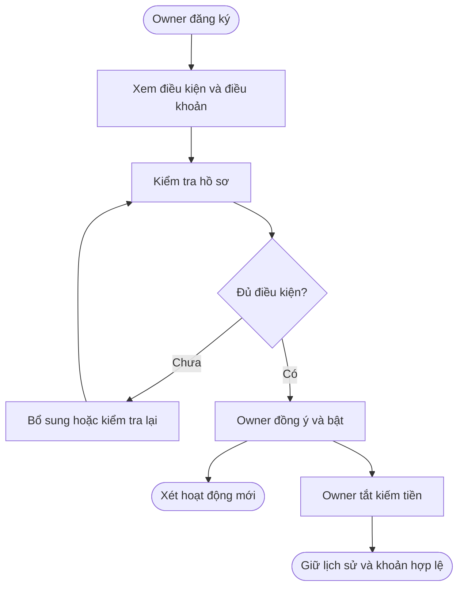
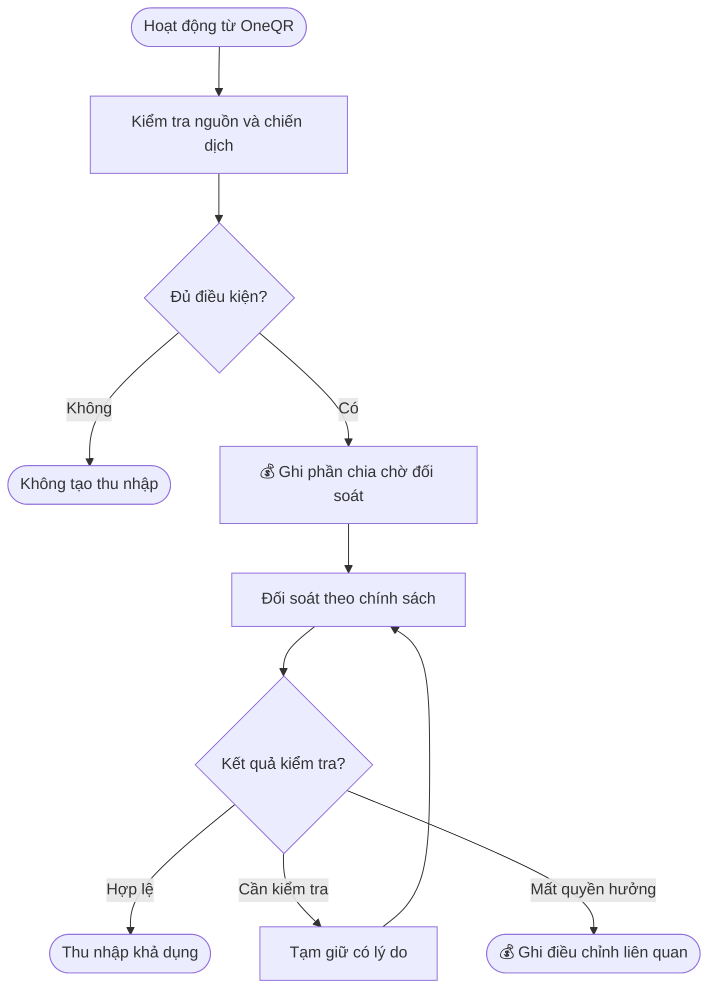
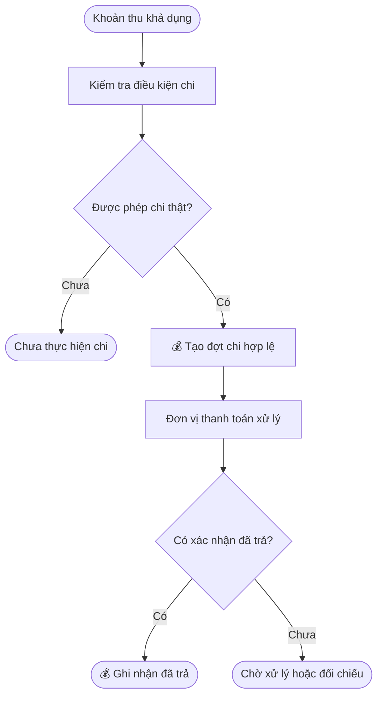
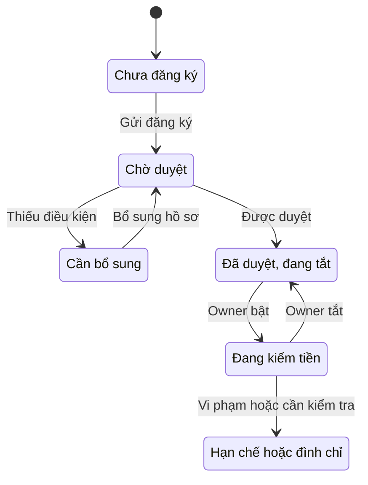
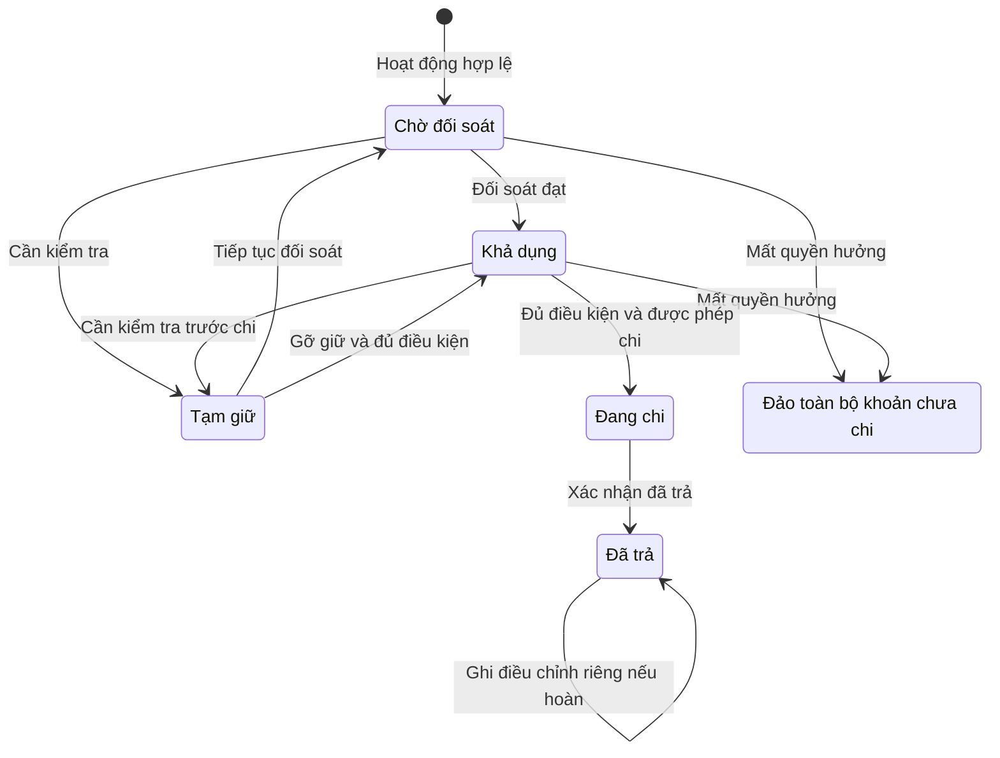

## Business OneQR — Kiếm tiền từ QR, đối soát và nhận tiền

**Cập nhật lần cuối:** Oct 26, 2026

**Đối tượng đọc:** Business Owner, Product Owner, BA, vận hành, QA, Support và đội phát triển.

**Trạng thái:** Đang rà soát theo tài liệu PO; chưa phải chính sách thu phí hoặc chi trả thật đã được kích hoạt.

**Ticket:** [#1599 — Kiếm tiền từ quảng cáo qua màn hình OneQR](https://github.com/vlink-group/vlink-nexora/issues/1599).

### Tổng quan

Business OneQR giúp doanh nghiệp nhận phần thu nhập được chia từ các hoạt động quảng cáo và dịch vụ đủ điều kiện do OneQR của mình giới thiệu. Business Owner chủ động tham gia, theo dõi nguồn thu, đối soát, điều chỉnh và kết quả nhận tiền. Nexora xác minh hoạt động, áp dụng đúng phiên bản chính sách và lưu lịch sử để các bên đối chiếu.

**Publisher Share là phần chia từ phí hợp lệ, không phải toàn bộ giá trị dịch vụ và không phát sinh chỉ vì khách quét QR.** Theo đặc tả PO hiện hành, thanh toán phí Ads thật và payout thật cho QR Host/Sponsor **ngoài đợt triển khai hiện tại**. Các mức phí bên dưới vẫn là đề xuất pilot.

#### Nguồn áp dụng và thứ tự ưu tiên

| Nguồn | Cách sử dụng |
| :--- | :--- |
| **[Đặc tả hiện hành của PO][po-brief]**, mục 1, 6, 11 và 16 | Quyết định phạm vi giai đoạn, ba tầng phân phối và các quyết định còn mở. Khi prototype hoặc phụ lục cũ khác đặc tả này, theo đặc tả hiện hành. |
| **[ONEQR-ADS-REF-REV-2026-09-21-v1][po-fees]** | Nguồn mức phí, tỷ lệ chia, điều kiện hưởng, valid click, chống trùng, ngân sách và đảo phần chia. Chính sách ghi rõ là đề xuất, chưa kích hoạt thu/chi thật. |
| **[Monetization Terms][po-terms]**, **[Ledger/Payout Operations][po-ledger]**, **[Business Verification/KYB][po-kyb]** | Bổ sung điều khoản tham gia, lịch sử đối soát, vai trò và yêu cầu xác minh. Các tỷ lệ hoặc số tiền minh họa không thay thế chính sách ngày 21/09. |
| **[Menu Placement][po-menu]**, phần đính kèm REF-2026-09-12-v1 và ADS-PARTNER-2026-09-12-v1 | Chỉ tham khảo đề xuất cũ về đăng ký, khóa nguồn, thời gian chờ và kỳ chi. Phải phân biệt với quyết định đã duyệt; không lấy tỷ lệ chia cũ thay mức mới. |

Các cơ chế dự phòng tự động, ví VlinkPay SSO và phân bổ nhiều loại tiền trong bản phân tích trước **chưa được các nguồn PO trên xác nhận là chính sách áp dụng**. Tài liệu này chuyển chúng về phần cần chốt, không sử dụng làm điều kiện thu/chi mặc định.

#### Phạm vi và giai đoạn

| Giai đoạn/phạm vi | Nội dung |
| :--- | :--- |
| Đợt hiện tại theo PO | Phân phối Internal/Public/Paid Boost và trải nghiệm OneQR trong phạm vi đặc tả. Nội dung kiếm tiền thể hiện điều kiện, mô hình và số liệu minh họa; không phát sinh thu phí Ads hoặc payout thật. |
| Nghiệp vụ Business trong tài liệu này | Đăng ký/bật/tắt kiếm tiền; xác minh điều kiện; nhận diện nguồn; phần chia trực tiếp của Business; theo dõi chờ đối soát, khả dụng, tạm giữ, điều chỉnh và nhận tiền. Luồng tiền chỉ vận hành thật sau khi được phê duyệt và tích hợp. |
| Giai đoạn có thu/chi thật | Cần phê duyệt chính sách, thời điểm kích hoạt, nguồn POS, đối soát, phương thức nhận tiền, xử lý hoàn tiền và khả năng thanh toán. Không suy ra đã sẵn sàng từ giao diện mẫu. |
| Ngoài phạm vi ticket #1599 | Thu nhập Personal; quản lý cấp Sponsor/Sponsor Override; nạp Ads Credit; xây mới Campaign Manager, Discovery hoặc KYB; portal Admin đầy đủ; rút tiền về ngân hàng. Sponsor chỉ được nhắc để giải thích phân bổ. |
| Giai đoạn sau | Voucher/deal trả trước trên marketplace và Sponsored Pin trên bản đồ thật; cần chính sách/triển khai riêng. |

### Khái niệm chính

| Thuật ngữ | Ý nghĩa |
| :--- | :--- |
| QR Host / Publisher | Chủ OneQR, link hoặc menu tạo ra nguồn khách hợp lệ. Trong tài liệu này là Business được hưởng thu nhập trực tiếp. |
| Advertiser | Doanh nghiệp trả phí theo chiến dịch; có thể đồng thời là Publisher ở chiến dịch khác. |
| Publisher Share | Phần phí hợp lệ được phân bổ cho QR Host. |
| Sponsor Override | Phần phân bổ riêng cho Sponsor đủ điều kiện; không phải tiền trừ từ Publisher Share của Business. |
| Chờ đối soát — pending | Thu nhập đã được ghi nhận nhưng chưa đủ điều kiện chuyển sang khả dụng. |
| Khả dụng — available | Khoản đã qua đối soát và đủ điều kiện để xét chi theo chính sách được duyệt; chưa đồng nghĩa đã nhận tiền. |
| Đang chi — in payout | Khoản đã được đưa vào đợt chi, chưa có kết quả trả tiền cuối cùng. |
| Đã trả — paid | Khoản đã có xác nhận chi trả thực tế; số liệu demo không phải bằng chứng đã trả. |
| Tạm giữ — hold | Khoản cần kiểm tra rủi ro, tranh chấp hoặc điều kiện nhận tiền; không tự đồng nghĩa đã bị thu hồi. |
| Điều chỉnh/đảo — reversal | Bút toán mới điều chỉnh phần thu nhập liên quan; giữ lịch sử gốc để đối chiếu. |
| Giữ chỗ ngân sách Ads — reserved | Ngân sách của **Advertiser** được giữ cho booking/order đủ dữ liệu. Đây không phải cơ chế trích dự phòng từ Publisher Share. |
| Dự phòng Publisher | Cơ chế trích giữ định kỳ từ thu nhập được nêu trong bản phân tích trước; PO chưa xác nhận tỷ lệ, thời hạn hoặc quy trình áp dụng. |

### Vai trò người dùng

| Vai trò | Trách nhiệm |
| :--- | :--- |
| Business Owner | Hoàn thiện điều kiện, chủ động đồng ý điều khoản, bật/tắt kiếm tiền và đối chiếu thu nhập thuộc Business mình có quyền. |
| Khách từ OneQR | Tạo hoạt động có nguồn; quét QR hoặc mở tiện ích chưa tạo quyền nhận thưởng cho chủ QR. |
| Advertiser | Chấp thuận mô hình quảng cáo/performance, ngân sách và điều kiện chiến dịch. |
| Nexora / vận hành | Kiểm tra điều kiện, nguồn, trùng lặp và gian lận; quản lý chính sách; đối soát, giữ/đảo khoản thu và xử lý khiếu nại theo quyền. |
| Support | Giải thích nguồn thu, trạng thái và lý do xử lý trong phạm vi dữ liệu được phép. |
| Đơn vị thanh toán | Xác nhận phương thức nhận tiền và kết quả chi khi có tích hợp thật. VlinkPay là phương án trong bản phân tích trước cần xác nhận; nguồn PO chưa chốt cơ chế ví SSO. |

### Luồng nghiệp vụ đầu cuối

Các luồng ghi nhận và chi trả dưới đây mô tả mô hình nghiệp vụ khi chính sách được kích hoạt; không mở rộng phạm vi thu/chi thật của đợt hiện tại.

#### Luồng 1: Đăng ký và bật/tắt kiếm tiền

**Người thực hiện chính:** Business Owner.

**Bắt đầu khi:** Owner muốn tham gia kiếm tiền từ OneQR.

**Kết quả:** Thể hiện rõ điều kiện, trạng thái tham gia và tác động của việc bật/tắt; không tự coi thao tác demo là phê duyệt thật.

**Nhu cầu người dùng:**

- Là Business Owner, tôi muốn hiểu điều kiện và chủ động đồng ý trước khi bật kiếm tiền.
- Là Business Owner, tôi muốn biết hồ sơ còn thiếu hoặc lý do bị hạn chế để hoàn thiện.
- Là Business Owner, tôi muốn tắt kiếm tiền mà vẫn theo dõi các khoản đã ghi nhận hợp lệ.

| Bước | Ai | Hành động và kết quả |
| :--- | :--- | :--- |
| 1 | Owner | Xem điều khoản, quyền hưởng và điều kiện xác minh. |
| 2 | Nexora / Owner | Kiểm tra kết quả KYC/KYB, tài khoản nhận tiền, thuế và đánh giá rủi ro theo quyền tham gia được duyệt. Không tự mặc định hồ sơ đã xác minh. |
| 3 | Owner | Chủ động chấp thuận điều khoản kiếm tiền của PO; không dùng đồng ý quảng cáo chéo hoặc mua Paid Boost thay cho việc này. |
| 4 | Nexora / Owner | Sau khi được xác nhận đủ điều kiện, Owner bật kiếm tiền. Khi chưa đủ điều kiện, hiển thị trạng thái và phần cần hoàn thiện. |
| 5 | Owner / Nexora | Tắt kiếm tiền thì dừng quyền hưởng cho hoạt động mới; các khoản đã khóa hợp lệ tiếp tục theo chính sách đã lưu. Nearby/Search và bộ lọc đối thủ vẫn hoạt động. Không cộng hồi tố click phát sinh lúc tắt. |

**Điều khoản chấp thuận của PO:**

> Thu nhập từ OneQR chỉ được ghi nhận khi khách tạo hành động hợp lệ được Nexora duyệt. Nexora có quyền từ chối, giữ, đảo hoặc thu hồi khoản earning nếu phát hiện traffic không hợp lệ, refund, chargeback, gian lận hoặc vi phạm chính sách. Tôi chịu trách nhiệm về thông tin tài khoản, thuế và cách tôi đặt/chia sẻ mã QR.

Bản KYB của PO đề xuất mức **Monetization/Payout Verified** với KYC/KYB, payout account, tax form và risk review. Cách ánh xạ vào hệ thống xác minh hiện có cần xác nhận; đăng nhập SSO thành công không chứng minh tài khoản đủ điều kiện nhận tiền.

#### Luồng 2: Ghi nhận và đối soát thu nhập

**Người thực hiện chính:** Khách tạo hoạt động; Nexora kiểm tra; Owner theo dõi.

**Bắt đầu khi:** Khách có nguồn OneQR hợp lệ tạo hoạt động đủ điều kiện.

**Kết quả:** Publisher Share đúng nguồn, đúng phí và phiên bản; có căn cứ cho khoản được duyệt, giữ hoặc đảo.

**Nhu cầu người dùng:**

- Là Business Owner, tôi muốn biết hoạt động nào tạo thu nhập và cách tính phần được hưởng.
- Là Business Owner, tôi muốn phân biệt khoản chờ, khả dụng và điều chỉnh để đối chiếu được số tiền.

| Bước | Ai | Hành động và kết quả |
| :--- | :--- | :--- |
| 1 | Khách / Nexora | Nhận diện nguồn OneQR/link/menu của Business và hoạt động phát sinh. Scan, mở menu và xem danh sách không tự tạo tiền. |
| 2 | Nexora | Kiểm tra chiến dịch, ngân sách, placement, bộ lọc đối thủ, khách/phiên, quyền hưởng, chống trùng và gian lận. |
| 3 | Nexora | Với dịch vụ, chỉ xét thưởng khi dịch vụ hoàn tất và thanh toán được xác minh. Claim, giữ chỗ hoặc booking chưa hoàn tất không tự tạo thưởng. Cách nối bill POS với nguồn OneQR còn cần PO chốt. |
| 4 | Nexora | 💰 Khi có thu/chi thật được phép, ghi phí hợp lệ và các phần chia theo phiên bản áp dụng; Publisher Share ở trạng thái chờ đối soát. Lưu liên hệ với hoạt động và nguồn, không sửa/xóa lịch sử. |
| 5 | Vận hành / Nexora | Kiểm tra rủi ro, hoàn tiền và điều kiện khả dụng. Không áp dụng mặc định 14 ngày cho tất cả loại thu nhập; dùng chính sách đã duyệt cho loại hoạt động. |
| 6 | Owner | Xem nguồn, chiến dịch, căn cứ tính, số tiền, trạng thái và lý do giữ/điều chỉnh trong quyền Business. |

#### Luồng 3: Điều chỉnh và nhận tiền — giai đoạn có chi trả thật

**Người thực hiện chính:** Nexora và đơn vị thanh toán; Owner theo dõi.

**Bắt đầu khi:** Có khoản đủ điều kiện chi, hoàn tiền hoặc kết quả kiểm tra cần điều chỉnh.

**Kết quả:** Theo dõi đúng khoản đã nhận, khoản chưa chi và điều chỉnh, không tạo khoản chi trùng.

**Nhu cầu người dùng:**

- Là Business Owner, tôi muốn biết khoản nào đủ điều kiện nhận và khoản nào còn chờ.
- Là Business Owner, tôi muốn hiểu lý do tạm giữ hoặc điều chỉnh và xem kết quả trả tiền thực tế.

| Bước | Ai | Hành động và kết quả |
| :--- | :--- | :--- |
| 1 | Nexora | Xét số dư khả dụng, điều kiện hồ sơ/phương thức nhận tiền và các khoản đang bị giữ hoặc cần xử lý. Kỳ chi và ngưỡng phải được phê duyệt trước khi áp dụng thật. |
| 2 | Nexora | Khi có refund/reversal, 💰 ghi bút toán đảo phần Publisher/Sponsor/Platform tương ứng; giữ liên hệ với hoạt động gốc. Khi chưa có kết luận, phân biệt tạm giữ với thu hồi đã xác nhận. |
| 3 | Nexora | Nếu điều chỉnh sau payout, tham khảo đề xuất cũ về số dư âm bù thu nhập tương lai; không tự áp dụng thứ tự dự phòng → khả dụng → kỳ sau như quy tắc đã chốt. Cơ chế chính thức phải được duyệt. |
| 4 | Nexora / đơn vị thanh toán | 💰 Đưa khoản đủ điều kiện vào đợt chi và thực hiện qua phương thức đã tích hợp. Đợt hiện tại không thực hiện bước tiền thật này. |
| 5 | Đơn vị thanh toán / Nexora | Chỉ ghi đã trả khi có xác nhận thực tế. Chưa có tích hợp hoặc chưa rõ kết quả thì chưa ghi đã trả; phải đối chiếu trước khi xử lý lại để tránh chi trùng. |
| 6 | Owner | Xem đợt chi, số tiền, thời điểm, tham chiếu, trạng thái và các điều chỉnh liên quan. |

### Cấu hình và quản trị

- Vận hành áp dụng đúng phiên bản chính sách cho chiến dịch/hoạt động; các tỷ lệ mẫu trong tài liệu khác không thay thế chính sách ngày 21/09.
- Theo dõi được cùng một hoạt động qua phí của Advertiser, Publisher Share, Sponsor Override, Platform Share và reversal, trong quyền của từng bên.
- Hồ sơ xác minh, thuế, quyền tham gia và điều kiện nhận tiền cần kết quả kiểm tra phù hợp; không tự gán trạng thái đã duyệt từ dữ liệu demo.
- Thiếu chính sách hoặc tích hợp tiền thật thì không tự chọn tỷ lệ dự phòng, thời gian chờ, tài sản nhận hay ví đích để thực hiện chi.
- Các chức năng quản trị chi tiết, quyền sửa cấu hình và quy trình duyệt cần được xác nhận trong giai đoạn triển khai liên quan; tài liệu này không mở rộng thành yêu cầu xây portal Admin đầy đủ.

### Vòng đời trạng thái

Đây là mô hình nghiệp vụ của PO, không phải xác nhận các trạng thái API hoặc tính năng production đang có. Trạng thái tham gia và trạng thái tiền cần được theo dõi riêng.

#### Tham gia kiếm tiền

Bản đăng ký ADS-PARTNER đề xuất các trạng thái: chưa đăng ký, cần bổ sung, chờ duyệt, đã duyệt/tắt, đang kiếm tiền, tạm hạn chế và đình chỉ. Ánh xạ trạng thái vào sản phẩm cần xác nhận trước triển khai thật.

#### Khoản thu và chi trả

| Trạng thái | Ý nghĩa/chuyển tiếp |
| :--- | :--- |
| Chờ đối soát | Khoản ghi nhận chờ kiểm tra; chưa phải tiền đã nhận. |
| Khả dụng | Qua đối soát và không còn điều kiện ngăn nhận tiền; chờ xét chi. |
| Tạm giữ | Có vấn đề cần kiểm tra; lý do và kết quả xử lý phải theo dõi được. |
| Đang chi | Khoản thuộc đợt chi đang xử lý; chưa được ghi là đã trả. |
| Đã trả | Có xác nhận chi thực tế. Nếu hoàn sau đó, giữ lịch sử chi và ghi điều chỉnh riêng. |
| Điều chỉnh/đảo | Ghi bằng bút toán liên kết bản gốc, có thể tương ứng một phần hoặc toàn bộ quyền hưởng. |

Không thêm vòng đời dự phòng định kỳ hoặc phần chi theo loại tiền khi PO chưa xác nhận các cơ chế đó.

### Quy tắc nghiệp vụ

#### 1. Quyền hưởng và hoạt động hợp lệ

Business nhận Publisher Share khi có đủ bốn điều kiện của chính sách ngày 21/09:

1. Khách bắt đầu từ OneQR/link/menu hợp lệ của Business.
2. Khách bấm quảng cáo/deal đủ điều kiện hoặc tạo giao dịch đủ điều kiện.
3. Hoạt động không bị loại do trùng lặp, gian lận, cùng chủ sở hữu, đối thủ bị chặn hoặc hết ngân sách.
4. Business đã bật kiếm tiền hoặc thuộc chương trình publisher đủ điều kiện.

Quét QR, mở menu Nearby/Search, xem danh sách, impression và click organic không tạo thu nhập CPC. Internal/Own placement không tạo phí mạng, Publisher Share hoặc Sponsor Override. Dịch vụ phải hoàn tất và thanh toán được xác minh; hoạt động hủy/hoàn hoặc vi phạm bị loại/điều chỉnh theo quyền hưởng thực tế.

#### 2. 💰 Mức phí và phần chia đề xuất

**Toàn bộ bảng là đề xuất pilot theo ONEQR-ADS-REF-REV-2026-09-21-v1, chưa phải giá đã kích hoạt.** Tỷ lệ tính trên phí hợp lệ, không tính trực tiếp trên toàn bộ bill.

| Hoạt động | Phí Advertiser | Publisher | Sponsor đủ điều kiện | Nexora |
| :--- | :--- | :--- | :--- | :--- |
| Click banner tài trợ hợp lệ | $0.40/click | 40% = $0.16 | 10% | 50% |
| Click card tài trợ Nearby/Explore | $0.25/click | 35% = $0.0875 trước làm tròn | 10% | 55% |
| Click card tài trợ Search Deals | $0.30/click | 35% = $0.105 trước làm tròn | 10% | 55% |
| Dịch vụ hoàn tất, khách mới đủ điều kiện | 10% giá trị dịch vụ đủ điều kiện sau giảm giá | 50% performance fee | 10% | 40% |
| Dịch vụ, khách quay lại sau 90 ngày, nếu campaign bật | 5% giá trị dịch vụ đủ điều kiện sau giảm giá | 50% performance fee | 10% | 40% |
| Mở menu, impression, Internal hoặc click organic | Không có phí CPC tương ứng | $0 từ hoạt động này | $0 từ hoạt động này | $0 từ hoạt động này |

- Cơ sở dịch vụ loại thuế, tip, phụ phí, retail, gift card lúc bán và phần đã hoàn tiền.
- Click Public organic miễn phí; giao dịch dịch vụ từ Public vẫn có thể tạo performance fee nếu merchant chấp thuận và đủ điều kiện.
- Sponsor Share là phần riêng; không tự cộng vào Publisher Share khi ticket không triển khai Sponsor. Nếu không có Sponsor đủ điều kiện, phần 10% giữ trong Nexora Platform hoặc network reserve theo cấu hình tài chính đã duyệt, không tự chuyển cho Sponsor khác. Network reserve này không xác lập cơ chế trích dự phòng từ thu nhập Publisher.
- Nguồn không có QR Host hợp lệ không phát sinh Publisher/Sponsor Share; không được gán tùy ý cho Business gần nhất.
- Chính sách có nêu làm tròn theo cent nhưng chưa đủ quy tắc xử lý phần lẻ giữa các bên; cần chốt trước thu/chi thật.

**Ví dụ trong chính sách PO:** dịch vụ khách mới có giá trị đủ điều kiện $80 sau giảm giá → performance fee $8; Business QR Host được $4, Sponsor đủ điều kiện được $0.80 và Nexora được $3.20. Đây là phép tính minh họa chính sách đề xuất, chưa phải khoản tiền đã chi.

#### 3. Chống trùng, ngân sách và bảo vệ đối thủ

- Banner: một valid click mỗi khách/phiên × Advertiser × 24 giờ; sponsored card: mỗi khách/phiên × deal × 24 giờ. Sale/redeem chống trùng theo booking/order, không theo click.
- Valid click cần campaign active, placement và khách/phiên hợp lệ, không bị bộ lọc đối thủ; phải mở chi tiết hoặc CTA thật. Bot, preload, crawler, double tap và refresh không tạo click được tính phí.
- Paid Boost cần Public, ngân sách và Owner duyệt. Trả phí không được vượt bộ lọc đối thủ trong phiên OneQR doanh nghiệp.
- Hết ngân sách thì dừng Paid Boost và ngừng giữ chỗ mới; khoản giữ chỗ hợp lệ trước đó xử lý theo chính sách đã lưu.
- 💰 Ngân sách **reserved** của Advertiser chưa phải **spent**. Không chuyển việc giữ chỗ ngân sách này thành quy tắc trích dự phòng thu nhập của Publisher.

#### 4. Phân biệt ba cơ chế quảng cáo

| Cơ chế | Ý nghĩa nghiệp vụ |
| :--- | :--- |
| Quảng cáo chéo | Đồng ý hiện ưu đãi đối tác và được phân phối ưu đãi trên QR đối tác; Nexora tự điều phối, không mời/duyệt từng deal. Không tự tạo quyền nhận tiền. |
| Paid Boost | Advertiser chi ngân sách để có vị trí tài trợ đủ điều kiện; không thay việc đăng ký nhận Publisher Share. |
| Bật kiếm tiền | Đồng ý điều khoản và nhận Publisher Share khi có hoạt động đủ điều kiện; không đồng nghĩa đã nhận tiền. |

**50/50 trong đặc tả banner là chia bố cục giữa tiệm và đối tác, không phải tỷ lệ chia doanh thu.**

#### 5. 💰 Điều chỉnh, tạm giữ và lịch sử

- Ledger giữ lịch sử; sai thì tạo reversal, không sửa/xóa bút toán gốc. Debit/credit và các phần chia phải đối chiếu được trên cùng một hoạt động, đúng quyền từng bên.
- Refund/reversal đảo Publisher Share, Sponsor Override và Platform Share tương ứng. Không thu hồi toàn bộ giá trị hóa đơn khi chỉ phần thưởng liên quan mất điều kiện.
- Khi vi phạm, PO cho phép Nexora từ chối, giữ, đảo hoặc thu hồi earning, tắt kiếm tiền, giữ payout hoặc khóa tài khoản; phải phân biệt quyền xử lý này với cơ chế dự phòng định kỳ chưa được chốt.
- Không ghi trùng thu nhập, điều chỉnh hoặc chi trả khi cùng sự kiện được xử lý lại. Chưa có tích hợp thanh toán thì không ghi paid.

#### 6. Đề xuất vận hành cũ — chưa áp dụng mặc định

Các nội dung sau có trong **REF-2026-09-12-v1/ADS-PARTNER** được nhúng trong Menu Placement, đều ở trạng thái đề xuất chờ duyệt. Chỉ được dùng sau khi xác nhận còn phù hợp với chính sách mới và giai đoạn triển khai.

| Nội dung | Đề xuất cũ và giới hạn sử dụng |
| :--- | :--- |
| Nguồn dịch vụ | Nguồn hợp lệ gần nhất cho đúng merchant trong 30 ngày trước khi khóa booking/order; hoàn tất/thanh toán trong 60 × 24 giờ kể từ khóa. Không coi đây là quyết định mới đã chốt về tích hợp POS. |
| Thời gian đối soát dịch vụ | Available sau 14 × 24 giờ từ mốc muộn hơn giữa completion và payment settlement, nếu không có dispute/risk hold. **Không có căn cứ mở rộng thành 14 ngày mặc định cho mọi click CPC.** |
| Ngưỡng và kỳ chi | Available tối thiểu $25; lập đợt chi thứ Ba hàng tuần, chốt số dư lúc 00:00 America/Chicago. Đây là đề xuất, chưa phải lịch chi được kích hoạt. |
| Hoàn tiền sau payout | Tạo số dư âm bù thu nhập tương lai, tạm ngừng payout đến khi đủ điều kiện; không tự rút từ ngân hàng đối tác. Không xác lập thứ tự dùng dự phòng rồi khả dụng. |
| Khiếu nại | Đề xuất gửi yêu cầu kiểm tra trong 30 ngày, mục tiêu phản hồi đầu tiên 5 ngày làm việc; chưa phải cam kết SLA chính thức. |
| Tắt/pause | Chặn khóa nguồn mới; khoản đã giữ chỗ tiếp tục theo phiên bản chính sách đã lưu. Khóa vì gian lận là trường hợp riêng cần review. |

Không dùng các tỷ lệ chia cũ hoặc ví dụ $1 chia 40/10/50 trong tài liệu tổng quan để thay tỷ lệ banner/card/service riêng của bản ngày 21/09.

### Các điểm cần PO và đơn vị tích hợp chốt

| Vấn đề | Quyết định còn thiếu |
| :--- | :--- |
| Kích hoạt thu/chi thật | Khi nào được thu Ads/payout; điều kiện phê duyệt, giới hạn và bên vận hành. Hiện đang ngoài phạm vi đợt này. |
| Quảng cáo màn chờ check-in | Tính CPC hay lượt hiển thị; đặc tả hiện hành mục 11 ghi rõ chưa có chính sách. Không áp giá banner CPC cho mọi placement màn chờ. |
| Nguồn dịch vụ và POS | Cách nối bill POS ↔ nguồn OneQR, khóa nguồn, cửa sổ ghi nhận và xử lý đổi/hủy. |
| Đối soát | Thời gian theo click/dịch vụ, mốc bắt đầu, quyền cấu hình và điều kiện gỡ hold. Không mặc định 14 ngày cho cả hai. |
| Dự phòng Publisher | Có áp dụng trích giữ tự động hay không; nếu có, căn cứ, tỷ lệ, thời hạn, đối tượng và điều kiện dùng/giải phóng. **20%/30 ngày trong bản cũ chỉ là ví dụ, không phải chính sách PO.** |
| Thu hồi sau chi | Quy trình xác nhận nghĩa vụ, bù trừ, xử lý số dư âm, tranh chấp và quyền khiếu nại; chưa chốt thứ tự dự phòng → khả dụng → kỳ sau. |
| Nhận tiền và VlinkPay | Đơn vị thanh toán, cách xác nhận Business/tài khoản nhận, điều kiện ví, trạng thái và đối chiếu kết quả. Ví VlinkPay SSO chưa phải phương thức đã được PO xác nhận. |
| Loại tiền và phí | Đồng tiền/tài sản nhận, có phân bổ nhiều loại hay không, tỷ giá, phí và xử lý chi một phần. Không mặc định cơ chế Admin chia tổng 100% thành nhiều tài sản. |
| Làm tròn | Độ chính xác, làm tròn/tích lũy phần lẻ và cách giữ tổng phân bổ khớp phí gốc. |
| Thời gian chờ và kỳ chi | Có tiếp tục dùng đề xuất REF-v1 về $25, thứ Ba và các cửa sổ thời gian hay không. |

### Tiêu chí rà soát nghiệp vụ

1. Thể hiện rõ đợt hiện tại không thu phí Ads hoặc payout thật; không ghi số liệu mẫu thành doanh thu đã nhận.
2. Đăng ký, điều kiện xác minh và đồng ý kiếm tiền tách với quảng cáo chéo/Paid Boost; không tự bật quyền hưởng khi Owner chưa đồng ý.
3. Thu nhập thuộc đúng Business và nguồn hợp lệ, có chiến dịch/căn cứ tính; không gộp với Ads Credit, tip hoặc Business khác.
4. Không tạo Publisher Share từ scan/menu/impression/Internal/organic click; dịch vụ chỉ xét khi hoàn tất và thanh toán được xác minh.
5. Banner/card/service dùng đúng tỷ lệ đề xuất ngày 21/09, không trộn tỷ lệ minh họa/cũ.
6. Áp dụng đúng chống trùng và bộ lọc đối thủ; paid placement không được vượt bộ lọc.
7. Phân biệt pending, available, hold, in payout và paid; không biến available thành xác nhận tiền đã về ví.
8. Điều chỉnh có căn cứ, liên kết khoản gốc và giữ lịch sử; không xử lý trùng cùng nghĩa vụ.
9. Tắt kiếm tiền không xóa khoản đã khóa hợp lệ hoặc lịch sử; không cộng hồi tố click lúc tắt.
10. Mọi thời hạn, dự phòng, phương thức nhận tiền hoặc loại tiền chưa chốt được ghi rõ là đề xuất/phụ thuộc, không xuất hiện như mặc định đã duyệt.

Đây là tiêu chí yêu cầu để rà soát, không phải báo cáo các chức năng đã được kiểm thử hoặc triển khai.

### Tình huống ngoại lệ và cách xử lý

| Tình huống | Xử lý nghiệp vụ |
| :--- | :--- |
| Chỉ mở menu, xem quảng cáo hoặc click organic | Không phát sinh thu nhập CPC. |
| Nguồn QR không hợp lệ hoặc truy cập app/web trực tiếp không có QR Host | Không phát sinh Publisher/Sponsor Share cho một Business tùy chọn. |
| Tự click, bot, trùng hoặc đối thủ bị chặn | Loại hoạt động; khoản đã ghi nhận sai được điều chỉnh có lịch sử. |
| Hết ngân sách | Dừng Paid Boost/giữ chỗ mới; không tự hủy cam kết hợp lệ trước đó. |
| Chưa đủ xác minh, thuế hoặc điều kiện nhận tiền | Chưa mở quyền tương ứng; theo dõi điều kiện cần hoàn thiện, không giả định đã duyệt. |
| Booking bị hủy, dịch vụ chưa hoàn tất hoặc thanh toán chưa xác minh | Không ghi thưởng dịch vụ như thu nhập đủ điều kiện nhận. |
| Hoàn một phần/toàn bộ | Đảo phần chia tương ứng; giữ liên kết với hoạt động gốc và không đảo trùng. |
| Hoàn sau payout | Giữ lịch sử khoản đã trả; xử lý nghĩa vụ theo chính sách thu hồi được duyệt. Đề xuất bù thu nhập tương lai chưa phải cơ chế chi/thu thật đã kích hoạt. |
| Chưa có tích hợp thanh toán hoặc kết quả chưa rõ | Không ghi paid, không tự giả lập ghi có ví; đối chiếu trước khi xử lý lại. |
| Owner tắt kiếm tiền | Ngừng quyền hưởng mới, giữ khoản đã khóa hợp lệ theo chính sách đã lưu; không ẩn tiện ích OneQR. |

### Câu hỏi thường gặp

**Quét QR là có tiền không?** Không. Phải có hoạt động và nguồn đủ điều kiện; scan, menu, impression và click organic chưa tạo thu nhập CPC.

**Bật quảng cáo chéo là bật kiếm tiền chưa?** Chưa. Đây là đồng ý phân phối hai chiều. Kiếm tiền có điều kiện và điều khoản riêng; 50/50 là bố cục banner.

**Có bắt buộc trích dự phòng sau 14 ngày không?** Nguồn PO chưa xác nhận cơ chế này. Mốc 14 ngày trong REF-v1 là đề xuất cho dịch vụ; không phải mặc định chung cho click và dịch vụ.

**Có thể nhận tiền thật trong đợt này không?** Chưa. Đặc tả hiện hành loại thu phí Ads và payout thật khỏi đợt này. Ngưỡng $25/lịch thứ Ba là đề xuất vận hành cũ.

**Ví nhận có chắc là VlinkPay SSO không?** Chưa được PO xác nhận trong bộ nguồn đang đối chiếu. Phải chốt phương thức, quyền sở hữu và tích hợp trước khi chi; đăng nhập SSO không chứng minh ví đã đủ điều kiện.

**Một hành trình có thể có cả phí click và phí dịch vụ không?** Ví dụ tổng hợp của chính sách ngày 21/09 có cả sponsored Search click và completed service đủ điều kiện sau đó. Không áp quy tắc chung “một hành trình chỉ một mô hình phí”; từng hoạt động vẫn cần đúng điều kiện, chiến dịch được chấp thuận và chống ghi nhận trùng.

### Tài liệu liên quan và nguồn PO

- [Đặc tả hiện hành — phạm vi, ba tầng kênh và các quyết định còn mở][po-brief].
- [Ads/Referral Revenue Policy — phí, phần chia và điều kiện hưởng][po-fees].
- [Monetization & Sponsor Terms — điều khoản và hành vi bị cấm][po-terms].
- [Ledger, Payout, CRM Operations — luồng tiền, trạng thái và phân quyền][po-ledger].
- [Business Verification/KYB — mức xác minh đề xuất][po-kyb].
- [Menu Placement — nguồn nhúng REF-v1 và ADS-PARTNER-v1][po-menu].
- [Five-Part Pilot — hành vi bật/tắt trong pilot][po-pilot].
- [Nạp Ads Credit](merchant-ads-credit.md) — phân biệt tiền mua quảng cáo với Publisher Share; tài liệu liên quan không thay nguồn PO hiện hành.

Các nguồn PO được dẫn tới cùng bản lưu trong `from-po/` để truy được căn cứ. Tài liệu này mô tả nghiệp vụ, không xác nhận hiện trạng API, giao dịch tiền thật hoặc khả năng tích hợp production.

[po-brief]: https://github.com/maivtn/taxiq/blob/b27ed0835bacc7c1b4bb63858c7672cc024aca38/from-po/NEXORA-Community/tai-lieu/brief-tong.md
[po-fees]: https://github.com/maivtn/taxiq/blob/b27ed0835bacc7c1b4bb63858c7672cc024aca38/from-po/NEXORA-OneQR-Tong-Hop-Toan-Bo-Gui-IT/NEXORA-OneQR-Ads-Referral-Revenue-Policy.html
[po-terms]: https://github.com/maivtn/taxiq/blob/b27ed0835bacc7c1b4bb63858c7672cc024aca38/from-po/NEXORA-OneQR-Tong-Hop-Toan-Bo-Gui-IT/NEXORA-OneQR-Monetization-Sponsor-Terms.html
[po-ledger]: https://github.com/maivtn/taxiq/blob/b27ed0835bacc7c1b4bb63858c7672cc024aca38/from-po/NEXORA-OneQR-Tong-Hop-Toan-Bo-Gui-IT/NEXORA-OneQR-Ledger-Payout-CRM-Operations.html
[po-kyb]: https://github.com/maivtn/taxiq/blob/b27ed0835bacc7c1b4bb63858c7672cc024aca38/from-po/NEXORA-OneQR-Tong-Hop-Toan-Bo-Gui-IT/NEXORA-OneQR-Business-Verification-KYB.html
[po-menu]: https://github.com/maivtn/taxiq/blob/b27ed0835bacc7c1b4bb63858c7672cc024aca38/from-po/NEXORA-OneQR-Tong-Hop-Toan-Bo-Gui-IT/NEXORA-OneQR-Menu-Placement.html
[po-pilot]: https://github.com/maivtn/taxiq/blob/b27ed0835bacc7c1b4bb63858c7672cc024aca38/from-po/NEXORA-OneQR-Tong-Hop-Toan-Bo-Gui-IT/NEXORA-OneQR-Five-Part-Pilot.html
