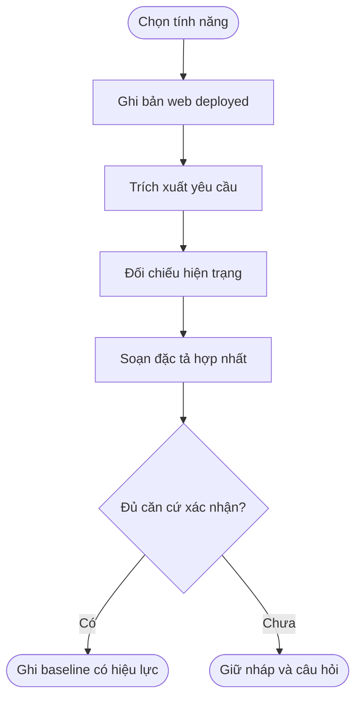
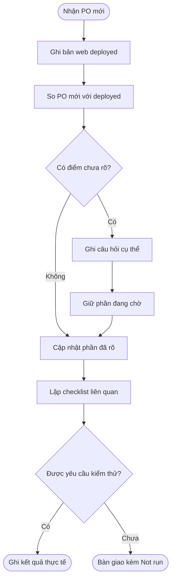

## Bộ chuẩn đối chiếu và hợp nhất yêu cầu PO

**Last Updated:** Nov 4, 2026
**Audience:** PO, BA, UI/UX, DEV, QA
**Status:** Draft — bộ chuẩn dùng chung; chưa khởi tạo baseline tính năng cụ thể

### Overview

Bộ chuẩn giúp xác định phần giữ, thêm, sửa, thay hoặc bỏ bằng cách so **PO mới với bản thực tế đã deploy trên web**. Mỗi tính năng giữ hồ sơ riêng; các tính năng dùng chung quy tắc phân loại, dẫn nguồn, quyết định và bàn giao. Turnboard là một trường hợp áp dụng, không phải cấu trúc cố định của bộ chuẩn.

Ví dụ: sau khi nhận V1, web đã có thêm nhiều sửa đổi thành V1.2–V1.5. Khi PO gửi V2, mốc chính là web đang chạy V1.5, không phải file V1. Master Spec, V1 và lịch sử quyết định giúp giải thích khác biệt; chúng không thay thế việc xác định hiện trạng web.

Dùng khi cần đối chiếu/quản lý yêu cầu. Chỉnh sửa prototype nhỏ, rõ ràng vẫn làm trực tiếp; không bắt buộc mở hồ sơ hoặc chờ duyệt lại.

### Key Concepts

| Thành phần | Mục đích | Khi cập nhật |
| --- | --- | --- |
| Deployed Baseline | Snapshot web làm mốc so sánh: URL, bản deploy, thời điểm, vai trò/cấu hình, hiện trạng có căn cứ | Xác minh khi nhận PO mới; tạo DEP mới nếu bản web/ngữ cảnh thay đổi |
| Feature Master List | Nguồn, căn cứ, yêu cầu, hiệu lực và mức đáp ứng | Có nguồn/nhận định/quyết định mới |
| Master Specification | Hành vi hợp nhất có hiệu lực, tách riêng mục còn mở | Có căn cứ xác nhận thay đổi yêu cầu |
| Change Impact Analysis | Delta và tác động một đợt | Mỗi đợt cần đối chiếu |
| Decision Log | Câu hỏi, câu trả lời và lịch sử thay quyết định | Có câu hỏi hoặc xác nhận mới |
| Regression Checklist | Tình huống kiểm tra, kết quả thực tế nếu được yêu cầu chạy | Có delta; kết quả chỉ ghi sau thực hiện |

ID, enum và nguyên tắc nằm tại [chuẩn đối chiếu](../../skills/po-requirement-reconciler/references/reconciliation-standard.md), không định nghĩa lại theo module.

### User Roles

| Vai trò | Trách nhiệm |
| --- | --- |
| PO / người yêu cầu | Cung cấp đầu vào, xác nhận nghiệp vụ còn mâu thuẫn/chưa rõ |
| BA / người phân tích | Kiểm tra nguồn, đối chiếu, ghi căn cứ, cập nhật hồ sơ |
| AI | Hỗ trợ trích xuất/phân loại/soạn bản hợp nhất, chỉ ra giới hạn; không tự xác nhận thay PO |
| UI/UX / DEV | Rà soát tác động và triển khai đúng phần được giao |
| QA / người kiểm tra | Kiểm thử và ghi kết quả khi được yêu cầu |

Một người có thể kiêm nhiều vai trò; vẫn ghi người xác nhận và nguồn thực tế.

### End-to-End Workflows

#### Workflow: Khởi tạo hồ sơ cho một tính năng

**Primary Actor:** BA / người phân tích, có AI hỗ trợ.
**Trigger:** Cần lập hồ sơ của một tính năng chưa được quản lý theo bộ chuẩn.
**Outcome:** Snapshot deployed và REQ có nguồn, tách phần đã/chưa xác nhận.

| Bước | Thực hiện | Đầu ra |
| --- | --- | --- |
| 1 | Chọn tên/slug, ranh giới, vai trò và môi trường web | Phạm vi |
| 2 | Xác định bản đang deploy, ghi hiện trạng và giới hạn | DEP / SRC / EVD |
| 3 | Trích xuất yêu cầu, đối chiếu PO với deployed | Feature Master List có REQ ổn định |
| 4 | Hợp nhất phần có căn cứ, tách phần chưa rõ | Master Spec nháp và Decision Log |
| 5 | Ghi xác nhận thực tế nếu có | Baseline có phạm vi xác nhận; nếu chưa có thì giữ nháp |



#### Workflow: Tích hợp một đợt thay đổi

**Primary Actor:** BA / DEV, có AI hỗ trợ.
**Trigger:** PO gửi nguồn mới hoặc người dùng yêu cầu điều chỉnh.
**Outcome:** Delta của PO mới so với deployed; master cập nhật đúng phần đã rõ.

| Bước | Thực hiện | Đầu ra |
| --- | --- | --- |
| 1 | Xác minh môi trường, bản deploy và ngữ cảnh; đọc PO mới | DEP đầu vào / phạm vi UPD |
| 2 | So PO mới với DEP; dùng master/lịch sử để giải thích | Change Impact Analysis |
| 3 | Giữ phần còn hiệu lực, hỏi đúng mâu thuẫn/thiếu quan trọng | DEC đang chờ hoặc đã giải quyết |
| 4 | Cập nhật phần đã xác nhận; sửa sản phẩm nếu được giao | Master và triển khai đúng phạm vi |
| 5 | Lập checklist; chỉ chạy khi được yêu cầu | Kết quả thực tế hoặc Not run |



### System Configuration & Administration

[Skill dùng lại](../../skills/po-requirement-reconciler/SKILL.md) và sáu biểu mẫu trong `skills/po-requirement-reconciler/assets/`. Gọi skill bằng đường dẫn trong repo; bộ này không phụ thuộc cài đặt skill toàn máy. Chỉ tạo hồ sơ tính năng khi được yêu cầu, không tạo hàng loạt thư mục trống.

```text
docs/requirements/
  README.md
  <feature-slug>/
    deployments/
      DEP-001.md                    # Snapshot bản deployed dùng đối chiếu
    feature-master-list.md
    master-specification.md
    decision-log.md
    updates/
      UPD-001/
        change-impact-analysis.md
        regression-checklist.md
        master-specification.proposed.md  # Chỉ khi cần bản hợp nhất để review
```

Master list giữ chỉ mục/hiện trạng, master spec giữ hành vi, change impact giữ delta, decision log giữ quyết định. Dẫn ID lẫn nhau thay vì sao chép toàn bộ nội dung.

`from-po/` hiện bị Git bỏ qua. Ghi đường dẫn và dấu vết phiên bản; nêu giới hạn nếu nguồn chỉ có trên máy cục bộ. Không tự đưa toàn bộ PO vào Git/di chuyển nguồn. Hồ sơ đã có được giữ đường dẫn và ID, rồi liên kết vào danh mục.

**Danh mục hồ sơ theo bộ chuẩn:** Chưa đăng ký tính năng cụ thể.

| Tính năng | Slug / hồ sơ | Người phụ trách | DEP dùng đối chiếu | BL yêu cầu, nếu có | UPD đang mở |
| --- | --- | --- | --- | --- | --- |

### State Lifecycle

Bộ chuẩn không tạo trạng thái nghiệp vụ cho các tính năng. Hiệu lực yêu cầu, mức đáp ứng và mức kiểm chứng là các trục độc lập trong chuẩn đối chiếu. Mỗi tính năng mô tả vòng đời thực thể trong Master Spec khi có nguồn.

### Business Rules

- Chỉ dẫn hiện tại đã rõ được xử lý đúng phạm vi, không xin duyệt lại để hoàn tất biểu mẫu.
- Mốc chính là bản deployed trên môi trường được chỉ định, gồm cả thay đổi phát sinh sau PO cũ. Không tự dùng V1, Master Spec hay code main/master thay web.
- Nếu không tiếp cận/xác minh được web, ghi rõ thiếu dữ liệu đối chiếu deployed; phần đã đọc từ nguồn khác vẫn là bằng chứng riêng, không nâng thành hiện trạng web.
- Chức năng vắng trong HTML mới chưa đủ căn cứ Remove. Khả năng từng có trong mẫu cũ chưa tự động thành yêu cầu còn hiệu lực.
- Bố cục, nghiệp vụ, nội dung và tương tác được đối chiếu riêng; không thay toàn bộ UI vì một delta nhỏ.
- Mỗi nhận định có căn cứ; nhánh code, bản deploy và môi trường kiểm chứng được ghi riêng.
- PO là nguồn chuẩn UI; phần PO chưa có mới lấy staging đúng ngữ cảnh. Thiếu nguồn thì ghi thiếu, không tự thêm nội dung UI.
- Chỉ ghi Confirmed khi có căn cứ; chốt yêu cầu chưa đồng nghĩa triển khai, UAT hay release.

### Edge Cases & Exception Handling

| Tình huống | Xử lý |
| --- | --- |
| Một chỉnh sửa nhỏ đã rõ | Làm trực tiếp; chỉ mở/cập nhật hồ sơ khi người dùng yêu cầu dùng bộ chuẩn |
| Chưa có snapshot deployed | Xác định web/môi trường và ghi hiện trạng; không thay mốc bằng file PO cũ |
| Chưa có baseline yêu cầu | Tạo master nháp từ nguồn và quyết định; vẫn dùng deployed làm mốc đối chiếu PO mới |
| Hai nguồn PO mâu thuẫn | Dẫn hai căn cứ, ghi đề xuất và câu hỏi; giữ phần đang có hiệu lực |
| Thiếu truy cập nguồn/môi trường | Ghi Unknown và giới hạn; tiếp tục phần độc lập đủ nguồn |
| Liên quan nhiều module | Xác định chủ quản, dẫn REQ liên tính năng; không tự mở rộng phạm vi sửa |

### Frequently Asked Questions

**Khởi tạo cho một tính năng mới như thế nào?**

> Dùng skill tại `skills/po-requirement-reconciler/SKILL.md` để khởi tạo hồ sơ Booking, slug `booking`. Web đang deploy: [URL/môi trường]. Nguồn PO mới: [đường dẫn]. Ghi DEP rồi đối chiếu PO với web; code [đường dẫn] chỉ dùng theo mức xác minh phiên bản. Chỉ lập hồ sơ, chưa sửa sản phẩm, chưa chạy test.

**Khi có PO mới?**

> Đối chiếu PO V2 [đường dẫn] của `booking` với bản đang deploy tại [URL/môi trường], gồm các thay đổi phát sinh sau V1. Xác minh DEP hiện tại và lập UPD kế tiếp. Dùng master/lịch sử trong `docs/requirements/booking/` để giải thích khác biệt; phân loại delta, tác động và câu hỏi. Không lấy V1 làm mốc thay web.

**Khi PO đã trả lời?**

> Ghi quyết định cho DEC-xxx của `booking`: [nội dung và nguồn xác nhận]. Cập nhật REQ, master và UPD liên quan; giữ lịch sử quyết định cũ.

**Có phải đọc lại toàn bộ V1–V8 mỗi lần không?**

Không. Xác minh deployed hiện tại, đọc PO mới, rồi chỉ đọc Master Spec/lịch sử liên quan delta hoặc xung đột. Snapshot deployed cũ cũng cần xác minh còn đúng phiên bản/ngữ cảnh; không mặc định nó vẫn là web hiện tại.

**Web khác Master Spec thì chọn bên nào làm mốc?**

Web thực tế vẫn là mốc hiện trạng để so PO mới. Ghi riêng độ lệch với Master Spec và căn cứ quyết định; không tự sửa kết quả quan sát cho giống tài liệu, cũng không tự coi mọi hành vi trên web là yêu cầu đúng.

### Related Features

- [Chuẩn đối chiếu, ID và trạng thái](../../skills/po-requirement-reconciler/references/reconciliation-standard.md).
- [Hướng dẫn tài liệu dự án](../../.claude/SKIL_Doc.md).
- [Quy tắc dự án](../../AGENTS.md).

Bộ chuẩn và skill chưa được kiểm thử hành vi. **Chưa chạy test — chờ yêu cầu của người dùng**.
