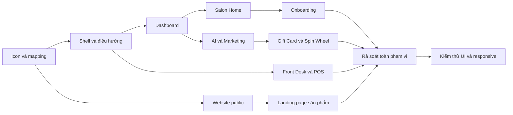

# Kế hoạch cập nhật prototype theo handoff PO ngày Oct 27, 2026

> Dành cho người triển khai: thực hiện từng task bằng checklist trong tài liệu này. Khi bắt đầu triển khai, dùng workflow `superpowers:executing-plans` và ưu tiên hướng dẫn dự án trong `AGENTS.md`. Kế hoạch không yêu cầu tạo spec, worktree, nhánh mới hay vòng duyệt thiết kế bổ sung.

**Mục tiêu:** Đưa giao diện và điều hướng của prototype hiện tại về cấu trúc PO mới, tái sử dụng các module đã có và thay các biểu tượng chưa phù hợp bằng bộ Icons8 3D Fluency thống nhất.

**Kiến trúc đề xuất:** Nâng cấp bộ shell đang dùng chung trong `nexora-shell.js` và `nexora-shell.css`, với ngữ cảnh Salon, SI POS và Staff. Các màn chức năng tiếp tục là trang HTML riêng; Trang chủ public và các landing page dùng layout website riêng. Giữ hai file `frame-salon.html`, `frame-staff.html` làm khung mẫu và đưa nội dung Dashboard vào trang thật. Các thay đổi ảnh hưởng cách người dùng nhìn thấy hoặc đi qua sản phẩm cần tuân thủ quy trình đối chiếu và xác nhận ở mục 2.1–2.3; việc ghi trong kế hoạch không có nghĩa phương án đã được người dùng chốt.

**Công nghệ:** HTML, CSS, JavaScript thuần, các store/localStorage và thư viện đang có; không bổ sung framework hoặc build pipeline.

**Trạng thái cập nhật Oct 27, 2026:** Đã triển khai Task 1–4 trên `main`: 26 icon 3D Fluency local, shell nhiều cấp, mapping điều hướng và Dashboard 9 thẻ/chi tiết module. Task 5–14 chưa triển khai. Người dùng đã chốt giữ Tax IQ tại `html/index.html` và mở Salon Home/Hướng dẫn bắt đầu bằng HTML mẫu PO trong đợt này.

**Kiểm thử đợt A:** 28/28 ca shell/Dashboard đạt. Lượt `npm test` cuối ghi nhận 1.559 đạt, 249 lỗi; bản trước thay đổi có 280 lỗi, không có tên ca lỗi mới so với baseline. Bộ test toàn dự án chưa xanh. Đã đo bố cục trên 26 kích thước Dashboard, 40 tổ hợp chi tiết module và 36 tổ hợp trang đang dùng shell; không ghi nhận tràn ngang tài liệu. Đã thao tác tìm/lọc/reset, chi tiết/quay lại/Back, menu nhiều cấp, Escape/focus, URL Calendar/Settings/QR và hai đích preview PO. Đây là giả lập viewport Chrome; chưa kiểm tra Safari/WebKit, thiết bị iPad/phone thật hoặc bàn phím ảo. Bằng chứng cục bộ: `tmp/po-handoff-qa/2026-10-27/verification-summary.json`, log và ảnh trong cùng thư mục.

**Mở demo:** Chạy `python3 -m http.server 8125 --bind 127.0.0.1` từ gốc repository, rồi mở `http://127.0.0.1:8125/html/pages/dashboard.html`. Thư mục PO phải có trong workspace để mở các trang xem trước đã được chốt.

**Nguồn yêu cầu:**

- [AGENTS.md](../../../AGENTS.md).
- [spec.md của PO](../../../from-po/NEXORA_TOUCH_dev_handoff_2026-10-27/spec.md).
- [Hướng dẫn triển khai](../../../from-po/NEXORA_TOUCH_dev_handoff_2026-10-27/docs/DEV_IMPLEMENTATION.md).
- [Báo cáo QA của PO](../../../from-po/NEXORA_TOUCH_dev_handoff_2026-10-27/docs/QA_REPORT.md); kết quả này chỉ thuộc package PO.
- [Dashboard mẫu](../../../from-po/NEXORA_TOUCH_dev_handoff_2026-10-27/dashboard.html), [Salon Home mẫu](../../../from-po/NEXORA_TOUCH_dev_handoff_2026-10-27/salon-home.html), [Trang chủ mẫu](../../../from-po/NEXORA_TOUCH_dev_handoff_2026-10-27/index.html).
- [Các trang sản phẩm](../../../from-po/NEXORA_TOUCH_dev_handoff_2026-10-27/products/README.md).
- Staging để bổ sung phần thiếu/chưa rõ: `https://staging-web.nexoratouch.com`; với luồng VLinkPay có `https://staging-merchant.vlinkpay.com`. Đã đối chiếu màn Analytics tip/QR, AI Hub Settings và POS Technician Report trên Nexora staging trong đợt A; chưa đối chiếu các luồng VLinkPay ngoài phạm vi. Xem [nguồn link Nexora staging](../../../html/assets/qr-stations-workflows.js) và [nguồn link merchant staging](../../../html/pages/owner-setting.html).
- [Icons8 3D Fluency](https://icons8.com/icons/all--style-3d-fluency--technique-3d) và [điều kiện dùng miễn phí](https://icons8.com/license).

## 1. Quy tắc triển khai

- Làm trên `main`; chỉ tạo nhánh/worktree khi người dùng yêu cầu.
- Trước mỗi đợt, đọc `git status` và diff để nhận diện thay đổi của người dùng. Chỉ commit file thuộc phạm vi đã hoàn tất; không tự push.
- Người dùng đã yêu cầu kiểm thử kỹ UI và responsive cho đợt thay đổi này, ưu tiên iPad và phone. Sau khi hoàn tất toàn bộ phạm vi triển khai được giao, gom chạy test tự động và kiểm thử UI theo Task 15 và ma trận ở mục 8; không cần xin phép lại cho phạm vi này.
- Không chạy test lẻ tẻ sau từng file/task. Sửa lỗi phát hiện trong lượt kiểm thử tập trung rồi kiểm tra lại phần lỗi và các luồng bị ảnh hưởng trước khi bàn giao.
- Lần cập nhật kế hoạch chỉ sửa tài liệu, chưa phải lượt kiểm thử giao diện. Báo rõ phần đã kiểm thử, chưa kiểm thử và giới hạn thiết bị thực tế; không ghi đang chờ yêu cầu test vì yêu cầu cho đợt này đã được xác nhận.
- Đọc nguồn, kiểm kê asset, xem ảnh nguồn và rà soát diff được phép thực hiện; không xem đó là bằng chứng luồng UI đã hoạt động.
- Bám sát bố cục, nhóm chức năng, điều hướng, trạng thái, quy tắc và câu chữ trong đúng màn PO. Không tự gộp/tách/ẩn/bỏ chức năng, đổi luồng hoặc thay ý nghĩa nghiệp vụ để thuận tiện triển khai.
- Câu chữ UI lấy từ đúng màn trong HTML/JS PO. Với phần PO chưa có nội dung hoặc chưa rõ, người dùng đã yêu cầu lên staging đối chiếu để dựng HTML; lấy cấu trúc, nhãn, trạng thái và hành vi từ đúng màn/ngữ cảnh staging, giữ dữ liệu demo phù hợp của prototype.
- Nếu PO và staging mâu thuẫn, staging chưa có nội dung tương ứng hoặc vẫn cần đề xuất khác mẫu, nêu rõ bằng chứng và hỏi người dùng trước khi triển khai phần đó. Không tự suy diễn, tự viết nội dung thay thế hoặc coi giả định trong kế hoạch là yêu cầu đã được duyệt.
- Nguồn icon mới nhất do người dùng chỉ định là **Icons8 3D Fluency**. Dùng một style cho bộ icon thay thế; không trộn với IconScout, OneQR 3D hoặc emoji trong cùng nhóm được cập nhật.
- Ngày đầy đủ hiển thị theo `MMM D, YYYY`; dữ liệu lưu trữ/API và giá trị native date input giữ ISO. Ngày kèm giờ dùng kiểu hai dòng đang có trong dự án.
- Dropdown dùng mũi tên 16px, cách mép phải 16px và padding phải tối thiểu 44px.
- Ưu tiên flex row/col cho layout; chỉ dùng grid với lịch, ma trận hoặc sơ đồ thực sự hai chiều.
- Nút thao tác có tên hiển thị; các nút đóng, thu gọn và menu dùng biểu tượng phải có tên truy cập được.
- Thông báo/xác nhận đơn giản dùng SweetAlert2 đang có; modal form và màn chi tiết có thể dùng cấu trúc phức tạp hiện tại.
- Giữ dữ liệu và trạng thái demo hiện có. Không reset localStorage, thay khóa lưu trữ hoặc thay toàn bộ store chỉ để nhập mẫu PO.

## 2. Hiện trạng và quyết định về shell

| Thành phần | Hiện trạng qua đọc mã | Hướng xử lý |
| --- | --- | --- |
| `html/pages/frame-salon.html` | Khung rỗng, cấu hình `activePage: 'dashboard'`; menu Dashboard đang dẫn vào đây | Giữ làm mẫu shell; chuyển đích Dashboard sang trang nội dung mới |
| `html/pages/frame-staff.html` | Khung Staff dùng cùng renderer, có `staff-shell.css` | Giữ vai trò mẫu; bảo toàn điều hướng Staff |
| `html/assets/nexora-shell.js` | Render sidebar/header cho nhiều trang; menu merchant hiện chỉ có nhóm và mục con | Mở rộng renderer để hỗ trợ cây menu PO và ngữ cảnh Salon/POS |
| `html/assets/nexora-shell.css` | Có rule chung cho cả Salon và Staff | Scope thay đổi bằng lớp ngữ cảnh; tránh đổi selector toàn cục làm lệch Staff |
| `html/index.html` | Dashboard Tax IQ | Giữ URL hiện tại trong đợt này; tạo Trang chủ public ở đường dẫn riêng |
| POS, Booking, Rewards, SMS, OneQR, Community | Đã có các trang, store và hành vi demo | Map lại điều hướng, đối chiếu rồi bổ sung phần thiếu |
| Package PO | Dashboard và Salon Home là các HTML lớn, chứa nhiều CSS/JS inline; có bản compatibility | Trích phần cần dùng vào trang/module phù hợp; không đưa toàn bộ bản sao vào từng màn |

**Quyết định đề xuất:** Nâng cấp shell Salon hiện có, giữ biến thể Staff cùng nền tảng. Không tạo thêm một bộ shell merchant song song để duy trì lâu dài.

### 2.1 Thứ tự đối chiếu PO và staging

| Bước | Việc cần làm | Cách xử lý |
| --- | --- | --- |
| 1 | Đọc yêu cầu trực tiếp của người dùng và đúng màn PO mới | Giữ các điều chỉnh đã được người dùng xác nhận, gồm style icon và yêu cầu test; triển khai phần PO đã rõ, không thêm ý tưởng ngoài mẫu |
| 2 | Nhận diện phần PO thiếu nội dung, chưa rõ tương tác hoặc chỉ có link ngoài | Mở đúng màn trên staging, đúng vai trò và ngữ cảnh tiệm để lấy căn cứ dựng HTML; không dùng trang khác chỉ vì có giao diện gần giống |
| 3 | Ghi lại căn cứ vừa đối chiếu | Ghi ngắn URL/màn, vai trò, nội dung/hành vi đã thấy và ảnh khi cần trong ghi chú task; không đánh dấu đã xem staging khi mới đọc URL trong repo |
| 4 | So sánh kết quả staging với PO | Phần staging bổ sung khoảng trống có thể dùng để làm HTML; phần trái PO phải hỏi người dùng, không tự ưu tiên staging chỉ vì đang chạy được |
| 5 | Phần vẫn chưa rõ hoặc cần làm khác nguồn | Nêu cụ thể chỗ thiếu/mâu thuẫn, ảnh hưởng và phương án đề xuất; chờ trả lời cho phần phụ thuộc, tiếp tục những phần độc lập đã rõ |

Ở kế hoạch này, “lên staging” nghĩa là truy cập để đối chiếu nội dung và luồng phục vụ làm HTML. Không tự hiểu thành yêu cầu deploy prototype lên staging, sửa dữ liệu staging hoặc thực hiện giao dịch thật. Nếu chưa có URL đúng màn, tài khoản hoặc quyền cần thiết, hỏi thông tin truy cập còn thiếu trước khi làm phần phụ thuộc.

### 2.2 Những trường hợp phải hỏi trước khi làm

- Nội dung, trạng thái, cách tính hoặc kết quả một thao tác khác nhau giữa PO, staging và module hiện tại.
- Muốn đổi tên, bỏ/gộp/tách menu, ẩn một mục PO, đổi thứ tự hoặc thay điểm đến khiến người dùng đi theo luồng khác mẫu.
- Muốn rút gọn màn hoặc luồng PO, tự thêm màn/chức năng/copy, hoặc thay một chức năng thiếu nội dung bằng một chức năng gần nghĩa.
- Chưa xác định được điểm vào public/Salon/Tax IQ, phạm vi đợt triển khai hoặc cách nối giữa các hệ thống sau khi đối chiếu nguồn.
- Icon trong 3D Fluency chưa có nghĩa phù hợp và muốn dùng biểu tượng khác nghĩa, khác style hoặc tài nguyên trả phí.

Các lựa chọn nội bộ như tên file helper, tách CSS/JS hoặc tái sử dụng renderer được xử lý theo quy tắc dự án khi không làm thay đổi UI, copy, luồng hoặc phạm vi PO. Không dùng lựa chọn kỹ thuật làm lý do tự thay đổi trải nghiệm sản phẩm.

### 2.3 Các phương án trong kế hoạch chưa được coi là đã chốt

| Phương án | Căn cứ hiện có | Điểm cần xác nhận trước khi ảnh hưởng UI/phạm vi |
| --- | --- | --- |
| Nâng cấp shell hiện có, dùng hai frame làm mẫu và tạo Dashboard riêng | Cấu trúc mã đang dùng chung shell; đây là đề xuất của người phân tích | Xác nhận nếu cách tổ chức này làm thay đổi giao diện hoặc đường đi so với PO; nội bộ phải giữ đúng trải nghiệm PO |
| Giữ Tax IQ ở `html/index.html`, thêm public home ở đường dẫn riêng | Bảo toàn URL đang có; PO có public home riêng trong package | Điểm vào mặc định và cách đi giữa Public, Salon, Dashboard và Tax IQ khi người dùng chưa chỉ định |
| Thực hiện Task 1–4 trước các phần còn lại | Đề xuất chia đợt để có shell và Dashboard sớm | Phạm vi triển khai thực tế; không tự bỏ/ẩn mục PO chỉ vì trang tương ứng nằm ở đợt sau |
| Map link PO sang màn local hoặc tạo URL chi tiết module | Tái sử dụng các trang đã có trong prototype | Nếu màn local có nội dung/hành vi khác, đối chiếu staging và hỏi cách xử lý chênh lệch trước khi thay đích |
| Đưa một số website hệ sinh thái sang đợt riêng | Package có nhiều website độc lập | Hỏi lại nếu link hoặc luồng PO trong phạm vi bàn giao cần các trang này; không tự cắt khỏi yêu cầu đã được giao |

Quy tắc này áp dụng cho toàn bộ checklist bên dưới, kể cả bước đang được viết dưới dạng mệnh lệnh. Phần bám đúng nguồn có thể thực hiện; phần thay đổi sản phẩm chưa có căn cứ phải được hỏi trước, không triển khai rồi mới báo.

## 3. Phạm vi từng đợt và phụ thuộc

| Đợt | Task | Kết quả bàn giao | Độ lớn tương đối |
| --- | --- | --- | --- |
| A | 1–4 | Bộ icon có nguồn rõ ràng, shell Salon, điều hướng và Dashboard có nội dung | Lớn |
| B | 5–6 | Salon Home và onboarding có nội dung theo PO | Lớn |
| C | 7–9 | Front Desk và các màn vận hành thống nhất với mẫu mới | Lớn |
| D | 10–12 | AI/Marketing, Gift Card, Spin Wheel và các module liên quan được nối đầy đủ | Lớn |
| E | 13–14 | Trang chủ public, 12 landing page và các trang giới thiệu cần thiết | Lớn, có thể thực hiện sau các đợt vận hành |
| F | 15 | Tổng kiểm thử UI, responsive ưu tiên iPad/phone, test tự động, sửa lỗi và kiểm tra lại trước bàn giao | Bắt buộc sau khi hoàn tất phạm vi triển khai được giao |

Độ lớn dùng để sắp thứ tự, không phải cam kết số ngày. Chưa ước lượng ngày công khi chưa triển khai và chưa có kết quả kiểm thử hiện trạng.

**Đợt A nên được triển khai trước.** Đợt này tập trung shell và điều hướng; các module đang có được nối vào đúng vị trí, chưa cần thay nội dung toàn bộ module cùng lúc.

## 4. Cấu trúc file dự kiến

Các file mới dưới đây là phương án tổ chức kỹ thuật dự kiến. Nếu tại thời điểm triển khai đã có file cùng trách nhiệm, sử dụng file đó thay vì tạo bản trùng. Đường dẫn nội bộ không được dùng để tự thay đổi điều hướng hoặc nội dung PO; các điểm cần xác nhận tuân thủ mục 2.1–2.3.

| Nhóm | File mới hoặc thư mục đích | File hiện tại cần thay đổi |
| --- | --- | --- |
| Icon | `html/assets/icons/3d-fluency/*.png`, `sources.json`, `LICENSE.txt`; `html/assets/nexora-icons.js`, `nexora-icons.css` | Các điểm render icon của shell, Dashboard, Salon Home và các phần POS được cập nhật |
| Shell | `html/assets/nexora-shell-nav.js` | `nexora-shell.js`, `nexora-shell.css`, hai file `frame-*` và script include trên các trang dùng shell |
| Nội dung mới | `html/pages/dashboard.html`, `salon-home.html`, `nexora-getting-started.html` | Mapping `PAGES` trong shell |
| Dashboard | `html/assets/nexora-product-catalog.js`, `nexora-dashboard.js`, `nexora-dashboard.css` | Đích điều hướng các module hiện có |
| Salon Home | `html/assets/salon-home.js`, `salon-home.css` | Dùng catalog và helper icon chung |
| Onboarding | `html/assets/nexora-getting-started.js`, `nexora-getting-started.css`, `nexora-getting-started-data.js` | Tái sử dụng nội dung hướng dẫn, ví dụ và trạng thái từ PO |
| Front Desk | `html/assets/front-desk-shortcut-settings.js` nếu cần tách logic | `front-desk-tabs.js`, `front-desk-tabs.css`, `pos-stations.js`, `pos-front-desk-overview.js` và các trang Front Desk |
| Marketing Studio | `html/pages/marketing-studio.html`, `html/assets/marketing-studio.js`, `marketing-studio.css` | Nối với Promotions, SMS và các đích AI Hub hiện có |
| Gift Card | `html/pages/gift-card-center.html`, `html/assets/gift-card-center.js`, `gift-card-center.css` | Shell, Front Desk; tận dụng phần Gift Card trong Products & Other Sales |
| Spin Wheel | `html/pages/spin-wheel.html`, `html/assets/spin-wheel.js`, `spin-wheel.css` | Các đích giới thiệu/demo trong Dashboard và Salon Home |
| Website public | `html/nexora-home.html`, `html/assets/nexora-public.css`, `nexora-public.js` | Tài nguyên public cần dùng từ PO |
| Trang sản phẩm | `html/products/index.html`, `html/products/<slug>/index.html` và asset dùng chung | Chuyển liên kết nội bộ từ đường dẫn PO sang đường dẫn prototype |

## 5. Đường dẫn và hợp đồng dùng chung

### 5.1 Đích điều hướng

Đường dẫn sau là đích trong prototype, không phải URL triển khai production.

| Mục | Đích dự kiến |
| --- | --- |
| Trang chủ public | `html/nexora-home.html` |
| Salon Home | `html/pages/salon-home.html` |
| Dashboard | `html/pages/dashboard.html` |
| Hướng dẫn bắt đầu | `html/pages/nexora-getting-started.html` |
| Front Desk | `html/pages/pos-front-desk.html` và các trang Front Desk đang có |
| Customers / Call Log | `html/pages/booking-book-phase-1.html?tab=customers` / `?tab=calllog` |
| Salon Settings / Menu dịch vụ | `html/pages/pos-salon-settings.html` và tab dịch vụ hiện có |
| Promotions / SMS / Loyalty | `reward-promotions.html` / `nexora-sms-dashboard.html` / `salon-setup-reward.html` trong `html/pages/` |
| One QR | `html/pages/qr-stations.html` và query của từng tab hiện có |
| Reviews | `html/pages/nexora-review.html` |
| POS Report | Giữ đích PO `/dashboard/pos/report/technician`: staging là báo cáo thợ/commission, khác Store Income và Service Income local; không thay bằng báo cáo gần nghĩa. Hai màn local giữ nguyên URL. |
| Community | `html/pages/community.html` với các tab hiện có |
| Tax IQ | `html/index.html`, `html/taxiq/`; giới thiệu trong catalog vẫn mang trạng thái preview của PO |
| Staff | Giữ các đích trong menu Staff hiện tại, gồm `staff-dashboard.html`, `staff-work-orders.html`, `pos-calendar.html` |

Các tab/query phải đối chiếu handler thực tế trước khi thêm link. Analytics về tip/QR của PO và báo cáo doanh thu POS là các ngữ cảnh riêng; không tự map mọi mục Analytics về báo cáo doanh thu hoặc Analytics Tax IQ. Nếu PO chưa đủ nội dung để xác định đích, xem staging theo mục 2.1; nếu vẫn thiếu hoặc có khác biệt thì hỏi trước khi map.

### 5.2 API shell và dữ liệu

- Giữ tương thích `window.NEXORA_SHELL.activePage`, `activeTab`, `onNavigate` và `setActiveTab(tabId)`.
- Bổ sung `workspace: 'salon' | 'pos' | 'staff'`. Với trang chưa truyền thuộc tính mới, suy ra từ cấu hình hiện tại; `activePage: 'staff'` luôn dùng shell Staff.
- Model menu mới dùng các trường `key`, `label`, `iconKey`, `href`, `page`, `tab`, `children`, `availability`. Renderer hỗ trợ `children` nhiều cấp; không phụ thuộc thứ tự mảng để xác định mục đang chọn.
- `window.NEXORA_ICONS.image(key, options)` trả về HTML ảnh từ asset local; `options` gồm `size` và `className`. Mapping chứa tên ngữ nghĩa, file, URL nguồn và trạng thái đã tải.
- `window.NEXORA_PRODUCT_CATALOG` dùng chung dữ liệu giới thiệu; mỗi mục có `key`, `title`, `iconKey`, `availability`, `dashboardVisible`, `showcaseOrder`, `groups`, `landingHref`. Nội dung lấy từ PO.
- Catalog mới chỉ quản lý giới thiệu/điều hướng. Dữ liệu vận hành tiếp tục qua `NEXORA_FRONT_DESK_DATA`, `NEXORA_APPOINTMENTS_STORE`, `NEXORA_STATIONS` và các store hiện có.
- Với chức năng chưa có màn local và PO chỉ cung cấp link ngoài, đối chiếu đúng màn staging để dựng HTML khi có căn cứ; nếu chưa đủ thì hỏi, không tạo nghiệp vụ giả để làm đầy menu hoặc tự đổi đích ngoài thành luồng khác.
- Các đích local mới phải có nội dung tương ứng trước khi bật link. Nếu phạm vi đợt đầu chưa bao gồm một màn PO, hỏi cách bàn giao phần đó; không tự ẩn/bỏ menu PO, tạo trang rỗng hoặc dùng placeholder tự viết làm đích tạm.

## 6. Checklist triển khai chi tiết

### Task 1 Chuẩn bị bộ icon Icons8 3D Fluency

**File:** Tạo thư mục icon và helper được liệt kê ở mục 4.

**Nguồn:** Link Icons8 người dùng cung cấp; đối chiếu các icon inline, ký tự và emoji trong HTML/JS PO. Đã khảo sát tùy chọn PNG 94×94 miễn phí và tải thử icon Home; việc này chưa đồng nghĩa toàn bộ bộ icon đã được tải vào repo.

- [x] Kiểm kê vị trí thay: sidebar cấp chính, thẻ sản phẩm, shortcut, nhóm onboarding, feature explorer, Promotions/Loyalty và trang public.
- [x] Chọn icon từ đúng style **3D Fluency**; cùng chất liệu, phối màu và cách dựng. Loại icon thương hiệu như Gemini/ChatGPT khi cần biểu tượng AI chung.
- [x] Ưu tiên các nghĩa: Home, Dashboard, POS, QR, Community, AI Hub, AI Voice, Marketing, SMS, Gift Card, Reviews, Analytics, Tax IQ, Booking, Staff, Tickets, Checkout, Settings, Report, Rewards, Support.
- [x] Tải bản miễn phí được website cung cấp; lưu file local theo tên ngữ nghĩa. Không nâng kích thước ảnh bằng nội suy và không gọi bản kích thước trả phí để vượt giới hạn miễn phí.
- [x] Ghi `sources.json`: key, tên icon gốc, URL trang icon, URL/file tải, kích thước, style, ngày lấy, nơi dự kiến sử dụng. Ghi điều kiện nguồn trong `LICENSE.txt`.
- [x] Kiểm kê file ảnh và xem ảnh nguồn để loại file lỗi, sai style hoặc sai nghĩa. Đây là rà soát tài nguyên, không phải test luồng UI.
- [x] Tạo helper dùng chung, giải quyết đường dẫn asset theo vị trí script để chạy được cả `html/pages/` và landing page lồng thư mục.
- [x] Dùng kích thước hiển thị thống nhất: sidebar 24–28px, thẻ sản phẩm 40–48px, shortcut 32–40px. Icon 94px phù hợp các vị trí này; không dùng làm hình hero lớn.
- [x] Icon thiếu nghĩa phù hợp được ghi rõ trong manifest; không lấy icon từ style khác hoặc đổi sang nghĩa gần nhưng dễ gây hiểu nhầm.
- [x] Nếu không tìm được icon phù hợp trong style đã chọn, hỏi người dùng về phương án cho đúng vị trí đó trước khi thay.
- [x] Chuẩn bị link ghi nguồn Icons8 tại các trang dùng bộ miễn phí theo yêu cầu của nhà cung cấp. Tên liên kết dùng thương hiệu `Icons8`; không thêm đoạn quảng bá tự viết.

**Tiêu chí hoàn tất:** Bộ asset thực tải, có mapping dùng lại được và nguồn/license rõ ràng; một chức năng dùng cùng biểu tượng tại các vị trí tương ứng. Chưa thay hàng loạt icon của các trang ngoài phạm vi.

### Task 2 Nâng cấp renderer và giao diện shell

**File:** `nexora-shell-nav.js`, `nexora-shell.js`, `nexora-shell.css`, `frame-salon.html`, `frame-staff.html`.

- [x] Đưa cấu hình merchant navigation ra file riêng; giữ `NEXORA_SHELL` tương thích với các trang cũ.
- [x] Render cây menu PO: Salon Home, Dashboard, Hướng dẫn bắt đầu; SI POS gồm Front Desk, Quản lý tiệm, Khách & tiếp thị; nhóm Tất cả sản phẩm và Hỗ trợ.
- [x] Trong AI Hub hiển thị đúng AI Receptionist và Marketing Assistant; trong Công cụ doanh nghiệp nhóm One QR và Payment Gateway theo mẫu.
- [x] Nhánh đang mở chỉ lộ các con thuộc nhánh đó. Mục đang chọn và nhánh tổ tiên được xác định theo page/tab/URL.
- [x] Tách header theo workspace: Salon dùng ngữ cảnh doanh nghiệp, SI POS dùng toolbar vận hành theo PO, Staff giữ ngữ cảnh nhân viên.
- [x] Giữ drawer mobile, trạng thái thu gọn và cấu hình ẩn/hiện menu hiện có; xử lý khóa menu cũ không còn trong model mà không xóa dữ liệu người dùng.
- [x] Scope CSS bằng workspace; không đổi toàn bộ `.header`, `.sidebar`, `.content` theo giao diện Salon rồi áp vào Staff.
- [x] Áp bộ icon đã chuẩn bị cho các vị trí shell nằm trong phạm vi; đảm bảo các trang cũ chưa nạp helper không bị lỗi khởi tạo.

**Tiêu chí hoàn tất:** Một bộ shell chung phục vụ được ba ngữ cảnh; Staff giữ các đích riêng; menu nhiều cấp không làm hỏng cách chuyển tab của các trang hiện có.

### Task 3 Nối đường dẫn và cập nhật các trang dùng shell

**File:** Các trang có include `nexora-shell.js`, mapping `PAGES`, hai file frame.

- [x] Kiểm kê tất cả trang dùng shell và các handler `onNavigate` trước khi đổi model.
- [x] Với mục PO còn thiếu màn/nội dung local hoặc chưa rõ luồng, lên đúng staging để đối chiếu trước; nếu không đủ căn cứ hoặc khác PO thì hỏi người dùng trước khi nối hoặc dựng HTML.
- [x] Cập nhật include theo thứ tự: dữ liệu menu/helper icon trước shell; CSS shell sau CSS trang như quy ước hiện tại.
- [x] Nối các mục đã có vào URL ở mục 5; giữ query/tab phục vụ Customers, Call Log, OneQR, Booking và các màn khác.
- [x] Chuyển menu Dashboard khỏi `frame-salon.html` sang `dashboard.html` khi trang Dashboard ở Task 4 được thêm trong cùng phạm vi bàn giao.
- [x] Đưa link Trang chủ và Salon Home về đúng ngữ cảnh; không đổi `html/index.html` thành Trang chủ public trong đợt này.
- [x] Xử lý quay lại từ chi tiết module, mở URL trực tiếp và browser back bằng URL hiện có; không dựng một SPA/router mới.
- [x] Rà soát diff và commit phần shell/điều hướng thuộc phạm vi đã hoàn tất, ghi trạng thái test thực tế.

**Tiêu chí hoàn tất:** Mỗi mục menu có đích đúng, hoặc giữ trạng thái preview/đích ngoài đúng PO. Không có mục mới dẫn vào khung nội dung rỗng chỉ để đủ menu.

### Task 4 Dashboard danh mục và chi tiết sản phẩm

**File:** `pages/dashboard.html`, `nexora-product-catalog.js`, `nexora-dashboard.js`, `nexora-dashboard.css`.

- [x] Trích đúng nội dung từ `#module-browser`, `#module-detail`, `catalog` và bộ lọc của Dashboard PO.
- [x] Hiển thị **9 thẻ**: SI POS, One QR, Payments & Payouts, AI Hub, Reviews, Gift Card Center, Analytics, Community, Spin Wheel.
- [x] Đặt bộ lọc và danh mục ngay dưới tiêu đề gọn; giữ việc PO đã bỏ hàng thẻ lặp và hàng quick-access.
- [x] Thực hiện tìm kiếm/lọc, cập nhật số kết quả, empty state và thao tác đặt lại bằng câu chữ PO.
- [x] Tạo màn chi tiết module với nhóm chức năng, trạng thái khả dụng, link đến màn hiện có và quay lại danh sách.
- [x] Dùng `dashboard.html?module=<key>` cho đích chi tiết. Hỗ trợ AI Marketing qua `module=aihub&section=marketing`; Tax IQ truy cập trực tiếp ở `module=taxiq` dù không thêm thẻ thứ 10.
- [x] Giữ trạng thái preview/đề xuất của Tax IQ, Spin Wheel và các phần Payments chưa có, kể cả khi repo đang có demo riêng.

**Tiêu chí hoàn tất:** Dashboard có đúng vai trò danh mục; URL mở đúng module, quay lại giữ ngữ cảnh tìm kiếm/lọc khi có thể; không đồng nhất nhầm số lượng 9 thẻ với 12 landing page.

### Task 5 Salon Home

**File:** `pages/salon-home.html`, `salon-home.js`, `salon-home.css`; dùng catalog và icon chung.

- [ ] Dựng hero/slideshow theo mẫu với thứ tự 12 khu giới thiệu: POS, AI Hub, AI Marketing, SMS Campaign, Spin Wheel, Gift Card, Community, One QR, Tax IQ, Payments, Reviews, Analytics.
- [ ] Giữ nút trước/sau, chọn slide, dừng/phát; giảm chuyển động theo thiết lập hệ thống.
- [ ] Bổ sung AI Tour/nghe giới thiệu từ lời mẫu PO; nếu trình duyệt không hỗ trợ giọng đọc, giao diện vẫn đọc được nội dung và dùng được link.
- [ ] Dựng hai khu video tổng quan Nexora và SI POS; dùng placeholder đã có trong mẫu khi chưa có video thật.
- [ ] Bổ sung hệ sinh thái sản phẩm, doanh nghiệp kết nối theo ngành và feature explorer có chọn sản phẩm/tính năng.
- [ ] Nối các lối tắt Bắt đầu ngày làm việc và Dành cho chủ tiệm vào các màn hiện có.
- [ ] Áp icon 3D Fluency cho vị trí tương ứng; ảnh sản phẩm/ảnh salon lấy từ asset PO, không thay bằng icon phóng lớn.

**Tiêu chí hoàn tất:** Salon Home là trang bắt đầu của tiệm, tách khỏi Dashboard danh mục; không giả định 12 khu giới thiệu là 12 sản phẩm độc lập trong catalog.

### Task 6 Onboarding theo ngành và sản phẩm

**File:** `pages/nexora-getting-started.html`, ba file `nexora-getting-started-*` ở mục 4.

- [ ] Nhập dữ liệu cho 6 ngành: nail, hair, spa, retail, food/café, restaurant từ các thư viện PO.
- [ ] Dựng đủ 5 mục: Bắt đầu, Tài liệu mẫu, Lễ tân AI, Hướng dẫn & FAQ, Tất cả sản phẩm.
- [ ] Bổ sung form mẫu, preview, đánh dấu hoàn thành và tải tài liệu mẫu theo ngành; lưu tiến độ theo doanh nghiệp/ngành trên trình duyệt.
- [ ] Khi sửa dữ liệu của bước đã hoàn tất, cập nhật trạng thái bước theo logic PO; nếu storage bị chặn, không báo đã lưu lâu dài.
- [ ] Nhập câu hỏi/câu trả lời mẫu và tài liệu kiến thức Lễ tân AI; các tình huống thiếu thông tin dẫn về cách xử lý của PO.
- [ ] Dùng thư viện có sẵn cho trợ lý hướng dẫn; không tạo kết nối LLM/API mới để mô phỏng tính năng này.
- [ ] Nối hướng dẫn theo sản phẩm đến đúng module hoặc trang hiện có.

**Tiêu chí hoàn tất:** Chọn ngành làm đổi nội dung đúng; tiến độ có phạm vi rõ ràng; nội dung hướng dẫn không được thể hiện như cài đặt đã áp dụng vào tài khoản thật.

### Task 7 Front Desk toolbar và shortcut

**File:** `front-desk-tabs.js`, `front-desk-tabs.css`, helper shortcut mới nếu cần; các trang Front Desk.

- [ ] Giữ bộ tab vận hành đang có và các URL chi tiết/checkout; không làm mất Live Waitlist hoặc chức năng hiện có ngoài mẫu PO.
- [ ] Tự phân bố tab theo chiều rộng thực tế và đưa phần dư vào More; không chia bằng một danh sách cố định cho mọi thiết bị.
- [ ] Thêm tùy chỉnh shortcut theo PO: chọn công cụ bổ sung, thay thứ tự bằng kéo thả và bằng bàn phím.
- [ ] Lưu lựa chọn và thứ tự theo tiệm; các mục cố định và mục thêm đều có key ổn định.
- [ ] Bổ sung tìm chức năng trong ngữ cảnh POS; cập nhật active tab khi chuyển giữa danh sách, chi tiết và checkout.
- [ ] Thay icon shortcut bằng mapping 3D Fluency; rà soát kích thước thực và padding của ảnh, tránh nhìn lệch giữa các ô.

**Tiêu chí hoàn tất:** Một định nghĩa toolbar dùng chung trên các trang Front Desk; tùy chỉnh không làm mất đích điều hướng hay nội dung tab.

### Task 8 Sơ đồ chỗ và dữ liệu Overview

**File:** `pos-stations.js`, `pos-turn-board-stations.js`, `pos-front-desk-operations.js`, `pos-front-desk-overview.js` và CSS/trang liên quan.

- [ ] Đối chiếu API `NEXORA_STATIONS` với ba kiểu xem Thẻ, Lưới, Hàng ngang của PO; dùng một nguồn dữ liệu cho cả ba kiểu.
- [ ] Hiển thị tổng hợp theo ghế pedicure, bàn làm móng và phòng; mẫu 6/5/2 là dữ liệu minh họa, không hard-code thành quy tắc mọi tiệm.
- [ ] Bảo toàn ý nghĩa các trạng thái đang có; map hiển thị Trống, Đang làm, Đang dọn, Quá hạn, Tạm khóa và màu theo mẫu.
- [ ] Giữ các điều kiện giữ chỗ, dọn chỗ, override của prototype; không thay store hiện tại bằng ảnh chụp tĩnh của PO.
- [ ] Đối chiếu bộ khách mẫu riêng trong Overview với `NEXORA_FRONT_DESK_DATA`; cập nhật số liệu và danh sách từ nguồn demo phù hợp để tránh mâu thuẫn với Tickets/Checkout.
- [ ] Giữ bộ lọc lượt khách và thông tin khách/thợ/dịch vụ/nguồn/trạng thái theo PO; không lấy số fixture làm số liệu vận hành thật.

**Tiêu chí hoàn tất:** Thay kiểu xem không thay dữ liệu chỗ; Overview và các màn vận hành không kể hai tình trạng trái nhau cho cùng dữ liệu demo.

### Task 9 Đối chiếu Booking Settings và chuỗi phục vụ

**File:** Các trang `pos-front-desk*`, `pos-direct-checkout.html`, `pos-completed-services.html`, `pos-salon-settings.html`, `booking-book-phase-1.html`; runtime/store liên quan khi có chênh lệch được xác định.

- [ ] Đối chiếu trực tiếp UI PO với màn đã có trong quá trình làm; sửa phần thiếu thay vì thay lại module hoàn chỉnh, không tạo thêm tài liệu bắt buộc.
- [ ] Dùng staging bổ sung các phần PO chưa mô tả; ghi nhận chênh lệch giữa PO, staging và hành vi hiện tại. Không tự chọn bên nào khi việc lựa chọn làm thay đổi nghiệp vụ hoặc trải nghiệm đã có; hỏi người dùng cho phần chênh lệch đó.
- [ ] Giữ cùng mã phiếu qua check-in, giao thợ, phục vụ, chờ thanh toán và hoàn tất; direct checkout vẫn dùng luồng hiện tại.
- [ ] Nối bốn góc nhìn Booking: yêu cầu, lịch đặt, lịch theo khách, lịch theo thợ; giữ quy tắc thời lượng, thợ và lịch đang có.
- [ ] Map chín phần Settings của PO vào các tab hiện tại; bảo toàn Operating Standards và cấu hình được bổ sung trước đó.
- [ ] Nối đúng các mục Chấm công, Customer History, Price Menu, AI Voice; mục nào PO chỉ có preview thì thể hiện đúng phạm vi đó.
- [ ] Chỉ thay data contract khi có nhu cầu thật từ phần đối chiếu; nếu cần chuyển đổi dữ liệu cũ, bổ sung tương thích đọc và không xóa dữ liệu.

**Tiêu chí hoàn tất:** Mẫu mới hòa vào chuỗi vận hành đang có; các chức năng đã triển khai không bị rút xuống mức mô phỏng đơn giản hơn của package PO.

### Task 10 AI Hub AI Voice và Marketing Studio

**File:** Catalog/shell; trang Booking, Call Log, AI Voice setup hiện có; `marketing-studio.html` và asset mới.

- [ ] Tổ chức AI Hub thành hai trợ lý đúng mẫu; Customers/Call Log/Plans/Settings dùng lại trang hoặc tab đã có.
- [ ] Đối chiếu màn cuộc gọi và hồ sơ khách liên quan; thể hiện yêu cầu, kết quả tiếp nhận và việc cần theo dõi theo mẫu.
- [ ] Nhập Marketing Studio từ `products/ai-marketing/studio.html` của PO thành ba góc nhìn Tạo, Quản lý, Hiệu quả.
- [ ] Hỗ trợ bản nháp gồm mục tiêu, nhóm khách, loại chiến dịch, nội dung, ngày chạy; xem trước, lưu/sửa/nhân bản và tải JSON theo hành vi mẫu.
- [ ] Giới hạn dữ liệu nháp theo doanh nghiệp; ghi rõ phạm vi lưu trên trình duyệt bằng câu chữ mẫu.
- [ ] Phân biệt Marketing Studio, Promotions và SMS Campaigns: nối các đích liên quan, không tạo ba danh sách chiến dịch trùng nhau cho cùng vai trò.
- [ ] Giữ link VLinkPay cho chiến dịch/AI Ads theo PO; không tích hợp dịch vụ gửi tin hoặc quảng cáo thật.

**Tiêu chí hoàn tất:** Người xem đi được từ AI Hub đến công cụ phù hợp; bản nháp Marketing không bị hiểu thành chiến dịch đã phát hành.

### Task 11 Promotions SMS Loyalty và các công cụ đang có

**File:** `reward-promotions.html`, `nexora-sms-dashboard.html`, `salon-setup-reward.html`, `qr-stations.html`, `nexora-review.html`, trang report và asset tương ứng.

- [ ] Promotions: đối chiếu template, Deal/Coupon, lịch chạy, kênh, trạng thái và lịch sử sử dụng; dùng store Promotions hiện tại.
- [ ] SMS: đối chiếu bốn bước Nhóm khách, Nội dung, Lịch gửi, Kiểm tra; preview, biến nội dung, ước tính và các chế độ gửi theo mẫu.
- [ ] Loyalty: đối chiếu bảy tab đã có với PO; cập nhật quy tắc, loại thưởng, ví, lịch sử và analytics khi có chênh lệch cụ thể.
- [ ] One QR: nối các khu QR tại tiệm, tip, payment, referral, staff invite; giữ đúng hành vi scan mở menu và bước check-in riêng.
- [ ] Reviews/Analytics/Payments: nối đúng ngữ cảnh, giữ các phần preview hoặc đích ngoài được PO chỉ định.
- [ ] Thay emoji/ký tự minh họa và icon khác style trong các vùng được chạm tới bằng bộ 3D Fluency; giữ nội dung và hành vi ngoài phạm vi.

**Tiêu chí hoàn tất:** Module hiện có đáp ứng các chênh lệch đã xác định, có đường dẫn thống nhất từ shell/Dashboard; không nhân bản store hoặc tự mở rộng nghiệp vụ từ phần giới thiệu.

### Task 12 Gift Card Center và Spin Wheel

**File:** Hai trang và asset mới ở mục 4; `front-desk-tabs.js`, catalog và shell.

- [ ] Gift Card: tạo màn trung tâm với nhóm phát hành/thiết kế, quản lý/sử dụng, thành viên/báo cáo từ PO.
- [ ] Tận dụng lookup/sell/redeem demo trong Products & Other Sales khi đúng ngữ cảnh; các thao tác VLinkPay giữ đúng link được PO cung cấp.
- [ ] Nối mục Gift Card Center trong sidebar và Front Desk; giữ ghi chú KYB đúng vị trí trong mẫu đối với E-Gift nâng cao.
- [ ] Spin Wheel: nhập demo quay và màn tạo nháp từ `products/spin-wheel/create.html`.
- [ ] Hỗ trợ tên chiến dịch, thời gian, giải thưởng, số lượng, tổng tỷ lệ 100%, điều kiện chơi, preview, lưu nháp và tải JSON theo mẫu.
- [ ] Giữ Spin Wheel là trải nghiệm demo; không suy ra cơ chế phát thưởng hoặc trừ ngân sách thật từ kết quả quay.
- [ ] Tìm icon vòng quay đúng style; nếu chưa có thì giữ phần thiếu rõ ràng, không thay bằng icon refresh hoặc pie chart gây nhầm chức năng.

**Tiêu chí hoàn tất:** Hai mục không còn là nút thiếu đích; đường đi đến chức năng demo và chức năng ngoài được phân biệt đúng theo PO.

### Task 13 Trang chủ public

**File:** `html/nexora-home.html`, `nexora-public.css`, `nexora-public.js`; ảnh nguồn cần dùng.

- [ ] Trích layout và copy từ `index.html` của package PO; dùng header/footer public riêng.
- [ ] Bổ sung hero, hành trình khách, hệ sinh thái, ngành/doanh nghiệp, video, About, bắt đầu, tải app, Founder và liên hệ đúng mẫu.
- [ ] Nối CTA vào Salon Home, Dashboard hoặc landing page phù hợp; giữ Dashboard Tax IQ ở URL hiện có.
- [ ] Form liên hệ và khu video giữ mức demo/placeholder có trong PO khi chưa có dịch vụ thật.
- [ ] Dùng bộ icon mới cho phần minh họa cần thay; giữ logo chính thức và ảnh nguồn đúng thương hiệu.

**Tiêu chí hoàn tất:** Có trang giới thiệu public độc lập, nối vào workspace đúng đường đi và không thay đổi điểm vào Tax IQ.

### Task 14 Landing page trang phụ và đa ngôn ngữ

**File:** `html/products/`, asset public chung và các thư mục trang phụ cần thiết.

- [ ] Tạo trang danh mục cùng 12 landing page theo slug PO: `si-pos`, `one-qr`, `payments-payouts`, `ai-hub`, `ai-marketing`, `ai-voice-sms`, `reviews`, `gift-card-center`, `analytics`, `community`, `spin-wheel`, `tax-iq`.
- [ ] Giữ cấu trúc nội dung, trạng thái sản phẩm, video/poster, FAQ và liên kết liên quan theo đúng từng trang.
- [ ] Chuyển đường dẫn asset khi đưa trang vào cấu trúc mới; dùng file local, không hotlink icon hoặc sao chép tài nguyên không được sử dụng.
- [ ] Chỉ đưa About Nexora, Founder, Stories và Event vào khi cần cho các link trong phạm vi public. Các website độc lập VMMTravel/VLinkPay và About của thương hiệu khác để đợt riêng.
- [ ] Giữ title/description theo PO; canonical và sitemap chỉ dùng cho môi trường phù hợp. Redirect HTTP, Search Console và publish domain là công việc triển khai riêng.
- [ ] Trên Dashboard/Salon Home/onboarding mới, dùng bộ ngôn ngữ PO cung cấp: vi, en, zh, ko, es, ja, th, ar, fr. Các trang public khác theo đúng tập ngôn ngữ riêng của trang đó.
- [ ] Giữ ngày hiển thị theo quy tắc dự án bất kể ngôn ngữ; xử lý hướng RTL ở phần tiếng Ả Rập có trong mẫu. Không tự dịch thêm câu chữ bằng Google hoặc AI.

**Tiêu chí hoàn tất:** Các trang được đưa vào có link/asset phù hợp, đúng nội dung PO và đúng style icon. Không xem toàn bộ thư mục hệ sinh thái là một yêu cầu xây lại mọi website.

### Task 15 Tổng kiểm thử UI responsive và bàn giao

**File:** Toàn bộ file đã thay đổi và các trang dùng chung shell/CSS bị ảnh hưởng; cập nhật test thực sự bị tác động. Bằng chứng kiểm thử lưu tại `tmp/po-handoff-qa/2026-10-27/`, không tự commit ảnh/log tạm.

**Ủy quyền kiểm thử:** Người dùng đã yêu cầu test kỹ UI và responsive, đặc biệt iPad và cả phone. Thực hiện sau khi làm xong toàn bộ phạm vi của đợt triển khai được giao; không cần hỏi lại có chạy test hay không.

- [ ] Rà soát diff theo từng đợt, loại file không thuộc yêu cầu và đối chiếu copy với nguồn PO.
- [ ] Đối chiếu các nhóm rủi ro ở mục 7; ghi nhận phần chưa triển khai và phần chỉ là preview.
- [ ] Đối chiếu UI/copy/luồng đã làm với đúng màn PO và căn cứ staging đã dùng; mọi chênh lệch có chủ đích phải có xác nhận của người dùng trước đó, không tự coi là cải tiến hợp lệ.
- [ ] Chốt danh sách trang thực tế thuộc phạm vi đã triển khai, gồm trang mới và trang cũ chịu ảnh hưởng bởi shell, CSS, icon hoặc điều hướng dùng chung; dùng danh sách này để ghi độ phủ kiểm thử.
- [ ] Chạy toàn bộ kiểm thử tự động bằng `npm test`. Chỉ chạy một file bằng `node --test tests/<đường-dẫn-file-test>` nếu người dùng chỉ định phạm vi đó; `npm test` không thay thế kiểm thử UI trên trình duyệt.
- [ ] Test JavaScript đặt trong `tests/` và phản ánh đường dẫn nguồn; fixture đọc từ `import.meta.url`/`__dirname`, không phụ thuộc cwd.
- [ ] Ưu tiên test sẵn có của shell/navigation, Front Desk, stations, Booking, Promotions, SMS và Rewards. Chỉ bổ sung test hành vi còn thiếu; không viết test soi class/icon path chỉ để khớp cách cài đặt.
- [ ] Kiểm thử UI và responsive theo đầy đủ ma trận ở mục 8, ưu tiên iPad dọc/ngang, Split View và phone; thao tác thực tế trên các trạng thái mở menu, modal, dropdown và bàn phím thay vì chỉ chụp trang ban đầu.
- [ ] Kiểm tra hồi quy Staff và các trang cũ dùng shell, cũng như điểm vào Tax IQ; đổi kích thước hoặc xoay thiết bị không được làm mất tab, bộ lọc và bản nháp đang nhập.
- [ ] Ghi URL, viewport, orientation, trình duyệt, chế độ thiết bị thật/giả lập, bước thực hiện và ảnh cho kết quả lỗi; lưu cả ảnh sau sửa ở cùng tình huống.
- [ ] Sửa các lỗi UI/responsive thuộc phạm vi, kiểm tra lại chính tình huống lỗi và các màn dùng chung thành phần bị sửa. Chỉ lặp lại bộ kiểm thử rộng hơn khi thay đổi hoặc lỗi mới tạo rủi ro hồi quy.
- [ ] Đối chiếu điều kiện hoàn tất ở mục 8.6; báo rõ ô nào chưa được kiểm thử và giới hạn thiết bị, không dùng kết quả giả lập để khẳng định đã test iPad/iPhone thật.
- [ ] Rà soát diff rồi commit; phản hồi ngắn gồm mã commit, kết quả test tự động, độ phủ UI/responsive và phần còn thiếu; không tự push.

**Tiêu chí hoàn tất:** Toàn bộ phạm vi triển khai được kiểm thử tự động và UI/responsive theo mức độ phủ đã ghi nhận, các lỗi liên quan được xử lý và kiểm tra lại; trạng thái phản ánh đúng bằng chứng. Báo cáo QA của PO không thay cho kết quả kiểm thử repo.

## 7. Các điểm cần tập trung khi rà soát

| Điều kiện dễ gặp | Hành vi cần giữ | Task sở hữu | Kiểm tra trong lượt tổng kiểm thử đã được yêu cầu |
| --- | --- | --- | --- |
| Trang cũ chỉ truyền `activePage/activeTab` | Shell vẫn khởi tạo đúng, handler tab vẫn nhận sự kiện | 2–3 | Các test shell/navigation hiện có và luồng trang cũ |
| Staff dùng chung CSS/header và Community | Không nhận menu/toolbar merchant; link Staff giữ đúng vai trò | 2–3 | Các test Staff shell, calendar và Community theo vai trò |
| localStorage bị chặn hoặc còn khóa menu cũ | Trang dùng được trong phiên, không mất dữ liệu hoặc báo lưu sai | 2, 6–7, 10, 12 | Tình huống storage lỗi, dữ liệu cũ và chuyển tiệm |
| URL mở thẳng vào module/tab hoặc browser back | Hiển thị đúng ngữ cảnh, active menu và nội dung | 3–4, 7, 10–12 | URL trực tiếp, back/forward và query tab |
| Thẻ Dashboard khác danh sách showcase/landing page | Giữ đúng 9 thẻ, 12 khu giới thiệu và 12 landing page | 4–5, 14 | Tìm kiếm, số kết quả và đích module |
| POS Overview và ticket dùng nguồn demo khác nhau | Cùng dữ liệu không có trạng thái trái nhau | 8–9 | Chuỗi check-in → phục vụ → thanh toán → hoàn tất |
| Đổi layout chỗ hoặc toolbar trên tablet | Không tràn document, không mất thao tác hoặc active tab | 7–8 | Các viewport được yêu cầu và thao tác bàn phím |
| Trang nằm sâu trong thư mục và ảnh 94px | Asset local đúng đường dẫn, không kéo giãn thành ảnh lớn | 1, 13–14 | Các trang đại diện và manifest asset |
| Tiếng Ả Rập và ngày hiển thị | Hướng nội dung theo mẫu, ngày vẫn `MMM D, YYYY` | 5–6, 14 | Bản dịch có sẵn, RTL, lịch và dropdown |
| Preview có nút thao tác/đích ngoài | Không báo thành công như giao dịch hay phát hành thật | 4, 10–14 | Phạm vi tác động của các nút và nhãn trạng thái PO |

## 8. Kế hoạch kiểm thử UI và responsive chi tiết

### 8.1 Thời điểm và cách thực hiện

- Gom kiểm thử sau khi hoàn tất toàn bộ phạm vi của đợt triển khai được giao; không chạy sau mỗi thay đổi nhỏ. Nếu đợt triển khai chỉ gồm Task 1–4, kiểm thử đầy đủ phạm vi đó và các trang cũ bị ảnh hưởng, không đánh dấu các task chưa triển khai là đã được kiểm thử.
- Mở prototype qua local HTTP server theo hướng dẫn dự án. Dùng dữ liệu demo và thao tác trong prototype; các link ngoài được kiểm tra đúng đích, không gửi tin, thanh toán hoặc phát hành chiến dịch thật.
- Kiểm tra giao diện ban đầu, cuộn giữa/cuối trang và các trạng thái tương tác. Ảnh chụp chỉ là bằng chứng cho trạng thái đã quan sát, không thay thế việc thực hiện luồng.
- Ưu tiên xử lý lỗi iPad trước, tiếp theo phone, rồi desktop; vẫn hoàn tất ma trận của phạm vi bàn giao. Các số đo dưới đây dùng **CSS pixel**, không phải độ phân giải màn hình vật lý.

### 8.2 Ma trận thiết bị và viewport

| Nhóm | Viewport cần kiểm thử | Tình huống ưu tiên |
| --- | --- | --- |
| iPad cỡ 768 | `768×1024` dọc, `1024×768` ngang | Sidebar/header, thanh Front Desk, bảng/lịch và modal khi chiều cao giảm |
| iPad cỡ 820 | `820×1180` dọc, `1180×820` ngang | Kích thước tablet trung gian; More và menu không phụ thuộc giả định chỉ có 768/1024 |
| iPad cỡ 834 | `834×1194` dọc, `1194×834` ngang | Các vùng nội dung hai cột, feature explorer và form nhập liệu |
| iPad cỡ 1024 | `1024×1366` dọc, `1366×1024` ngang | Phân biệt bố cục tablet lớn và desktop; vẫn thao tác được bằng chạm |
| iPad Split View | Chiều rộng `500`, `600`, `700`, chiều cao `1024` | Giả lập cửa sổ hẹp khi chia màn hình; drawer/toolbar không bị cắt, không giữ cứng layout desktop |
| Phone nhỏ | `360×800` dọc | Nội dung gọn, nút đủ dùng, không tràn ngang hoặc ép chữ quá nhỏ |
| Phone phổ biến | `390×844` dọc, `844×390` ngang | Form, bàn phím, modal và thao tác khi chiều cao hạn chế |
| Phone lớn | `430×932` dọc, `932×430` ngang | Cách chia cột, icon/card và sticky action không bị giãn hoặc che nội dung |
| Desktop | `1280×800`, `1440×900` | Sidebar, mật độ nội dung, bảng và tính nhất quán với mẫu desktop PO |
| Biên breakpoint | Trước/tại/sau mỗi breakpoint thực tế; tối thiểu `767/768/769` và `1023/1024/1025` px | Kiểm tra chuyển drawer/sidebar, số cột và phân bổ tab; thêm `819/820/821`, `1365/1366/1367` nếu CSS sử dụng các ngưỡng này |

Viewport Split View và thiết bị giả lập chỉ mô phỏng kích thước; ghi rõ điều này trong kết quả. Khi kiểm thử bằng iPad thật, ghi thêm model, phiên bản iPadOS, Safari và trạng thái chia màn hình thực tế.

### 8.3 Độ phủ trình duyệt và thiết bị thật

- Chromium/Chrome: chạy toàn bộ danh sách trang trong phạm vi qua các viewport ở mục 8.2; kiểm tra console error, ảnh lỗi và tràn ngang cùng với thao tác UI.
- Safari/WebKit: ưu tiên các luồng shell, Front Desk, Booking, dropdown/date input, modal, sticky và cuộn trên kích thước iPad/phone. Dùng Safari thực tế nếu có; WebKit giả lập được ghi riêng, không gọi là đã test Safari trên thiết bị thật.
- Khi có iPad thật: thực hiện ít nhất một luồng hoàn chỉnh ở cả dọc/ngang, một tình huống Split View, nhập form với bàn phím màn hình và thao tác cuộn/chạm trong menu/modal.
- Khi có phone thật: kiểm tra luồng chính, mở bàn phím, cuộn form, dropdown, modal và xoay ngang. Ghi rõ iPhone/Safari hoặc Android/Chrome thực tế đã dùng.
- Nếu môi trường không có thiết bị hoặc trình duyệt cần thiết, hoàn tất phần giả lập khả dụng và báo phần kiểm thử thực chưa thực hiện. Không đánh dấu toàn bộ ma trận PASS dựa trên một trình duyệt desktop.

### 8.4 Checklist UI theo nhóm màn hình

| Nhóm màn hình | Tình huống bắt buộc | Điều kiện đạt |
| --- | --- | --- |
| Shell Salon và SI POS | Mở/đóng drawer, mở nhánh nhiều cấp, đổi màn, mở URL trực tiếp, back/forward; cuộn menu dài | Mục active đúng, nhánh không chồng nhau, overlay và z-index đúng, đóng drawer trả lại cuộn trang và focus |
| Shell Staff và trang cũ | Dashboard, Community theo vai trò, My Tickets, My Calendar và một trang cũ của mỗi nhóm merchant bị tác động | Không xuất hiện menu/toolbar sai vai trò; header, khoảng trống nội dung và handler tab giữ đúng |
| Dashboard | Đủ 9 thẻ, tìm kiếm/lọc, không có kết quả, chi tiết module, quay lại, nhãn dài | Không lặp thẻ, không cắt nhãn hoặc nút; số kết quả và trạng thái preview đúng; bộ lọc không mất khi quay lại theo hành vi đã thiết kế |
| Salon Home | Chuyển/dừng slide, AI Tour, video placeholder, explorer, liên kết nhanh; cuộn hết trang | Ảnh và icon đúng tỷ lệ, không nhảy layout che CTA, carousel không nuốt thao tác cuộn, reduced motion được tôn trọng |
| Onboarding | Đổi ngành/tab, nhập form, preview, hoàn thành/sửa bước, reload và storage bị chặn | Nội dung và tiến độ đúng ngành/tiệm; input, thông báo và nút lưu đều nhìn thấy và thao tác được |
| Front Desk toolbar | Chạm các tab, More, tìm chức năng, thêm/bớt shortcut, kéo đổi thứ tự và thao tác bàn phím | Không tràn document; mục dư vào More đúng, không mất tab active; touch không phụ thuộc hover hoặc kéo bằng chuột |
| Stations và Overview | Chuyển Thẻ/Lưới/Hàng ngang, lọc, xem trạng thái, thay đổi ticket và cuộn danh sách dài | Các kiểu xem dùng cùng dữ liệu; chip/tên thợ không đè nhau, trạng thái và tổng số không mâu thuẫn |
| Booking và chuỗi phục vụ | Yêu cầu/lịch khách/lịch thợ; check-in → giao thợ → phục vụ → checkout → hoàn tất; direct checkout | Giữ mã phiếu và dữ liệu; bảng/lịch có vùng cuộn đúng; chọn thợ/dịch vụ và nút xác nhận dùng được trên tablet/phone |
| Salon Settings | Chuyển các tab, form dài, select nhỏ, mở dropdown, xác nhận; kiểm tra Operating Standards | Nội dung không bị header/sidebar che; mũi tên select đúng khoảng cách; footer action không che trường cuối |
| Marketing, SMS, Promotions, Loyalty | Đi hết các bước form, trạng thái lỗi/rỗng/đã lưu, preview, bảng hành động, modal chi tiết | Không có control ngoài màn hình; nhãn và trạng thái lấy đúng PO; bản nháp không bị hiểu thành đã gửi/phát hành |
| Gift Card và Spin Wheel | Mở trung tâm thẻ, các đích ngoài, form nháp, tổng tỷ lệ, quay demo, xem kết quả | Không gán giao dịch thật cho demo; giải thưởng, nút và kết quả không bị cắt; các trạng thái mở modal đều responsive |
| Public và landing page | Header mobile, hero, CTA, video, FAQ, footer, liên kết; toàn bộ 12 trang sản phẩm nếu thuộc phạm vi triển khai | Không chỉ kiểm tra một landing page mẫu; mỗi trang có ảnh/icon/copy và đường dẫn đúng, không tràn ngang |
| Icon và ngôn ngữ | 3D Fluency ở sidebar/card/shortcut, font tải chậm, chuỗi dài, đổi ngôn ngữ và RTL | Cùng style, icon không méo/mờ rõ rệt hoặc vỡ đường dẫn; nhãn dài không che action; ngày vẫn đúng quy tắc dự án |

Với mỗi trang đã thay đổi: kiểm tra layout ở mọi viewport nhóm thiết bị bắt buộc. Các thao tác đầy đủ được thực hiện ít nhất trên iPad dọc/ngang, phone dọc/ngang và desktop; lặp lại tại viewport khác nếu bố cục hoặc cách tương tác thay đổi. Các màn dùng chung thành phần vẫn cần kiểm tra ngữ cảnh thực tế, không suy ra tất cả trang đạt chỉ từ một trang đại diện.

### 8.5 Checklist responsive ưu tiên iPad và phone

- [ ] Không có cuộn ngang ở cấp document. Bảng/lịch rộng có thể cuộn trong container riêng; cột cuối và nút thao tác vẫn tiếp cận được.
- [ ] Sidebar, drawer, topbar, thanh tab, More và sticky action không che nhau hoặc che nội dung ở đầu/cuối trang.
- [ ] Menu/dropdown/popover tự nằm trong vùng nhìn thấy, cuộn được khi dài; vị trí không sai sau khi xoay máy hoặc mở bàn phím.
- [ ] Modal vừa vùng hiển thị, có vùng cuộn nội dung; nút đóng/xác nhận luôn tiếp cận được, không khóa cuộn trang sau khi đóng.
- [ ] Trường đang nhập và lỗi validation không bị bàn phím màn hình che; có thể đi tới trường cuối và submit form trên iPad/phone.
- [ ] Các action cần thiết dùng được bằng chạm, không dựa riêng vào hover; mục gần nhau không gây bấm nhầm, vùng chạm ưu tiên khoảng 44×44px khi bố cục cho phép.
- [ ] Kéo thả shortcut có cách thao tác thay thế; cuộn danh sách/carousel không vô tình kích hoạt kéo hoặc click.
- [ ] Xoay dọc/ngang, resize và chuyển Split View giữ tab đang chọn, bộ lọc, bản nháp, trạng thái modal và dữ liệu ticket theo hành vi dự kiến.
- [ ] Header/modal/CTA xử lý đúng viewport thấp, thanh trình duyệt mobile và safe area nếu thiết bị có; kiểm tra cả khi trang đã cuộn.
- [ ] Form, card và bảng không co chữ/nút quá nhỏ để vừa màn hình; nhãn dài wrap hoặc truncate có chủ đích và vẫn đọc được thông tin cần thiết.
- [ ] Chọn ngày/thời gian, select và dropdown nhỏ giữ định dạng ngày, icon 16px, khoảng cách phải 16px và padding phải ít nhất 44px theo quy tắc dự án.
- [ ] Icon PNG hiển thị rõ ở kích thước sử dụng và màn hình mật độ cao; không phóng icon 94px thành hình lớn hoặc bóp méo bằng CSS.
- [ ] Tab, Enter, Escape, focus visible và trả focus sau đóng modal/drawer hoạt động; motion/carousel tôn trọng reduced motion.
- [ ] Console không có lỗi JavaScript phát sinh từ các thao tác kiểm thử; không có ảnh/icon lỗi hoặc nội dung mất sau đổi kích thước.

### 8.6 Bằng chứng kết quả và điều kiện bàn giao

Mỗi kết quả cần ghi: URL/trang, trình duyệt và phiên bản, viewport, dọc/ngang hoặc Split View, thiết bị thật/giả lập, trạng thái UI/luồng đã thao tác, PASS/FAIL/Chưa kiểm thử và đường dẫn bằng chứng. Ghi các kết quả ngay trong mục này khi thực hiện, hoặc trong một bảng kết quả ngắn đi kèm lượt bàn giao; không tạo thêm bộ tài liệu QA nặng.

Ảnh nên đặt tên như `ipad-820x1180-front-desk-more.png`, `phone-390x844-booking-modal.png`; ảnh lỗi kèm bước tái hiện và ảnh sau sửa. Lưu log `npm test` cùng thư mục bằng chứng, giữ nguyên kết quả thực tế.

- [ ] Có kết quả cho toàn bộ trang/viewport thuộc phạm vi, trong đó iPad dọc/ngang, Split View và phone được ghi riêng.
- [ ] Không còn lỗi thuộc phạm vi làm mất thao tác, che nút/trường nhập, tràn document, mất dữ liệu demo, sai vai trò hoặc sai đích điều hướng.
- [ ] Các lỗi UI/responsive phát hiện đã được sửa và kiểm tra lại cùng điều kiện gây lỗi; các thành phần dùng chung được kiểm tra hồi quy tại các trang liên quan.
- [ ] Kết quả `npm test` được ghi rõ; lỗi còn lại có mô tả và phạm vi ảnh hưởng, không khẳng định bộ test đạt khi còn lỗi.
- [ ] Giới hạn thiết bị/trình duyệt và các ô chưa kiểm thử được nêu rõ trong bàn giao; không thay chúng bằng kết quả QA của PO.
- [ ] Chỉ tuyên bố UI/responsive đã được kiểm thử trong đúng phạm vi có bằng chứng. Khi thiếu kiểm thử thiết bị thật, ghi rõ đã giả lập kích thước iPad/phone và phần thực tế còn thiếu.

## 9. Những việc không đưa vào đợt prototype

- Backend, đăng nhập thực, KYB thực, quyền truy cập production và audit trail mới.
- Gửi SMS/email, gọi điện AI, chạy quảng cáo, thanh toán, payout hoặc phát thưởng thật.
- Mua gói icon, tạo tài khoản mới hoặc nâng cấp thuê bao. Dùng tài nguyên miễn phí có điều kiện ghi nguồn được xác nhận.
- Chuyển framework, xây SPA/router mới hoặc thay cấu trúc toàn bộ store đang có.
- Đổi root `html/index.html`, publish, deploy, push hoặc thay cấu hình domain.
- Xây lại Staff app, VMMTravel, VLinkPay hoặc mọi trang nằm trong thư mục handoff chỉ vì chúng đi kèm package.

Các mục này có thể được bổ sung bằng yêu cầu riêng. Trạng thái preview trong handoff không tự trở thành yêu cầu tích hợp production.

## 10. Trình tự commit và mốc bàn giao

| Mốc | Nội dung commit gợi ý | Điều kiện bàn giao |
| --- | --- | --- |
| A1 | `chore: add Icons8 3D Fluency assets and source mapping` | Asset tải thật, đúng style, có nguồn và điều kiện sử dụng |
| A2 | `feat: update salon shell and merchant navigation` | Shell nhiều cấp, mapping màn cũ; Staff được bảo toàn ở mức rà soát nguồn |
| A3 | `feat: add Nexora product dashboard` | Dashboard có nội dung và thay đích menu đang trỏ vào frame rỗng |
| B | `feat: add salon home and getting started` | Hai trang có nội dung, dùng cùng catalog và shell với Dashboard |
| C | `feat: align front desk workspace with PO handoff` | Toolbar, sơ đồ chỗ, Overview và phần vận hành được cập nhật |
| D | `feat: connect marketing gift cards and spin wheel previews` | Module mới có đích, module cũ được đối chiếu bổ sung |
| E | `feat: add Nexora public and product pages` | Trang public/landing và link trong phạm vi đầy đủ |
| F | `fix: address handoff UI and responsive findings` | Chỉ tạo khi có lỗi cần sửa sau lượt tổng kiểm thử đã được người dùng yêu cầu |

Mỗi mốc có thể tách thành commit nhỏ khi thay đổi độc lập. Trước mọi commit rà soát diff; không chạy test sau từng commit nhỏ. Toàn bộ phạm vi triển khai được giao phải qua lượt tổng kiểm thử UI/responsive và test tự động đã được yêu cầu trước khi bàn giao cuối đợt. Bàn giao luôn phân biệt **đã triển khai**, **đã kiểm thử**, **preview** và **chưa làm**.

## 11. Phạm vi bắt đầu được đề xuất

Thực hiện **Task 1–4** làm đợt triển khai đầu: tải bộ icon cần thiết, nâng cấp shell Salon, nối các màn hiện có và bổ sung Dashboard có nội dung để thay đích `frame-salon.html` đang rỗng. Đây là mốc đủ cụ thể để xem lại toàn bộ cấu trúc menu mới trước khi tiếp tục Salon Home, onboarding và các module còn lại.

Nếu triển khai đợt đầu này, sau khi hoàn tất Task 1–4 phải thực hiện Task 15 cho phạm vi tương ứng và các trang cũ chịu ảnh hưởng; ưu tiên iPad và phone theo mục 8 trước khi bàn giao.

File này là kế hoạch cho toàn bộ đợt thay đổi. Việc tạo kế hoạch chưa đồng nghĩa các task triển khai đã hoàn thành.
