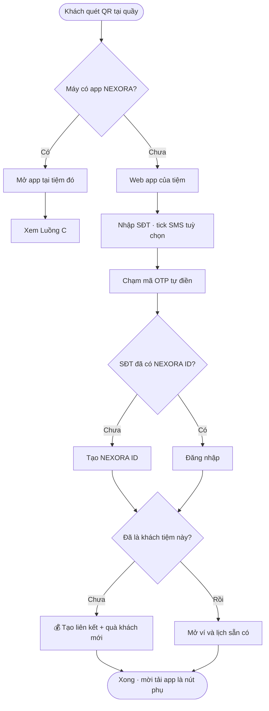
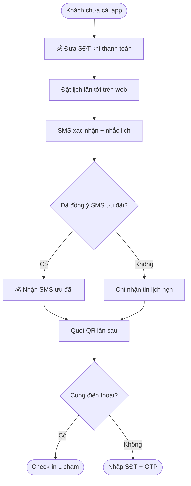
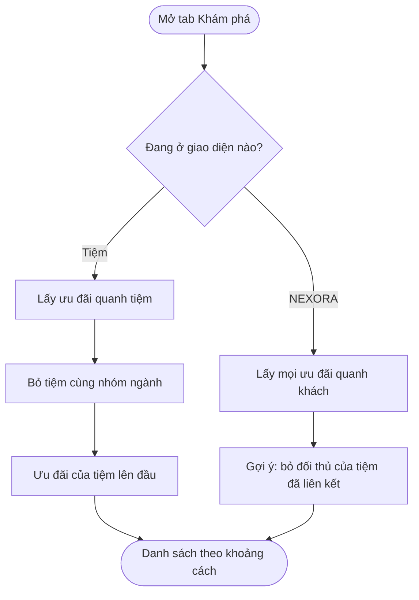
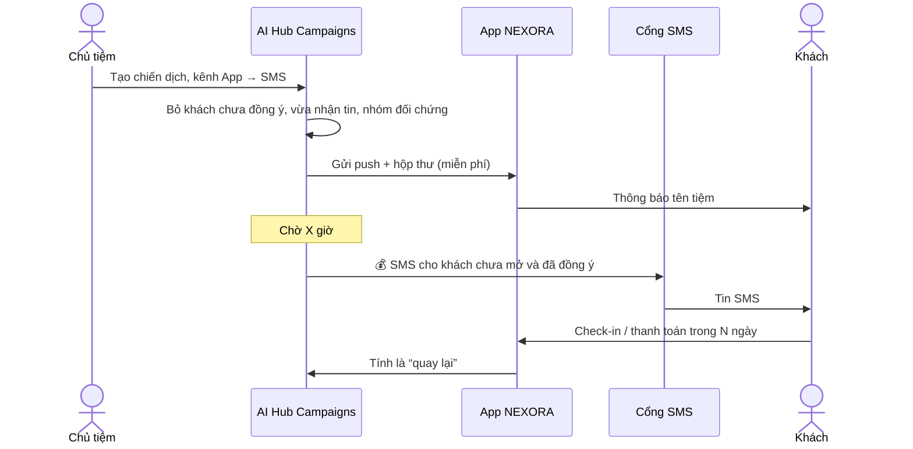
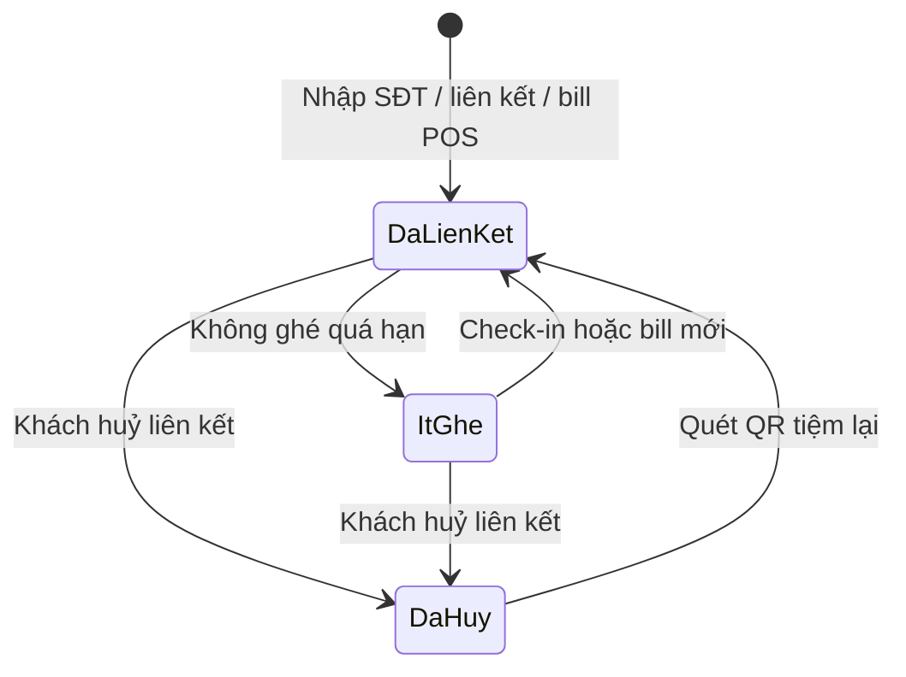
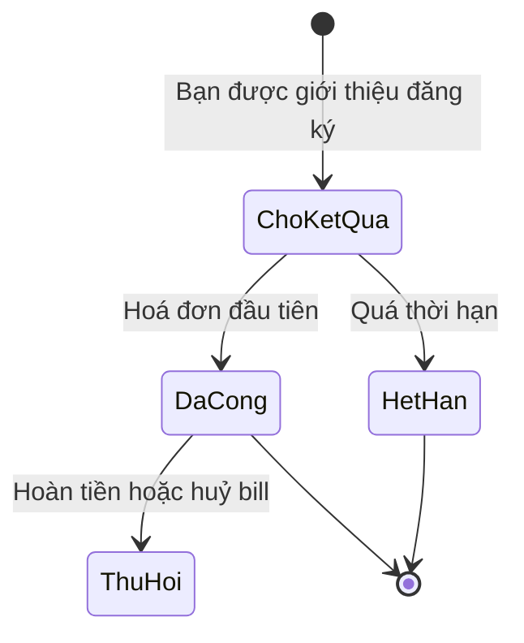

## App khách hàng NEXORA — mang thương hiệu tiệm (spec cho Dev)

**Cập nhật:** 29/09/2026 · **Đối tượng đọc:** Dev (mobile, web, backend), QA, BA · **Trạng thái:** Draft — chờ Brian chốt các mục ở **Câu hỏi mở**

**Nguồn:** quyết định của Brian trong các buổi làm việc 25–29/9 và các prototype: `nexora-luong-qr-dang-ky-tai-app.html`, `nexora-app-thuong-hieu-tiem.html`, `nexora-oneqr-tai-tiem.html`, `nexora-ai-hub-campaigns.html`. Không có repo `vlinkpay-docs` trong phiên này — tên kỹ thuật trong ngoặc là **đề xuất**, dev đổi theo code thật.

> Quy ước: **[Chốt]** = Brian đã quyết · **[Đề xuất]** = số / cách làm tạm, chờ chốt. Mọi số điểm, tiền, khoảng cách trong prototype là **số mẫu**.

---

### 1. Tổng quan

Một app **NEXORA** duy nhất trên App Store / Google Play, cộng một **web app** mở từ QR tại tiệm. Khách đăng nhập bằng **số điện thoại** là vào **giao diện mang logo, màu của tiệm** (white label). Một khách có thể là khách của nhiều tiệm, nhiều ngành — cùng một tài khoản. App giúp tiệm:

- có thêm khách vào **Customer list của POS** chỉ với 3 thao tác tại quầy;
- gửi ưu đãi bằng **thông báo app miễn phí** trước, SMS sau (chỉ khách đã đồng ý);
- giữ khách: đặt lại lịch 1 chạm, ví điểm riêng của tiệm, link giới thiệu.

Khách được: quà khách mới, đặt lịch / check-in không cần gọi điện, một chỗ xem mọi tiệm quen, khám phá ưu đãi quanh mình.

### 2. Phạm vi

| Trong phạm vi (MVP) | Để sau (Pro) | Ngoài phạm vi |
|---|---|---|
| Web app từ QR (mọi điện thoại) | App Clip iOS theo từng tiệm | App riêng mang tên tiệm trên store |
| App NEXORA iOS + Android | Deep link trả phí (Branch / AppsFlyer) để bỏ OTP lần 2 | Rút tiền mặt từ ví |
| Đăng ký / đăng nhập bằng SĐT + OTP | | Chương trình đối tác NEXORA-PARTNER |
| Web app cài vào màn hình chính (PWA) + web push | | |
| Giao diện theo tiệm, đổi tiệm, “Của tôi” | | Màn POS của chủ tiệm (đã có) |
| Ví: điểm tiệm + tín dụng NEXORA | | |
| Đặt lịch, đặt lại, check-in | | |
| Khám phá: Gần đây · Tìm deal · Ngành | | |
| Thông báo: push, hộp thư, SMS | | |
| Link giới thiệu 1 tầng | | |

### 3. Khái niệm chính

| Thuật ngữ | Định nghĩa |
|---|---|
| **NEXORA ID** | Tài khoản khách, khoá theo SĐT chuẩn E.164. Một người = một NEXORA ID dù là khách của bao nhiêu tiệm. |
| **Liên kết tiệm** (`shop_link`) | Quan hệ khách ↔ tiệm. Tạo khi khách nhập SĐT trên QR của tiệm, liên kết 1 chạm trong app, hoặc có hoá đơn POS. Tiệm chỉ thấy khách đã liên kết với mình. |
| **Giao diện tiệm** | App / web app hiển thị logo, màu, ưu đãi của một tiệm. Khám phá **chặn tiệm cùng ngành**. |
| **Giao diện NEXORA** | Giao diện trung tính (logo NEXORA): “Của tôi” và Khám phá NEXORA. **Không chặn** ngành. |
| **Tiệm “nhà”** (`home_biz_id`) | Tiệm app mở ra mặc định: tiệm có QR khách vừa quét, hoặc tiệm xem gần nhất. |
| **Điểm tiệm** | Điểm do tiệm trả, chỉ dùng tại tiệm đó, không cộng chung giữa các tiệm. |
| **Tín dụng NEXORA** | Do NEXORA trả (từ phần NEXORA thu), dùng ở mọi tiệm trong mạng. |
| **Quà khách mới của tiệm** | Tiệm cài, tiệm trả. 1 lần / SĐT / tiệm. |
| **Mã giới thiệu** (`ref_code`) | Gắn tự động từ QR / link. Giữ **người giới thiệu đầu tiên** ở cấp NEXORA. |
| **Đồng ý SMS** | Đồng ý nhận SMS ưu đãi, **riêng từng tiệm**, lưu thời gian + nguồn (TCPA). |
| **Deal / Coupon / Last minute** | Deal = không giới hạn số lượng; Coupon = có số lượng; Last minute = giờ trống hôm nay. Mọi ưu đãi theo điều kiện tiệm cài (ngày, giờ, cần đặt lịch). |

### 4. Vai trò

| Vai trò | Việc trong tính năng này |
|---|---|
| Khách chưa có app | Quét QR, nhập SĐT, dùng web app: check-in, đặt lịch, ví, nhận SMS (nếu đồng ý). |
| Khách có app | Như trên + push, “Của tôi”, Khám phá, đổi tiệm, giới thiệu. |
| Chủ tiệm | In QR, cài logo / màu / quà khách mới / thưởng giới thiệu trong OneQR Studio; gửi chiến dịch từ AI Hub › Campaigns; xem khách trong POS › Customer list. |
| Thợ / thu ngân | Nhận SĐT khi thanh toán → POS tự áp quà, cộng điểm. |
| NEXORA admin | Cấu hình trần thông báo, giờ yên lặng, nhóm ngành cạnh tranh, quy tắc thưởng. |

---

### 5. Luồng chính

#### Luồng A — Khách mới tại quầy: 3 thao tác **[Chốt]**

**Người làm:** khách mới · **Bắt đầu:** quét QR tại quầy · **Kết quả:** khách có NEXORA ID, đã liên kết tiệm, quà vào ví, có trong Customer list POS.

**User stories**
- Là khách mới, tôi muốn nhận quà chỉ bằng SĐT, không phải tải app hay tạo mật khẩu.
- Là chủ tiệm, tôi muốn khách quét QR của tôi được tính là khách của tôi và mã giới thiệu tự gắn.
- Là khách, tôi muốn tự chọn có nhận SMS ưu đãi hay không.
- *Ngoại lệ:* SĐT đã có tài khoản → cùng ô này là đăng nhập, không tạo trùng.
- *Ngoại lệ:* SĐT đã có trong Customer list POS (khách cũ chưa có app) → gộp vào hồ sơ cũ, **không** tặng quà khách mới nếu đã có hoá đơn tại tiệm.
- *Ngoại lệ:* OTP sai / hết hạn → cho gửi lại, giới hạn số lần.

| Bước | Ai | Thao tác | Hệ thống | Ghi chú |
|---|---|---|---|---|
| 1 | Khách | Mở Camera, quét QR | Mở `nexora.link/q/<tiệm>?q=<qr_id>`. Có app → mở app (universal link / app link). Chưa có → web app. | Không in link App Store trực tiếp. Không dùng mã chỉ đọc được trong app. |
| 2 | Khách | Nhập SĐT trên banner quà, (tuỳ chọn) tick đồng ý SMS, bấm **Nhận quà** | Giữ `ref_code` từ QR trong phiên; gửi OTP | Không hỏi tên, không mật khẩu. Ô SMS **không tick sẵn** trên bản thật. |
| 3 | Khách | Chạm mã OTP iPhone / Android gợi ý | Xác minh → tạo hoặc tìm NEXORA ID → tạo `shop_link` → cấp quà khách mới 💰 → thêm vào Customer list, nhóm **New Customers** | Tự gửi khi đủ 6 số (`autocomplete="one-time-code"`, Android SMS Retriever). |
| 4 | Khách | Thấy “Xong · quà đã vào ví” | Hiện nút phụ **Tải app** và “Không tải app” | Không đẩy sang store trước bước 3 (mất mã giới thiệu). |

#### Luồng B — Khách không cài app **[Chốt]**

| Bước | Ai | Thao tác | Hệ thống | Ghi chú |
|---|---|---|---|---|
| 1 | Thu ngân | Nhập SĐT khi thanh toán | 💰 POS tự áp quà khách mới / coupon, cộng điểm; bill gắn NEXORA ID | Bill đầu tiên = sự kiện tính thưởng giới thiệu. |
| 2 | Hệ thống | — | Web app (nếu còn mở) tự hiện “Cảm ơn · điểm đã cộng” + **Đặt lịch lần tới** + nút phụ tải app | Cần kênh realtime hoặc polling. |
| 3 | Khách | Đặt lịch trên web | Cookie nhận ra khách → không nhập lại SĐT | Cùng trang Online Booking Link trong AI Hub. |
| 4 | Hệ thống | Gửi SMS lịch hẹn | Xác nhận + nhắc lịch, link riêng của khách | Tin lịch hẹn là tin giao dịch; **không chèn khuyến mãi**. |
| 5 | Hệ thống | Gửi SMS ưu đãi | Chỉ khi khách đồng ý SMS với tiệm đó 💰 (trừ credits tiệm) | Link token riêng, hết hạn sau N ngày. |
| 6 | Khách | Quét lại QR lần sau | Cùng máy → nhận ra, hiện lịch hẹn, **check-in 1 chạm**. Khác máy → SĐT + OTP. | Reset mốc 15 / 30 / 60 ngày ở AI Hub. |

#### Luồng C — Tải app sau (tuỳ chọn) **[Chốt]**

| Bước | Ai | Thao tác | Hệ thống | Ghi chú |
|---|---|---|---|---|
| 1 | Khách | Bấm **Tải** | Mở store NEXORA theo hệ điều hành | Ghi `app_install_click` theo NEXORA ID. |
| 2 | Khách | Mở app, nhập SĐT, chạm OTP | Server trả danh sách tiệm đã liên kết + `ref_code` | Không cần deferred deep link ở MVP — SĐT mang theo mọi thứ. |
| 3 | Hệ thống | — | 1 tiệm → mở giao diện tiệm đó. ≥3 tiệm → “Của tôi” | Ngưỡng 3 là **[Đề xuất]**. |
| 4 | Khách | Màn của tiệm hỏi “Nhận ưu đãi từ <tiệm>?” → hộp xin quyền của iOS / Android | Lưu `push_token` theo thiết bị | Hỏi màn của tiệm trước để tăng tỷ lệ đồng ý. |

> ⚠ Tài liệu §17 cũ ghi “cài xong tự mở đúng tiệm (deferred deep link)”. Luồng mới **thay thế**: đăng ký trên web trước, đăng nhập bằng SĐT trong app. Deferred deep link chuyển sang Pro.

#### Luồng D — Khách đã có app, đến tiệm mới **[Chốt]**

| Bước | Ai | Thao tác | Hệ thống | Ghi chú |
|---|---|---|---|---|
| 1 | Khách | Quét QR tiệm mới | Mở thẳng app tại tiệm đó | |
| 2 | Khách | Xem thẻ “Liên kết <tiệm> · 1 chạm”, tick SMS riêng cho tiệm này | Hiện dữ liệu chia sẻ: tên, SĐT | Không OTP (đã đăng nhập). |
| 3 | Khách | Bấm **Liên kết** | 💰 Tạo `shop_link` + quà khách mới của tiệm mới (tiệm mới trả) | `ref_code` **không đổi**. Tiệm cũ **không** được báo. |
| 4 | Khách | Ở giao diện tiệm mới | Thanh chọn tiệm / “Tiệm của bạn” (2 tiệm) hoặc “Của tôi” (≥3) | Điểm từng tiệm riêng. |

#### Luồng E — Đặt lại lịch ở tiệm cũ

- Trang chủ: **Tiệm của bạn** — mỗi tiệm 1 thẻ “Lần trước: <dịch vụ> với <thợ>” + **↻ Đặt lại**.
- Bấm → chuyển giao diện sang tiệm đó, chọn sẵn dịch vụ + thợ, khách chỉ chọn giờ.
- Tab Lịch hẹn: hàng **Đặt tại** (chọn tiệm) + danh sách lịch hẹn ở mọi tiệm, mỗi dòng có logo tiệm.
- Đây là thao tác của khách → **bộ lọc cạnh tranh không áp**.

#### Luồng F — Khám phá: Gần đây · Tìm deal · Ngành **[Chốt quy tắc chặn]**

| Khách đang ở | Gần đây / Tìm deal / Ngành | Gợi ý NEXORA tự đẩy |
|---|---|---|
| **Giao diện tiệm** (vd. Bitcoin Nail Bar) | Ưu đãi của tiệm lên đầu, rồi tiệm **khác ngành**. **Không** hiện tiệm cùng ngành. Gõ “nail” chỉ ra ưu đãi của chính tiệm. | Không có |
| **Giao diện NEXORA** (Đổi tiệm › NEXORA, hoặc từ “Của tôi”) | **Không chặn** | **[Đề xuất]** không đẩy tiệm cạnh tranh với tiệm khách đang liên kết |
| Web app từ QR (chưa có app) | Như giao diện tiệm | Hero 50/50 không chèn ngành cạnh tranh |

- **Gần đây:** mặc định tính từ **vị trí tiệm** (không xin quyền). Khách bấm “Vị trí của tôi” → xin quyền 1 lần, không lưu toạ độ chính xác.
- **Tìm deal:** hiểu câu gõ (ngành, món, giờ, giá). MVP: tìm theo từ khoá + từ đồng nghĩa ngành từ bộ 119 ngành.
- **Ngành:** chỉ hiện ngành **đang có ưu đãi** sau khi lọc, kèm số ưu đãi.
- Nút trên thẻ: Coupon → **Lấy** (vào ví), Last minute → **Giữ giờ**, Deal → **Xem**.
- Mọi ưu đãi hiện kèm điều kiện tiệm cài.

#### Luồng G — Tiệm gửi ưu đãi: app trước, SMS sau **[Chốt]**

Gửi từ **AI Hub › Campaigns** (xem `nexora-ai-hub-campaigns.html`). App nhận như sau:

| Kênh | Khách thấy | Điều kiện |
|---|---|---|
| Push | Icon **NEXORA** · tiêu đề = **tên tiệm** · ảnh ưu đãi màu tiệm. Chạm → mở **đúng tiệm, đúng ưu đãi**, kể cả khi đang xem tiệm khác. | Có app + bật thông báo + chưa tắt tiệm đó |
| Hộp thư (chuông 🔔) | Số chưa đọc, lọc theo tiệm, nút **Xem ưu đãi** | Luôn có (cả web app) |
| SMS | “<Tên tiệm>: … link · Reply STOP” | Đồng ý SMS với **tiệm đó** |

#### Luồng H — Giới thiệu bạn bè (1 tầng)

| Bước | Ai | Thao tác | Hệ thống | Ghi chú |
|---|---|---|---|---|
| 1 | Khách A | Chia sẻ link cá nhân `nexora.link/r/<mã>` | Link mở giao diện tiệm A đang xem | |
| 2 | Bạn B | Mở link, nhập SĐT + OTP | Tạo NEXORA ID, `referrer_type=customer`, `ref_code` của A | Nếu B đã có NEXORA ID → không đổi người giới thiệu. |
| 3 | Bạn B | Có hoá đơn đầu tiên tại tiệm | 💰 Thưởng cho A theo chương trình tiệm (tiệm trả) | Không thưởng lúc đăng ký. |
| 4 | Hệ thống | — | 💰 Phần từ doanh thu NEXORA (nếu có) → tín dụng NEXORA của A | Chỉ 1 tầng · có thời hạn + trần **[Đề xuất]**. |

#### Luồng I — Cài web app vào màn hình chính (PWA)

| Bước | Ai | Thao tác | Hệ thống | Ghi chú |
|---|---|---|---|---|
| 1 | Hệ thống | Hiện thẻ “Thêm <tiệm> vào màn hình chính” | Chỉ với khách đã nhập SĐT và quay lại lần 2 | iPhone không cho web tự bật hộp cài — phải hướng dẫn Chia sẻ › Thêm vào MH chính. Android: nút **Cài đặt** 1 chạm (`beforeinstallprompt`). |
| 2 | Khách | Chia sẻ › Thêm vào MH chính › Thêm | Tên, icon, màu lấy từ **manifest của tiệm** (OneQR Studio) | `start_url=/q/<tiệm>?src=pwa` |
| 3 | Khách | Mở icon logo tiệm | Mở không thanh địa chỉ | |
| 4 | Khách | Nhập SĐT 1 lần, mã tự điền | **iPhone: bộ nhớ icon riêng với Safari** → phải đăng nhập lại 1 lần. Android thường dùng chung với Chrome. | Màn này phải nói rõ quà và điểm vẫn còn. |
| 5 | Khách | Bật thông báo | Web push mang **logo + tên tiệm** | iPhone chỉ nhận web push khi đã cài vào màn hình chính (iOS 16.4+). AI Hub tính là kênh push miễn phí. |

---

### 6. Màn hình (theo prototype)

| Màn | Nội dung chính | Prototype |
|---|---|---|
| Web app — trang tiệm | Banner quà + ô SĐT, Check-in, Đặt lịch, Dịch vụ, ưu đãi | `nexora-luong-qr-dang-ky-tai-app.html` bước ①-2 |
| OTP | 6 ô, mã tự điền, tự gửi | ①-3 |
| Xong | Quà vào ví, nút phụ Tải app | ①-4 |
| Trang chủ tiệm | Header thương hiệu (logo, Đổi tiệm, chuông), ví, 4 nút nhanh, “Tiệm của bạn”, Lịch hẹn tới, Ưu đãi của tiệm, Mời bạn | `nexora-app-thuong-hieu-tiem.html` |
| Khám phá | 3 tab Gần đây · Tìm deal · Ngành, dòng “Đang xem trong <tiệm>” | tab Khám phá |
| Khám phá NEXORA | Header NEXORA, nút ‹ về tiệm, Gợi ý cho bạn, danh sách không chặn | Đổi tiệm › NEXORA |
| Của tôi (≥3 tiệm) | Hôm nay, tìm tiệm, ghim, nhóm ngành, ít ghé | |
| Lịch hẹn | Đặt tại, dịch vụ, ngày, giờ, thợ, danh sách mọi tiệm | |
| Ví | Điểm tiệm, tín dụng NEXORA, coupon, lịch sử | từ Trang chủ |
| Mời bạn | Link cá nhân, tiến độ, danh sách đã mời | |
| Web app đã cài (PWA) | Icon + tên tiệm trên màn hình chính, mở không thanh địa chỉ, đăng nhập 1 lần, web push logo tiệm | `nexora-luong-qr-dang-ky-tai-app.html` đường ③ |
| Tôi | Hồ sơ, Tiệm đã liên kết, Thông báo, Quyền riêng tư, Đăng xuất | |
| Tiệm đã liên kết | Số tiệm, số tiệm được gửi tin, công tắc push / SMS từng tiệm, Huỷ liên kết | |
| Hộp thư | Lọc theo tiệm, Xem ưu đãi | |

**Thanh dưới (web app và app giống nhau):** Trang chủ (hoặc Của tôi) · Khám phá · **Đặt lịch** (nút giữa) · Ví · Tôi. Lịch hẹn đã đặt nằm trong màn Đặt lịch.
- **Không có nút Quét QR trong app / web app [Chốt 29/9]:** camera điện thoại đã mở QR; trang tiệm (OneQR) đã có menu Check-in · Đặt lịch · Dịch vụ ở Trang chủ.
- **Một bộ giao diện cho web app và app:** header màu tiệm, thẻ nổi, thanh dưới giống nhau — chỉ khác thanh địa chỉ trình duyệt.

**Giao diện theo tiệm:** màu `b1/b2` + logo từ OneQR Studio. Chân trang “Powered by NEXORA”. Đổi màu trong Studio → app đổi ngay lần mở sau.

---

### 7. Vòng đời

#### Liên kết khách ↔ tiệm

| Trạng thái | Sự kiện | Trạng thái mới | Ghi chú |
|---|---|---|---|
| — | Nhập SĐT trên QR / liên kết 1 chạm / bill POS có SĐT | Đã liên kết | Cấp quà khách mới nếu chưa có bill tại tiệm |
| Đã liên kết | Không ghé > 3 tháng **[Đề xuất]** | Ít ghé | Chỉ đổi cách hiển thị, không mất điểm |
| Ít ghé | Check-in / bill mới | Đã liên kết | |
| Đã liên kết / Ít ghé | Khách bấm Huỷ liên kết | Đã huỷ | Tiệm không gửi tin được; hoá đơn giữ theo luật; điểm chưa dùng — chờ chốt |
| Đã huỷ | Khách quét QR tiệm lại | Đã liên kết | **Không** cấp lại quà khách mới |

#### Thưởng giới thiệu

| Trạng thái | Sự kiện | Trạng thái mới | Ghi chú |
|---|---|---|---|
| — | Người được giới thiệu đăng ký | Chờ kết quả | Ghi `ref_code`, `funded_by` |
| Chờ kết quả | Bill POS đầu tiên / coupon được dùng / NEXORA thu phí | Đã cộng 💰 | Vào điểm tiệm hoặc tín dụng NEXORA |
| Chờ kết quả | Quá thời hạn | Hết hạn | |
| Đã cộng | Hoàn tiền / huỷ bill | Thu hồi 💰 | |

---

### 8. Quy tắc nghiệp vụ

- **R1 · Một app, nhiều tiệm [Chốt]:** một app NEXORA trên store; giao diện theo tiệm sau đăng nhập (Apple 4.2.6 “picker model”).
- **R2 · SĐT là khoá [Chốt]:** chuẩn hoá E.164; một SĐT = một NEXORA ID; gộp với khách POS cùng SĐT.
- **R3 · 3 thao tác tại quầy [Chốt]:** quét → SĐT → OTP. Không hỏi tên, không mật khẩu ở bước đăng ký.
- **R4 · Đăng ký trước, tải app sau [Chốt]:** không đẩy khách sang store trước khi có NEXORA ID.
- **R5 · Mỗi tiệm chỉ thấy khách của mình [Chốt]:** không lộ lịch sử tiệm khác; tiệm cũ không biết khách đi tiệm mới.
- **R6 · Quà khách mới 1 lần / SĐT / tiệm [Chốt]** 💰 — tiệm trả.
- **R7 · Giới thiệu 1 tầng, giữ người đầu tiên [Chốt]** 💰 — thưởng khi có kết quả thật (bill, coupon dùng, phí NEXORA thu), không theo lượt xem / bấm.
- **R8 · Điểm tiệm riêng, tín dụng NEXORA chung [Chốt]** 💰.
- **R9 · Đồng ý SMS riêng từng tiệm [Chốt]** — ⚖ TCPA: lưu thời gian, nguồn, nội dung đồng ý; STOP phải tắt ngay cho tiệm đó.
- **R10 · Tin lịch hẹn ≠ tin ưu đãi** — ⚖ tách 2 loại; không chèn khuyến mãi vào tin lịch hẹn khi khách chưa đồng ý SMS ưu đãi.
- **R11 · App trước, SMS sau [Chốt]:** chỉ tốn SMS cho khách không có app hoặc chưa mở push sau X giờ.
- **R12 · Chặn cạnh tranh theo giao diện [Chốt]:** giao diện tiệm chặn cùng ngành; giao diện NEXORA không chặn. Mức chặn (cả nhóm / cùng ngành) theo quyết định #22.
- **R13 · Gợi ý tự đẩy không đưa đối thủ [Đề xuất]** của tiệm khách đang liên kết.
- **R14 · Trần thông báo [Đề xuất]:** tối đa N tin / tiệm / khách / tuần + giờ yên lặng — tiệm spam làm khách tắt thông báo cả app.
- **R15 · Vị trí:** mặc định vị trí tiệm; vị trí khách chỉ khi khách bật; không lưu toạ độ chính xác.
- **R16 · “Của tôi” từ 3 tiệm [Đề xuất]**; quét QR tiệm nào luôn mở thẳng tiệm đó.

> 💡 R6, R7, R8, R11 có tiền đi ra (điểm, tín dụng, credits SMS). R9, R10 là đồng ý nhận tin — cần luật sư xem.

### 9. Trường hợp đặc biệt

| Tình huống | Hệ thống làm gì | Ai xử lý |
|---|---|---|
| Khách đổi điện thoại | Đăng nhập lại SĐT + OTP; push token cũ bị huỷ | Tự động |
| Khách đổi số điện thoại | Đổi SĐT trong Tôi, xác minh cả số cũ + mới | Khách; CSKH nếu mất số cũ |
| Hai người dùng chung 1 SĐT (vợ chồng) | Một NEXORA ID; hồ sơ phụ để sau | Chờ chốt |
| Quét QR tiệm A khi đang ở giao diện tiệm B | Mở tiệm A | Tự động |
| Push của tiệm đã huỷ liên kết | Không gửi | Tự động |
| Khách trả lời STOP | Tắt SMS ưu đãi của tiệm đó, ghi log | Tự động |
| OTP không tới | Gửi lại sau 30 giây **[Đề xuất]**, tối đa N lần / giờ | Tự động |
| Coupon hết số lượng khi khách bấm Lấy | Báo hết, gợi ý ưu đãi khác của tiệm | Tự động |
| Bill bị huỷ sau khi đã thưởng giới thiệu | Thu hồi thưởng | Tự động; CSKH nếu điểm đã dùng |
| Trình duyệt xoá cookie | Nhập lại SĐT + OTP; không mất quà / điểm | Tự động |
| Tiệm đổi ngành | Bộ lọc cạnh tranh tính theo ngành mới từ lần tải sau | Tự động |

---

### 10. Phụ lục cho Dev

#### 10.1 Dữ liệu (đề xuất)

| Bảng | Trường chính |
|---|---|
| `customer` | `nexora_id`, `phone_e164`, `name?`, `created_at`, `ref_code`, `referrer_type (biz/customer/tech)`, `referrer_id` |
| `shop_link` | `nexora_id`, `biz_id`, `status (linked/dormant/unlinked)`, `source (qr_counter/link/app_link/pos_bill)`, `source_qr`, `linked_at`, `new_customer_reward_granted` |
| `consent` | `nexora_id`, `biz_id`, `channel (sms/push)`, `granted`, `granted_at`, `source`, `text_version`, `revoked_at` |
| `device` | `nexora_id`, `platform`, `push_token`, `last_seen` |
| `wallet_entry` 💰 | `nexora_id`, `biz_id?`, `type (shop_points/nexora_credit)`, `amount`, `reason`, `funded_by`, `ref_event_id` |
| `referral_reward` 💰 | `ref_code`, `referrer_id`, `referee_id`, `funded_by`, `reward_rule_id`, `qualifying_event (pos_bill/redeem/fee)`, `status`, `expires_at` |
| `biz_brand` | `biz_id`, `logo_url`, `color_b1`, `color_b2`, `welcome_gift_rule`, `referral_rule`, `industry_id`, `industry_group` |
| `offer` | `offer_id`, `biz_id`, `offer_type (deal/coupon/last_minute)`, `qty?`, `rules {days, from, to, svc, book, newOnly}`, `geo` |

#### 10.2 API (đề xuất)

| Method | Endpoint | Việc |
|---|---|---|
| GET | `/q/{biz_slug}?q={qr_id}` | Trang web app tiệm; ghi `ref` vào phiên |
| POST | `/auth/otp` | Gửi OTP `{phone, biz_id, ref_code, sms_consent}` |
| POST | `/auth/verify` | Xác minh → token + `{shops[], home_biz_id}` |
| POST | `/shops/{biz_id}/link` | Liên kết 1 chạm (đã đăng nhập) + `sms_consent` |
| DELETE | `/shops/{biz_id}/link` | Huỷ liên kết |
| GET | `/me/shops` | Tiệm đã liên kết, lần ghé cuối, dịch vụ + thợ lần trước |
| GET | `/explore?mode={shop|nexora}&biz_id=&anchor={shop|gps}&lat=&lng=&q=&industry=` | Ưu đãi đã lọc. **Lọc cạnh tranh làm ở server**, không ở app |
| POST | `/offers/{id}/claim` | Lấy coupon / giữ giờ last minute |
| PUT | `/me/consent` | Bật / tắt push, SMS theo tiệm |
| POST | `/devices` | Lưu push token |
| GET | `/me/inbox` | Hộp thư, lọc theo tiệm |

#### 10.3 Sự kiện phải ghi

`qr_open {biz, qr_id, has_app}` · `signup {ref_code, referrer_type, home_biz_id}` · `login_existing` · `shop_join {biz, new_customer_of_shop, source_qr}` · `reward_grant {funded_by, qualifying_event}` · `app_install_click` · `push_optin {biz}` · `explore_view {mode, blocked_group}` · `explore_loc {source}` · `deal_action {deal, shop, type, mode}` · `rebook_start {biz, last_service}` · `book_switch_shop` · `notif_send {biz, channels, campaign}` · `notif_open {channel}` · `notif_pref` · `shop_unlink` · `hub_open` · `checkin {biz}`

#### 10.4 Tiêu chí nghiệm thu (QA)

1. Khách mới từ quét QR tới “Xong” trong **3 thao tác** trên iPhone Safari và Android Chrome, không cài app.
2. Khách mới xuất hiện trong POS › Customer list, nhóm New Customers, gắn `ref_code` của QR.
3. SĐT đã có trong POS → không tạo khách trùng; đã có bill → không cấp quà khách mới.
4. Tải app, đăng nhập cùng SĐT → mở đúng giao diện tiệm, quà và `ref_code` còn nguyên.
5. Khách đã có app quét QR tiệm mới → mở app, liên kết 1 chạm, không OTP, `ref_code` không đổi.
6. Giao diện Bitcoin Nail Bar › Khám phá: không có tiệm cùng nhóm ngành trong Gần đây, Tìm deal, Ngành; gõ “nail” chỉ ra ưu đãi của Bitcoin.
7. Giao diện NEXORA › Khám phá: có tiệm cùng ngành.
8. Push của tiệm A khi khách đang xem tiệm B → chạm mở đúng tiệm A, đúng ưu đãi.
9. Khách chưa đồng ý SMS với tiệm → không nhận SMS ưu đãi của tiệm đó trong mọi chiến dịch.
10. STOP → tắt SMS ưu đãi của đúng tiệm đó.
11. ≥3 tiệm → trang đầu là “Của tôi”; quét QR vẫn mở thẳng tiệm.
12. Không lỗi, không tràn ngang ở màn rộng 360 px.

#### 10.5 Thứ tự làm (gợi ý)

| Giai đoạn | Hạng mục |
|---|---|
| 1 | Web app từ QR + SĐT/OTP + `shop_link` + gộp Customer list POS + quà khách mới |
| 2 | App iOS/Android: đăng nhập SĐT, giao diện tiệm, ví, lịch hẹn, đặt lại, check-in |
| 3 | Push + hộp thư + công tắc từng tiệm + nối AI Hub › Campaigns (App → SMS) |
| 4 | Khám phá (lọc cạnh tranh ở server) + “Của tôi” |
| 5 | Giới thiệu 1 tầng + báo cáo giới thiệu của tiệm |
| 6 | Web app cài được (manifest theo tiệm, web push, thẻ mời thêm vào màn hình chính) |
| Pro | App Clip, deferred deep link |

---

### 11. Câu hỏi thường gặp

**Q:** Tên tiệm có trên App Store không?
**A:** Không. Mọi tiệm dùng chung app NEXORA. Khách không cần tìm — quét QR là vào tiệm.

**Q:** Khách không muốn tải app thì sao?
**A:** Vẫn check-in, đặt lịch, dùng quà trên web. Tiệm chỉ liên lạc được qua SMS nếu khách đồng ý.

**Q:** Khách vào NEXORA thấy đối thủ thì có phải NEXORA “lấy khách” của tiệm không?
**A:** Giao diện tiệm và QR của tiệm không bao giờ hiện đối thủ. Trong NEXORA, khách tự tìm thì thấy hết; phần NEXORA tự gợi ý thì đề xuất không đẩy đối thủ (R13).

**Q:** Vì sao phải OTP lần 2 khi mở app?
**A:** Máy mới cần xác minh. Mã tự điền nên chỉ 1 chạm. Bỏ hẳn cần dịch vụ deep link trả phí (Pro).

### 12. Liên quan

- Deal & Coupon · POS Promotions (`04-deal-coupon-pos-promotion.md`)
- Bộ 119 ngành, 13 nhóm (`06-bo-nganh-nghe-chuan.md`) — dùng cho lọc cạnh tranh
- OneQR tại tiệm, hero 50/50, quảng cáo chéo tự động (đặc tả §16)
- AI Hub › Campaigns (đặc tả §18)
- Tài khoản định danh (`00-tai-khoan-dinh-danh-dieu-khoan.md`)

### 13. Câu hỏi mở

1. Ngưỡng “Của tôi”: 3 tiệm?
2. “Ít ghé” sau bao lâu: 3 tháng?
3. Mức chặn cạnh tranh: cả nhóm ngành hay chỉ cùng ngành (quyết định #22)?
4. R13 — gợi ý NEXORA tự đẩy có bỏ đối thủ không?
5. Trần thông báo: bao nhiêu tin / tiệm / khách / tuần; giờ yên lặng?
6. SMS sau bao nhiêu giờ nếu chưa mở push; “quay lại” tính trong bao nhiêu ngày; % nhóm đối chứng?
7. Huỷ liên kết: điểm chưa dùng giữ hay mất?
8. Thưởng giới thiệu: mức thưởng, thời hạn, trần — cần luật sư.
9. Link token trong SMS hết hạn sau bao lâu?
10. OTP: giới hạn gửi lại mỗi giờ?
11. Có hỏi tên khách không, và hỏi lúc nào (sau bill đầu / trong app)?
12. Hai người dùng chung một SĐT có cần hồ sơ phụ không?
13. Cookie nhận ra khách trên web giữ bao lâu?
