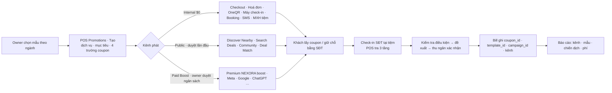
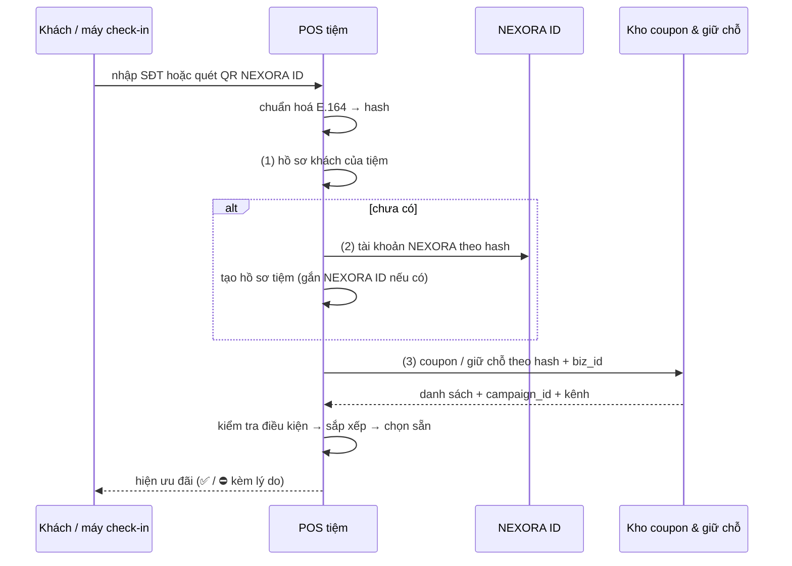

# Đặc tả hiện hành — Deal & Coupon · POS Promotions (bản 28/9/2026)

> **Đọc cái này trước.** Đây là bản **có hiệu lực**. Nếu Phụ lục A (tài liệu 04 gốc) hoặc prototype nói khác, **theo bản này**. Mọi con số trong prototype là **số mẫu**; mọi mức phí lấy từ chính sách *ONEQR-ADS-REF-REV-2026-09-21-v1* (Phụ lục C) và **chưa thu thật trong pilot**.

## 1. Phạm vi

| Trong phạm vi | Ngoài phạm vi (không làm trong đợt này) |
|---|---|
| Tạo / quản lý khuyến mãi trong **POS › Promotions** (nguồn duy nhất) | Tích điểm / thẻ thành viên / gift card (module riêng) |
| Phát lên kênh theo 3 tầng **Internal · Public · Paid Boost** | Voucher trả trước (marketplace) — chính sách để giai đoạn sau |
| Khách lấy coupon / giữ chỗ bằng **SĐT** (không cần app) | Thanh toán phí Ads thật, payout thật cho QR Host / Sponsor |
| **Nhận diện khách theo SĐT** ở máy check-in và đề xuất coupon | Tên địa danh đa ngôn ngữ (bản thật dùng Google Places) |
| Community: Deal gần bạn · Coupon theo ngành · ✦ Deal Match · 🎊 Sắp khai trương | Bản đồ thật cho Sponsored Pin |
| 🎊 Khai trương 30 ngày (chiến dịch cha) | |
| Lịch đăng tự động lên kênh của tiệm | |
| Báo cáo theo kênh / mẫu / chiến dịch | |
| Template Library (admin NEXORA) | |

## 2. Vai trò

| Vai trò | Làm được | Không làm được |
|---|---|---|
| **Khách** (có hoặc chưa có app) | Xem deal, lấy coupon / giữ chỗ bằng SĐT, dùng tại quầy, gõ một câu ở Deal Match | Tạo khuyến mãi |
| **Cá nhân** (thợ · người làm tự do · thuê ghế · nhân viên tiệm) | Trang cá nhân công khai, **tạo coupon cá nhân một màn hình (không cần POS)**, Mini quầy trên điện thoại, khách của tôi, Deal Match nhu cầu gần tôi — quy tắc theo hình thức làm việc (mục 14) | Tạo / sửa khuyến mãi **của tiệm**; nhân viên không tự chạy coupon khi chưa được chủ duyệt |
| **Thu ngân / Staff** | Check-in, xác nhận ưu đãi, redeem, huỷ redeem trong thời hạn cho phép | Tạo / dừng khuyến mãi, bật Paid |
| **Manager** | Sửa kênh Internal, lịch | Duyệt Public / Paid / ngân sách |
| **Owner** | Mọi thứ của tiệm; **duyệt** Public, Paid, đối tác, ngân sách | — |
| **Agency** | Nộp asset | Tiêu ngân sách |
| **Admin NEXORA** | Template Library, duyệt nội dung Public, duyệt mẫu chuỗi đề xuất, cấu hình ngưỡng | — |

## 3. Bản đồ màn hình ↔ prototype

| Màn hình | Ai | Mở trong file này |
|---|---|---|
| Deal gần bạn · Coupon theo ngành · Ví coupon · Sắp khai trương | Khách | Menu **Khách hàng** |
| Trang cá nhân · Tạo coupon · Mini quầy · Khách của tôi · Hiệu quả | Cá nhân | Menu **Cá nhân** |
| Coupon của thợ (duyệt nhân viên · nhận coupon thợ thuê ghế ở POS) | Owner | **Doanh nghiệp › Chương trình** |
| ✦ Deal Match (khách gõ 1 câu / tiệm thấy nhu cầu / điều phối) | Khách · Tiệm · NEXORA | Menu **Khách hàng › Deal Match** và **Doanh nghiệp › Deal Match** |
| POS › Promotions: Tổng quan · Chương trình · **Tạo** · Hiệu quả · Kết nối | Owner / Manager | Menu **Doanh nghiệp › POS · Promotions** |
| Máy check-in (màn chờ, nhận diện SĐT) | Khách tại tiệm · Thu ngân | **Doanh nghiệp › Máy check-in** |
| Quầy redeem (mã + PIN — đường phụ) | Thu ngân | **Doanh nghiệp › Quầy redeem** |
| 🎊 Khai trương 30 ngày | Owner tiệm mới | **Doanh nghiệp › Khai trương** |
| 📈 Chiến dịch (plugin kênh, ROAS) | Owner | **Doanh nghiệp › Chiến dịch** |
| Template Library | Admin NEXORA | **Admin › Template Library** |
| ⚡ Last minute — khách đặt giờ trống | Khách | **Khách hàng › Last minute hôm nay** |
| ⚡ Last minute — cài đặt & bảng hôm nay | Owner | **Doanh nghiệp › Last minute** |
| ⚡ Mở bán giờ trống của tôi | Cá nhân | **Cá nhân › Mở bán giờ trống** |

**Ngành trên màn khách (Deal gần bạn · Coupon theo ngành):** bộ chuẩn có **13 nhóm · 119 ngành** (cộng 13 mục “Khác” cho doanh nghiệp không khớp ngành nào — không tính là ngành). Màn khách **chỉ hiện nhóm và ngành đang có deal/coupon**; ngành chưa có vẫn tìm được bằng ô tìm, hiện “chưa có · báo tôi khi có”, và có nút “Xem tất cả 119 ngành” + “✦ Đăng mong muốn”. Màn tạo khuyến mãi (tiệm, cá nhân) luôn hiện đủ 119 ngành.

## 4. Luồng tổng

## 5. Tạo khuyến mãi — trường & quy tắc

| Bước | Trường | Quy tắc |
|---|---|---|
| Mẫu | `template_id`, `template_version` | Mẫu lọc theo **ngành trong Salon Settings** (không bắt chọn lại) + mẫu chung. Chọn mẫu điền: tên, mô tả, dịch vụ, loại & mức giảm, lịch, mốc đăng. Lưu `edited_fields[]` = trường tiệm đã sửa (from → to). |
| 02 (đầu) | **Số lượng → kiểu ưu đãi** (quy tắc Brian 28/9) | **Có nhập số lượng = 🎟️ Coupon. Để trống số lượng = 🏷️ Deal.** Không có ô chọn kiểu riêng — ô số lượng quyết định; bấm “Deal” là xoá số lượng, bấm “Coupon” khi chưa có số thì con trỏ nhảy vào ô số lượng. **🏷️ Deal**: hiện **kiểu banner** — số tiền ($10 OFF) hoặc % off — **có điều kiện** (khách mới, ngày trong tuần, dịch vụ, hoá đơn tối thiểu…), **không giới hạn số lượng**, **không cần lấy**, tự áp khi khách đủ điều kiện ở check-in / checkout / Booking; chạy tới ngày kết thúc hoặc khi tắt; vẫn có giới hạn *mỗi khách* (1 lần/lượt ghé · /tuần · /tháng) và tuỳ chọn **trần giảm giá / tháng** — tới trần tự dừng và báo chủ; ô giới hạn/người và giữ lượt bị khoá; trên Community card ghi “🏷️ DEAL · không giới hạn số lượng” và “Không cần lấy — tự áp tại tiệm”, không có nút lấy. **🎟️ Coupon**: khách lấy bằng SĐT, đếm suất (còn X/Y), hết suất tự dừng, giới hạn/người, hạn, giữ lượt; card ghi “🎟️ COUPON”. Mẫu tự đặt kiểu (Giờ vàng, Add-on, Combo ⇒ Deal; Khách mới, Khai trương, Giới thiệu ⇒ Coupon). Lưu `offer_type = deal / coupon` (và `last_minute` cho mục 15). |
| 01 | Tên, badge, mô tả, **dịch vụ áp dụng** | Dịch vụ lấy từ danh mục POS. POS chỉ trừ giảm trên đúng dịch vụ; Booking chỉ gắn nhãn đúng dịch vụ. |
| 02 | **Mục tiêu** (lấp giờ vắng / kéo khách quay lại / khách mới / bán gift card), loại giảm, giá trị, ngày trong tuần, giờ bắt đầu–kết thúc | Mục tiêu **bật sẵn** các kênh gợi ý (bảng mục 6). Giờ theo giờ tiệm, cùng ngày. |
| 02 (tóm tắt) → Nâng cao | **Ngày bắt đầu, ngày kết thúc, tổng suất, giới hạn / người, giữ lượt (ngày)** | Thiếu 4 trường này thì không có “coupon”. Giới hạn/người **đếm theo lần dùng**, khoá theo SĐT. Lấy coupon = giữ 1 suất N ngày; không tới ⇒ suất trả về kho. |
| Nâng cao | **Áp dụng cho**: mọi khách · khách mới (lần đầu) · khách hiện có · 45+ ngày chưa quay lại · khách OneQR gần tiệm | **POS tự kiểm** bằng lịch sử bill theo SĐT lúc check-in (thay dòng “verify first-visit eligibility”). |
| Nâng cao | Ngân sách (chỉ Paid), Duyệt (nháp / cần owner / tự bật Internal), **Chiến dịch** (`campaign_id`) | Tiệm đang trong cửa sổ khai trương ⇒ gắn sẵn 🎊. |
| Nâng cao | Nội dung đối tác trên OneQR Hero **và màn chờ check-in** | Mặc định chỉ ưu đãi của tiệm. Dải đối tác / thẻ xoay vòng cần owner duyệt + chặn đối thủ. |
| Lưu | Trạng thái | Nháp → (Chờ duyệt) → Lên lịch → Đang chạy ⇄ Tạm dừng → Kết thúc; Bị từ chối → sửa. |

## 6. Kênh phát — 3 tầng (theo chính sách OneQR)

| Tầng | Kênh | Phí | Điều kiện |
|---|---|---|---|
| **Internal** | POS checkout · Hoá đơn POS · OneQR Hero · **📱 Máy check-in** · **📅 Booking** (gồm AI Voice) · SMS khách tiệm · Email · Facebook / IG / Google Business / Website · Gift Card Center · Link tuỳ chỉnh · (Merchant ATM, CryptoMap360 — chỉ khi tiệm có gói) | $0, không publisher payout, không sponsor override | Không cần duyệt. SMS chỉ khách đã opt-in (TCPA, 08:00–21:00, STOP). |
| **Public** | Discover Nearby · Search Deals · Community · Đối tác chéo | Click organic **$0**. **Phí thành công** (chỉ khi tiệm bật): 10% giá trị dịch vụ đủ điều kiện (khách mới) · 5% (quay lại sau 90 ngày, nếu bật). Không tính thuế, tip, retail, gift card. Chia: QR Host 50% · Sponsor 10% · NEXORA 40% | Duyệt nội dung lần đầu; không cam kết vị trí. |
| **Paid Boost** | Premium NEXORA boost (banner $0.40 · thẻ Explore $0.25 · Search $0.30 / valid click) · Partner network boost · Meta · Google · ChatGPT Ads · TikTok · Yelp · Agency · Vendor khác · (ChatGPT Sponsored Agent — early access) | CPC chia: banner 40/10/50 · thẻ 35/10/55 (QR Host / Sponsor / NEXORA). Quảng cáo ngoài trả cho nền tảng ngoài. | **Phải có Public**, ngân sách, **owner duyệt**; hiện bảng “tiền đi đâu” trước khi xác nhận; dedupe 24h, chặn bot, **không chèn vào phiên OneQR của tiệm đối thủ**. Hết ngân sách ⇒ tự dừng. |

**Mục tiêu → kênh bật sẵn** (bản đề xuất — **chờ Brian chốt**):

| Mục tiêu | Bật sẵn | Máy check-in | Booking |
|---|---|---|---|
| Lấp giờ vắng | POS · OneQR · SMS · Google · Discover Nearby; gợi ý Premium boost | Màn chờ · Sau SĐT | Bật: banner · nhãn khung giờ · AI Voice · giữ suất |
| Kéo khách quay lại | POS · Hoá đơn · SMS · Email · Community | Sau SĐT · Sau thanh toán | Bật: AI Voice · tin xác nhận · giữ suất |
| Khách mới | POS · OneQR · FB · IG · Google · Nearby · Search · Community; gợi ý Premium boost, Meta | Sau SĐT | Tắt |
| Bán gift card | POS · Hoá đơn · Gift Card · Email · SMS · OneQR | Màn chờ · Sau thanh toán | Tắt |

### 6.1 📱 Máy check-in

| Vị trí | Hiện khi | Nên dùng cho |
|---|---|---|
| Màn chờ (xoay vòng) | Không ai check-in | Add-on, gift card, giới thiệu bạn, bán lẻ |
| Sau khi nhập SĐT | **Chỉ khi khách đủ điều kiện** (POS vừa kiểm) — lời chào cá nhân + nút *Dùng* | Mọi loại, kể cả khách mới |
| Mời ngồi chờ | Sau check-in, lúc chờ tới lượt | Add-on |
| Sau thanh toán | Màn cảm ơn | Hẹn lần sau, quay lại, giới thiệu bạn |

Quy tắc: ưu tiên Cao hiện gấp đôi trong vòng xoay; chỉ trong khung ngày giờ của chương trình; tắt chương trình ⇒ rời màn ngay. **Cảnh báo** khi đặt ưu đãi “khách mới” ở Màn chờ / Mời ngồi (khách đã tới rồi).

### 6.2 📅 Booking

Tuỳ chọn: banner trang đặt lịch · **nhãn ưu đãi trên khung giờ áp dụng** · gợi ý add-on · **AI Voice** nhắc khi gọi / nhắn / gọi nhỡ · kèm tin xác nhận & nhắc lịch · **giữ suất khi đặt** (tới là tự áp; huỷ / không tới ⇒ trả suất).

### 6.3 Lịch đăng tự động (kênh của tiệm)

Chế độ: Ngay khi bật · **Theo mốc chương trình**: T−3 “Sắp có” · ngày bắt đầu · mỗi 7 ngày nhắc lại (đổi banner, cần ≥ 2 banner) · T−2 “Sắp hết — còn N suất” (N thật lúc đăng) · kết thúc · lặp tuần. Đổi ngày chương trình ⇒ lịch tự dời. **Bài đã sửa tay không tự dời nữa** (`source=manual`). Hàng đợi: Sửa · Đăng ngay · Tạm dừng · Bỏ · Thử lại. Kênh chưa kết nối ⇒ thất bại có lý do + nút Kết nối; token sắp hết hạn ⇒ cảnh báo trước mốc.

## 7. Nhận diện khách theo SĐT (check-in)

| Quy tắc | Nội dung |
|---|---|
| Khoá | Hash của SĐT chuẩn E.164; không lưu SĐT thô ở bảng coupon. |
| Nhiều tiệm | Chỉ coupon có `biz_id` (chuỗi: `brand_id`) trùng mới hiện. |
| SĐT dùng chung | Giới hạn / người thực chất là / SĐT — chấp nhận ở MVP, ghi trong điều khoản. |
| Gõ nhầm | Số không có hồ sơ ⇒ hiện lại số để thu ngân xác nhận trước khi tạo khách mới. |
| Gian lận | Coupon thường: thu ngân xem tên che (Kayla N.). Coupon giá trị cao / suất giới hạn: **OTP SMS** hoặc QR + PIN động từ app; ngưỡng do tiệm đặt. |
| Mất mạng | POS xếp hàng, đồng bộ lại; kho trung tâm chặn lượt trùng. |
| Kiểm tra điều kiện | Tạm dừng · hết hạn · khách mới mà đã ghé · khách quen chưa đủ · 45+ ngày · vượt giới hạn/người · quá hạn giữ lượt · hết suất. “Mọi khách” không đủ ⇒ ẩn; đối tượng cụ thể ⇒ hiện kèm lý do. |
| Đường phụ | Quầy redeem: mã + PIN động 30 giây (khách không muốn đưa SĐT). |

## 8. 🎊 Khai trương (chiến dịch cha)

- Bật “Sắp khai trương” ⇒ tạo `campaign_id` type `open`, cửa sổ **từ nay → ngày mở + 30**. Mọi coupon / banner / link đại sứ tạo trong cửa sổ **mặc định gắn** campaign (bỏ tick được).
- **Trước ngày mở**: link dẫn tới trang Sắp khai trương `nexora.link/open/<tiệm>?c=<kênh>`; khách **chỉ giữ chỗ bằng SĐT, không phát mã**.
- Ngày mở: check-in SĐT ⇒ nhận đủ ưu đãi, bill ghi `campaign_id` + kênh. Tự đóng sau 30 ngày; coupon còn hạn vẫn dùng tới hạn.
- **Tạo = chạy** trên kênh miễn phí; bước trả phí là hành động riêng.
- POS Promotions **phải chạy trên web/app trước khi tiệm có máy POS**.

## 9. Dữ liệu phải đóng dấu (không có thì không có báo cáo)

| Bản ghi | Trường thêm |
|---|---|
| promotion | `template_id, template_version, template_origin (nexora/chain/shop), edited_fields[], goal, services[], audience, start_date, end_date, total_slots, per_person_limit, hold_days, campaign_id, channels{internal[], public[], paid[]}, checkin{on, placements[], priority}, booking{on, options[]}, perf_fee_opt_in` |
| post | `post_id, promotion_id, template_id, channel, milestone, source (auto/manual), status` |
| claim / reservation | `coupon_id, promotion_id, template_id, channel (c=), campaign_id, phone_hash, qr_host_id, hold_until` |
| redemption / bill | `bill_id, coupon_id, template_id, campaign_id, channel, qr_host_id, amount_after_discount, cashier_id` |
| ads ledger | `event_id, advertiser_id, qr_host_id, sponsor_id, placement, amount, split[], status (reserved/spent/reversed)` |

## 10. Báo cáo

Theo **kênh** (xem · bấm · redeem · doanh thu · chi phí) · theo **mẫu** (tỉ lệ dùng của tiệm vs trung bình ngành ẩn danh trong khu vực) · theo **chiến dịch** (giữ chỗ / lấy · redeem · doanh thu · chi phí). Doanh thu = bill POS có `coupon_id`. Xếp hạng mẫu và nhãn 🔥 chỉ khi mẫu **vượt ngưỡng** (số chương trình · số tiệm khác nhau · số lượt lấy). Trung bình ẩn danh chỉ hiện khi đủ số tiệm tối thiểu trong khu vực. Tính lại hằng đêm.

## 11. Quyết định còn mở — BA cần Brian chốt trước khi viết user story

| # | Câu hỏi | Đề xuất hiện tại |
|---|---|---|
| 1 | Bảng **Mục tiêu → kênh bật sẵn** (mục 6) | Như bảng — do đội sản phẩm đề xuất |
| 2 | Ngưỡng xếp hạng mẫu (số CT · số tiệm · số lượt lấy) và số tiệm tối thiểu cho benchmark | Prototype để tạm 10 · 5 · 100 · 5 — **chưa chốt** |
| 3 | Nhiều coupon cùng lúc: lợi nhất cho khách hay cho tiệm | Cho khách; tiệm được tắt cộng dồn |
| 4 | Giữ lượt: bắt buộc hay tuỳ chọn; mặc định mấy ngày | Tuỳ chọn, mặc định 7 |
| 5 | ~~Thợ tạo coupon cá nhân~~ | **Đã chốt 28/9: có nhóm Cá nhân** — quy tắc ở mục 14 |
| 6 | Chuỗi nhiều chi nhánh: coupon theo brand hay theo tiệm | Theo brand, tiệm được tắt |
| 7 | Ngưỡng bắt OTP cho coupon giá trị cao | Tiệm tự đặt; mặc định cho deal “suất giới hạn” |
| 8 | Đại sứ khai trương được thưởng lúc khách giữ chỗ hay lúc khách tới | Lúc khách tới (tránh SĐT ảo) |
| 9 | Đổi ngày khai trương: cửa sổ 30 ngày dời theo? giữ chỗ không tới bao lâu thì huỷ? | Dời theo; huỷ sau ngày mở + 7 |
| 10 | Vị trí **màn chờ check-in** cho quảng cáo đối tác: tính CPC hay theo lượt hiển thị | Chưa có trong chính sách — cần bổ sung |
| 11 | Phí thành công: nối bill POS ↔ phiên OneQR (QR Host) thế nào | Cần `qr_host_id` trên claim và bill |
| 12 | Public mà không bật phí thành công có được Deal Match / Bảng tin không | Được; không được Paid Boost |
| 13 | Huỷ redeem nhầm: trong bao lâu, ai được huỷ | Chưa có trong prototype — cần thêm |
| 14 | 📈 Chiến dịch (Community) và Hiệu quả › Theo chiến dịch (POS) trùng | Giữ bên POS làm chính |
| 15 | Cá nhân: xác minh danh tính & giấy phép hành nghề (ví dụ license nail của bang) trước khi Public | Bắt buộc trước Public; Internal không cần |
| 16 | Cá nhân: phí thành công / Paid Boost có áp như doanh nghiệp không | Như doanh nghiệp; trần ngân sách/ngày thấp hơn |
| 17 | Thợ thuê ghế: coupon trừ vào phần của thợ ở POS tiệm — đối soát chia tiền thế nào | POS ghi `issuer=individual`, `payee=thợ`; đối soát theo kỳ trả tiền ghế |
| 18 | ⚡ Last minute: mở bán trước / đóng bán trước bao lâu, giữ chỗ bao lâu, tới trễ bao lâu thì mất giờ | Chưa có — prototype để số tạm (tag tím “chờ chốt”) |
| 19 | ⚡ Last minute: khoá khách vừa huỷ lịch giá gốc bao lâu; no-show nhiều lần có bị chặn | Bật khoá; thời gian chờ chốt |
| 20 | ⚡ Last minute: có thu cọc / giữ thẻ không; có cộng coupon không; giới hạn giờ/ngày theo tiệm hay theo thợ | Không cọc ở MVP; không cộng dồn |
| 21 | ⚡ Last minute: tính phí NEXORA / OneQR cho giờ đặt qua Last minute theo tầng nào; có lên trang SEO không | Chưa có |
| 22 | 📱 QR tại tiệm: bộ lọc đối thủ mặc định chặn cả nhóm ngành hay chỉ cùng ngành; Search có hiện tiệm cùng ngành khi khách gõ đúng ngành đó không; bán kính mặc định; tỷ lệ banner giữ 50/50 hay cho tiệm chọn; đối tác chéo đổi chỗ miễn phí hay trả phí | Chặn cả nhóm; Search vẫn áp bộ lọc; 50/50 cố định; đổi chỗ miễn phí, Paid Boost lấp chỗ trống |

## 12. Những gì prototype **không** phải spec

Số liệu, tên tiệm, khách, SĐT đều là **mẫu**. Tooltip tiền phải đọc từ cấu hình chính sách, không hard-code. Tên địa danh, bản đồ “radar”, toạ độ là giả. Bản gộp nhúng dữ liệu địa lý toàn cầu vào file — bản thật tải theo nước. Một số màn cũ còn trong mã module Deal (tạo coupon cũ, “Coupon của tôi”) **không còn đường vào** — bỏ qua.

## 13. SEO — trang công khai (xem mục “🔎 SEO” trong menu)

Hiện Deal & Coupon là app một trang — **Google không đọc được**. Cần 4 loại trang công khai render sẵn trên server, mỗi trang một URL ổn định: ① ngành × thành phố (`/us/tx/katy/nail`, chỉ đăng khi có ≥ 1 deal thật) · ② trang tiệm (`/biz/<tiệm>`, LocalBusiness + Offer) · ③ một deal (`/c/<id>-<slug>`, hết hạn vẫn mở + gợi ý deal khác, sau 30 ngày `noindex`, xoá hẳn 410) · ④ sắp khai trương (`/open/<tiệm>`, Event; ngày mở + 30 ⇒ 301 về trang tiệm). Không index: ví, luồng lấy coupon, mong muốn Deal Match, máy check-in, POS. `?c=` canonical về URL gốc. Song ngữ `/vi/` `/en/` + hreflang. **Chờ Brian chốt:** tên miền chính cho SEO (`nexora.link` · `nexora.deals` · `nexoratouch.com/deals`).

## 14. Nhóm Cá nhân — thợ · người làm tự do

| Hình thức | Ai chịu giảm giá | Dùng coupon ở đâu | Duyệt |
|---|---|---|---|
| 🚗 **Làm tự do** (tại nhà khách, sự kiện, tiệm tạm) | Cá nhân | **Mini quầy trên điện thoại** của cá nhân (nhập SĐT / quét QR, nhập giá, SMS biên nhận) | Không (Public vẫn duyệt lần đầu) |
| 🪑 **Thuê ghế** | Cá nhân — chỉ **dịch vụ của mình** | Mini quầy của cá nhân, **hoặc** POS tiệm nếu tiệm bật “POS nhận coupon thợ thuê ghế” (trừ vào phần của thợ, không trừ doanh thu tiệm) | Không |
| 🏪 **Nhân viên tiệm** | Tiệm | Chỉ POS tiệm | **Chủ tiệm duyệt** trong POS › Chương trình › Coupon của thợ; khách gắn tên thợ để tính hoa hồng |

**Vì sao thợ của tiệm có coupon riêng:** khách đi theo thợ; thợ có nhóm khách riêng (MXH, khách quen) và muốn kéo khách về ghế mình. Coupon cá nhân biến nhóm đó thành lượt ghé — **tiệm vẫn nắm quầy**.

**Dùng coupon của thợ tại tiệm (thợ là nhân viên hoặc thuê ghế):**

1. Khách check-in bằng SĐT ở máy của tiệm (không cần mở ví).
2. POS tra SĐT → thấy coupon có `issuer_type=individual`, `issuer_id=thợ`, `host_biz_id=tiệm`.
3. Kiểm tra: tiệm đã duyệt (nhân viên) / tiệm bật nhận coupon thợ thuê ghế · **thợ có ca hôm nay** · khách đủ điều kiện (tuỳ chọn của chủ: *chỉ khách mới của tiệm*).
4. **Tự xếp khách vào hàng của thợ phát coupon.** Thợ không có ca ⇒ ⛔, máy gợi ý đặt lịch với thợ (coupon giữ nguyên) hoặc check-in với thợ khác không dùng coupon.
5. Bill qua POS tiệm, ghi `coupon_id, issuer_id`. **Ai chịu giảm** — nhân viên: chủ chọn *tiệm chịu / trừ hoa hồng thợ / chia theo tỉ lệ chủ đặt*; thuê ghế: trừ vào phần của thợ khi đối soát tiền ghế.
6. Khách vào **hồ sơ khách của tiệm** và là **người theo dõi thợ** — hai quan hệ tách nhau. Thợ chuyển tiệm: người theo dõi đi theo thợ, hồ sơ ở tiệm cũ vẫn của tiệm, coupon gắn tiệm cũ tự kết thúc. Thợ **không** truy cập danh sách khách của tiệm.

Cá nhân dùng cùng quy tắc: **có số suất = Coupon**, **để trống = Deal cho khách của tôi** (tự áp khi đặt lịch / check-in với thợ, 1 lần/lượt ghé).

Quy tắc chung: coupon cá nhân gắn **tên cá nhân**, không gắn tiệm; **khách thuộc NEXORA ID của cá nhân** (đi theo khi chuyển tiệm); SMS chỉ khách đã đồng ý, tối đa 1 tin/chương trình; Paid Boost cần Public; trang cá nhân `nexora.deals/p/<tên>` được index như trang tiệm. Dữ liệu thêm: `issuer_type (business/individual)`, `issuer_id`, `work_mode`, `host_biz_id`, `payee_id`, `approved_by`.

## 15. ⚡ Last minute — bán giờ trống hôm nay (xem mục “⚡ Last minute” ở cả 3 vai trò)

**Định nghĩa:** loại ưu đãi thứ 3, bên cạnh 🏷️ Deal và 🎟️ Coupon. Last minute **không phải mã giảm giá**, mà là **một giờ trống cụ thể** (giờ + thợ + dịch vụ) được bán với giá thấp hơn **cho đúng giờ đó**. Có người đặt là hết.

| | 🏷️ Deal | 🎟️ Coupon | ⚡ Last minute |
|---|---|---|---|
| Bán cái gì | Banner $ / % off có điều kiện, không giới hạn số lượng | Mã, khách lấy trước | Một giờ trống cụ thể |
| Khách làm gì | Không cần làm gì | Lấy bằng SĐT, dùng sau | Đặt giờ đó ngay bằng SĐT |
| Hết khi nào | Tắt / tới ngày kết thúc | Hết suất / hết hạn | Có người đặt / tới giờ đóng bán |
| Cần Booking | Không | Không | **Bắt buộc** |

**Chủ tiệm** (POS › Promotions › Tạo › mục tiêu “Lấp giờ trống hôm nay”): bật một lần. Cài: nguồn giờ trống (tự động từ lịch / chọn tay), mở bán trước, đóng bán trước, mức giảm (% hoặc $), giá sàn, dịch vụ, thợ tham gia, tối đa giờ/ngày, thời gian giữ chỗ, kênh (Community Last minute · banner máy check-in · AI Voice · SMS khách đăng ký báo giờ trống · trang tiệm/Booking), chống lạm dụng (khoá khách vừa huỷ lịch, không cộng dồn, tuỳ chọn chỉ khách mới). Tắt Booking → Last minute tắt theo. Có **bảng hôm nay** theo thợ × giờ: mở bán tay / thu hồi từng ô.

**Khách:** thấy giờ trống gần mình → chọn giờ → nhập SĐT → giữ chỗ → SMS xác nhận (giờ, thợ, giá, link huỷ). Có “Báo tôi khi có giờ trống” (chỉ khi khách đồng ý nhận SMS).

**Cá nhân:** thuê ghế / tự do tự mở bán giờ của mình; tiệm không ép được giờ của thợ thuê ghế. Nhân viên tiệm chỉ mở bán khi chủ cho phép “Thợ tự mở giờ trống”, nếu không thì gửi đề nghị. Một giờ chỉ được bán ở một nơi — hệ thống khoá trùng.

**Check-in:** SĐT → tầng lịch đặt (reservation theo SĐT) → thấy lịch last minute và **giá đã chốt lúc đặt**. Tới trễ quá thời gian cho phép → mất giờ, mời đặt giờ trống kế tiếp theo giá lúc đó. Walk-in thấy giờ trống đang bán ngay trên máy. **AI Voice** chỉ đọc giá last minute khi giờ khách hỏi đang được mở bán.

**Vòng đời:** trống → `released` → `held` → `booked` → `checked_in` / `no_show`; không ai đặt → `expired`; held quá hạn → quay lại `released`; chủ/thợ thu hồi → `withdrawn`. Khi `booked`, mọi kênh gỡ giờ đó cùng lúc.

**Dữ liệu:** `lm_id`, `slot_id`, `tech_id`, `service_id`, `price_orig`, `price_lm`, `floor`, `released_at`, `closes_at`, `hold_until`, `status`, `booking_id`, `phone_hash`, `channel`, `issuer_type`, `issuer_id`, `payee_id`, `rule_id`, `campaign_id`. Quyết định còn mở: #18–21 ở mục 11.

## 16. 📱 Quét QR tại tiệm — Deals Nearby & Search Deals (khách chưa có tài khoản)

**Bối cảnh (Brian 28/9):** QR dán nơi khác rất ít người quét; lượt quét chủ yếu là **khách đang ở tiệm** (check-in, xem menu). MVP chỉ thiết kế cho QR tại tiệm.

**Deals Nearby — 2 hướng vị trí:**
1. **Mặc định: vị trí tiệm tạo QR** (`loc_source = qr_anchor`) — lấy từ địa chỉ hồ sơ tiệm khi tạo OneQR. Không xin quyền, có kết quả ngay.
2. **Tuỳ chọn: vị trí của khách** (`gps`) — chỉ khi khách **tự bật** “Dùng vị trí của tôi”; trình duyệt hỏi quyền; khách từ chối thì vẫn xem quanh tiệm hoặc nhập ZIP (`zip`). **Không bao giờ xin vị trí khi vừa mở trang.**

**Search Deals:** khách gõ câu tự nhiên (“trà sữa tối nay”, “ăn tối dưới $30”). Hệ thống tách **ngành** (theo từ khoá của bộ 119 ngành), **giá tối đa**, **thời gian**; tìm trong deal đang chạy, xếp **khớp nhu cầu → gần**. Không có kết quả → mời để SĐT **đăng mong muốn** (Deal Match).

**Bộ lọc đối thủ** (chủ tiệm cài, mặc định đề xuất: chặn cả nhóm ngành): áp cho cả Nearby và Search; màn hình ghi rõ số deal bị ẩn. Ưu đãi của chính tiệm luôn hiện đầu, gắn nhãn “Tiệm bạn đang ở”.

**Bố cục chốt (Brian 28/9):**
1. Tên tiệm → **2 nút Deals Nearby · Search Deals** (nội dung thật, đổi theo giờ).
2. **Banner hero = chỗ quảng cáo chính**, xoay tự động:
   - **50/50 chia đôi (mặc định)**: banner chia 2 nửa — **nửa trái luôn là quảng cáo của tiệm** (tiệm có nhiều chương trình → **nửa trái tự đổi qua lại**, lệch nhịp với nửa phải; mỗi chương trình có nhãn điều kiện ngắn: 📅 Cần đặt lịch / ✅ Đang áp dụng / ⏰ giờ áp dụng), **nửa phải xoay các đối tác** (mỗi ~4 giây, có vạch tiến độ). Khách luôn thấy cả hai cùng lúc; mỗi nửa có nút riêng. Tiệm tắt quảng cáo chéo → banner nguyên khổ chỉ của tiệm.
   - *Phương án so sánh — 50/50 xoay vòng*: cả banner đổi tiệm ↔ đối tác; lượt quét chẵn mở bằng tiệm, lẻ mở bằng đối tác.
   - **Ai lên banner — NEXORA điều phối tự động (Brian 28/9)**: chủ tiệm chỉ **bật 1 lần** “Cho quảng cáo chéo” = đồng ý hiện deal tiệm gần **và** được hiện trên QR tiệm khác. **Không mời, không duyệt từng deal.** Mỗi lần mở QR, hệ thống chọn:
     1. Chỉ doanh nghiệp **cũng đã bật**, trong **1 mile**; chưa đủ đối tác (tạm: 3 — chờ chốt) thì nới **tối đa 2 mile**.
     2. **Hàng rào mặc định**: bộ lọc đối thủ (cùng nhóm ngành) · chặn ngành nhạy cảm (bar, thuốc lá, cannabis, người lớn).
     3. **1 deal / đối tác** trong vòng xoay; ưu tiên deal **đang áp dụng giờ này**, rồi gần hơn.
     4. Thiếu đối tác → ⭐ **Paid Boost** lấp chỗ; không có gì → banner nguyên khổ của tiệm.
     5. **Sổ đổi lượt tự cân**: bên nhận nhiều hơn cho thì deal của họ xoay ít đi.
     6. Chủ tiệm chỉ có nút **“Ẩn tiệm này”** (báo cáo tuần qua SMS / app). Dữ liệu: `cross_optin`, `radius_used`, `match_reason`, `owner_hidden[]`.
   - **Nút bấm khoá slide**: chạm nửa đối tác → dừng xoay và **ghi slide đang thấy ngay lúc chạm**; nhả tay mở chi tiết của đúng slide đó (kể cả khi slide vừa đổi). Vuốt ngang > ~40px = chuyển slide, không mở. Chi tiết đối tác ghi “🤝 [tiệm] giới thiệu đối tác gần tiệm”. Máy bật “giảm chuyển động” → không tự xoay.
   - Đo: `hero_impression` (slide hiện đủ 1 giây) · `hero_click` kèm `slide`, `kind` (own/cross/paid), `pos`, `qr_id`.
3. Menu tiệm (Check-in, Booking, Services, Gallery). **Bỏ mục “Ưu đãi của tiệm”** — chương trình của tiệm đã chạy trên nửa trái banner.
3b. **⭐ Được tài trợ · gần đây** ngay dưới menu (nhận lại chỗ của “Ưu đãi của tiệm”): 3 deal Paid Boost gần nhất, không cùng nhóm ngành, **ưu tiên deal chưa có trên banner** để khách không thấy lặp; nút “Xem thêm ›” mở Deals Nearby. Slot `home_below_own`.
4. **Màn chờ sau check-in**: deal tài trợ trước, deal gần sau.
4b. **Điều hướng sau mỗi hành động — không bao giờ tự chuyển khách sang quảng cáo.** Quảng cáo chỉ nằm trên **màn “xong việc”**:

| Khách bấm | Đưa tới | Quảng cáo |
|---|---|---|
| ✓ Check-in | Đã check-in: số thứ tự, thời gian chờ | ✅ “Trong lúc chờ” (`wait_feed`) |
| ▦ Booking | Dịch vụ → giờ → thợ → SĐT → Đã đặt lịch (+ Thêm vào lịch) | ✅ “Trước / sau giờ hẹn · gần tiệm” (`book_done`) |
| ≡ Services | Danh sách dịch vụ + giá, nút Đặt → Booking | ❌ |
| ▧ Gallery | Lưới mẫu → “Làm mẫu này” gắn vào lượt check-in | ❌ |
| ⭐ Review · 💵 Tip | Gửi xong → Cảm ơn | ✅ “Đi đâu tiếp? · gần tiệm” (`review_done`, `tip_done`) |

Mọi màn con có “← Menu chính” ở đầu; màn xong việc có thêm “← Về menu chính” ở cuối; thanh dưới luôn có Main Menu.

**Điều kiện ưu đãi — tiệm đặt, hệ thống tự kiểm (Brian 28/9: “mọi ưu đãi đều có điều kiện, mình làm theo yêu cầu của tiệm”):** ngày trong tuần · khung giờ · dịch vụ · khách mới · **cần đặt lịch trước** · số lượng — đều là **ô chọn có cấu trúc** trong POS › Tạo khuyến mãi (cần thêm ô “Cần đặt lịch trước”). Khách thấy nhãn: 📅 Cần đặt lịch · 👋 Khách mới · ✅ Đang áp dụng · T3–T5 · 10AM–3PM / ⏰ ngoài giờ. Nút đổi theo điều kiện:
- Cần đặt lịch → “📅 Đặt lịch để dùng ưu đãi này” → Booking **chỉ hiện ngày/giờ hợp lệ**, chọn sẵn dịch vụ; đặt xong ưu đãi gắn vào lịch hẹn (coupon: phụ “Chỉ lấy — đặt lịch sau”).
- Không cần đặt lịch & đang trong giờ → dùng ngay (bảng dưới).
- Ngoài giờ → “📅 Đặt lịch vào giờ áp dụng” + “Lấy coupon — dùng khi tới giờ” / “🔔 Nhắc tôi khi tới giờ”.
- Tiệm khác cần đặt lịch → “📅 Đặt lịch tại [tiệm]” + Chỉ đường.
Vì hệ thống tự kiểm điều kiện trước khi cho gắn, thợ/thu ngân không phải từ chối; ngoại lệ “khách mới” khi SĐT lạ nhưng khách từng đến → thu ngân có nút “không đủ điều kiện” kèm lý do.

**Bấm vào một ưu đãi — nút theo loại (khách đang ở tiệm, ưu đãi đang trong giờ):**

| Loại | Nút chính | Không có |
|---|---|---|
| 🏷️ Deal của tiệm đang ở | “Check-in & dùng ưu đãi này” (đã check-in → “Báo tiệm: tôi muốn dùng”) → gắn vào lượt, hiện ở màn Đã check-in, thợ & thu ngân thấy | Chỉ đường |
| 🎟️ Coupon của tiệm đang ở | SĐT → “Lấy coupon & check-in luôn” / “& dùng ngay”; phụ: “Chỉ lấy — dùng lần sau” | Chỉ đường |
| 🎟️ Coupon tiệm khác (đối tác / tài trợ / gần đây) | SĐT → “Lấy coupon”; phụ: 📍 Chỉ đường | — |
| 🏷️ Deal tiệm khác | 📍 Chỉ đường; phụ: 🔔 Lưu & nhắc tôi (SMS, cần đồng ý) | — |

Dữ liệu: `own_offer_attach`, `own_coupon_claim_use`, `own_coupon_claim_later`, `save_remind`.
5. **Đã bỏ**: khối “Về tiệm”.

**Đăng nhập / Đăng ký từ QR + mã giới thiệu:** góc trên 2 nút nhỏ **Đăng nhập** (viền) · **Đăng ký** (tô màu); đã đăng nhập → “👤 Tên · thành viên”. Không bắt buộc — check-in, lấy coupon bằng SĐT vẫn chạy khi chưa có tài khoản. Đăng ký = SĐT → mã SMS → tên (tuỳ chọn), không tải app, màn trượt từ dưới có “Để sau”. **Mã giới thiệu tự gắn** theo QR đang quét: `ref_code`, `referrer_biz`, `source_qr` — khách không nhập. Quyền lợi giới thiệu: chờ Brian chốt.

**Nút quay lại:** mọi màn con có thanh trên **dính cố định** khi cuộn, nút “← Menu chính” cao 40px, nền tím nhạt viền đậm — không bị nội dung/banner che.

**Tạo ưu đãi (POS › Tạo, bước 03 Kênh phát):** ô **“🤝 Cho chạy quảng cáo chéo với ưu đãi này”** — bật sẵn khi tiệm đã bật quảng cáo chéo (OneQR Studio); bỏ tích = ưu đãi này không lên QR tiệm khác. Tiệm chưa bật → hiện dòng “Tiệm chưa bật quảng cáo chéo — Bật trong OneQR Studio”. Lưu `cross_ok` trên từng ưu đãi. Nửa banner 50/50 của NEXORA chỉ lấy ưu đãi có `cross_ok`, **không bao giờ** lấy tiệm cùng nhóm ngành hoặc ngành nhạy cảm.

**Quyền riêng tư:** khách chưa có tài khoản — vị trí chỉ giữ trong lượt xem; nhật ký lưu `zip_bucket`, không lưu toạ độ.

**Dữ liệu mỗi lượt:** `qr_id`, `biz_id`, `loc_source`, `zip_bucket`, `screen`, `query`, `parsed`, `filtered_out`, `claim_id`.

## 17. Giới thiệu (referral) & app mang thương hiệu tiệm — quyết định Brian 29/9

**App:** chỉ **một app NEXORA** trên App Store / Google Play (tránh quy định 4.2.6 của Apple — app dựng từ mẫu phải do chính doanh nghiệp đăng). Khách tải app NEXORA hoặc mở web app từ QR → **đăng nhập xong thì vào giao diện mang logo, màu của tiệm** (white label). Icon trên màn hình điện thoại: app tải từ store = logo NEXORA; web app “Thêm vào màn hình chính” từ QR = logo tiệm. Khách thuộc nhiều tiệm → tiệm “nhà” = tiệm giới thiệu / ghé gần nhất, có nút đổi tiệm. Một NEXORA ID cho khách; mỗi tiệm chỉ thấy khách của mình.

**Ai chịu thưởng:**
| Đăng ký qua | Thưởng cho khách mới | Thưởng cho người giới thiệu | Ai trả |
|---|---|---|---|
| QR / link / app của tiệm | Điểm hoặc tiền dùng tại tiệm (tiệm cài) | Tiệm được khách mới | **Tiệm** |
| Link cá nhân của khách hoặc thợ | Theo chương trình của tiệm (nếu có) | Phần từ doanh thu NEXORA khi người được giới thiệu tạo ra doanh thu | **NEXORA** (từ phần NEXORA thu) |

**Quy tắc bảo vệ (đề xuất, chờ Brian + luật sư):**
1. **Một tầng**: chỉ người giới thiệu trực tiếp được thưởng — không thưởng tầng dưới của tầng dưới (tránh bị coi là đa cấp). Tách hẳn khỏi chương trình đối tác NEXORA-PARTNER (xếp hạng Agent → Diamond).
2. **Chỉ thưởng khi có kết quả thật**: hoá đơn POS, coupon được dùng, phí thành công NEXORA thu được — **không** thưởng theo lượt xem / lượt bấm quảng cáo của người được giới thiệu (dễ bị bấm giả).
3. **Có thời hạn** (ví dụ N tháng sau khi đăng ký — chờ chốt) và **trần**.
4. Thưởng cho khách mặc định là **điểm / tín dụng NEXORA**; rút tiền mặt cần xác minh danh tính và có thể phát sinh báo cáo thuế — quyết định riêng.

Dữ liệu: `ref_code`, `referrer_type (biz / customer / tech)`, `referrer_id`, `funded_by (biz / nexora)`, `reward_rule_id`, `qualifying_event (pos_bill / redeem / fee)`, `reward_status`, `expires_at`, `home_biz_id`.

**Prototype:** menu Khách hàng › “📱 App NEXORA · thương hiệu tiệm · giới thiệu” — 3 cách vào (QR tại tiệm / link bạn bè / tải từ store), OneQR Studio › App của tiệm (logo, màu, quà chào mừng, thưởng giới thiệu do tiệm nhập), ví tách **điểm tiệm (tiệm trả)** và **tín dụng NEXORA (NEXORA trả)**, link giới thiệu cá nhân (thưởng khi bạn bè có hoá đơn đầu tiên), nút Đổi tiệm, báo cáo giới thiệu của tiệm. Mọi số điểm / tiền là số mẫu.

**QR → app, khách không cần tìm tên tiệm trên store (Brian 29/9):** QR luôn là **link sâu** `nexora.link/b/<tiệm>`:
1. Chưa có app → mở **web app mang thương hiệu tiệm** ngay (mặc định, không cần cài).
2. Có app NEXORA → mở thẳng vào tiệm đó.
3. Khách chọn cài app → store của NEXORA → cài xong **tự mở đúng tiệm** (deferred deep link, mã giới thiệu giữ nguyên).
4. iOS (Pro): **App Clip** — quét QR hiện thẻ “Bitcoin Nail Bar · Check-in” với ảnh của tiệm, chạy ngay không cần cài; mỗi tiệm một “advanced App Clip experience” đăng ký qua App Store Connect.
Tài liệu bán hàng: **không** nói “tìm tên tiệm trên App Store” — nói “quét QR là vào app của tiệm”.

**Kiểm chứng (research 29/9):**
- Apple 4.2.6 (bản hiện hành) cho phép rõ **“single binary… ‘picker’ model”** — một app chứa trang riêng cho từng khách hàng doanh nghiệp. Đây đúng là mô hình NEXORA. App riêng mang tên tiệm thì phải do **chính tiệm đăng** (tài khoản developer của tiệm).
- Thị trường có 2 kiểu: (a) **một app nền tảng** — Fresha for customers, app Vagaro — tiệm là một trang bên trong, store không có tên tiệm; (b) **app mang tên tiệm** (gói trả thêm) — Vagaro Branded App, Mindbody Branded App — tiệm phải tự mở tài khoản Apple/Google, phí developer không nằm trong gói.
- **App Clip**: mỗi “advanced experience” đặt được tiêu đề, phụ đề, ảnh header, tên doanh nghiệp, gắn địa điểm; tạo được qua **App Store Connect API** → tự động hoá theo từng tiệm khả thi. Giới hạn số lượng: tài liệu không nêu — dev kiểm tra.
- **Android Instant Apps ngừng từ 12/2025** → Android dùng web app (PWA) + deep link.
- Lộ trình NEXORA: MVP = (a) + web app mang logo tiệm + deep link; Pro = App Clip theo tiệm; gói cao (tuỳ chọn) = (b) app mang tên tiệm, tiệm tự đứng tên tài khoản developer.
- **Đối thủ thực tế (Space POS, giải mã QR trên website một tiệm nail):** QR “Download Space POS App” = link thẳng App Store (`apps.apple.com/.../space-pos/id1517342811`, Salon Connections LLC) → chỉ chạy iPhone, Android quét vào trang Apple là cụt; app mang tên Space POS, không phải tên tiệm. QR “Scan to Check-in” **không phải link** — chỉ là mã chữ (`nD5Q8lu!kkA=`), camera điện thoại quét chỉ ra chữ; phải tải app rồi quét lại trong app. → **Quy tắc NEXORA:** một QR duy nhất là **link thông minh** `nexora.link/b/<tiệm>?q=<qr_id>` — chạy mọi điện thoại, không app vẫn check-in được (web app), có app thì mở thẳng tiệm, tự nhận iOS/Android khi mời cài; **không bao giờ** in link App Store trực tiếp hoặc mã chỉ đọc được trong app.

**Khách đã có tài khoản đến tiệm khác (vd: đăng ký ở Bitcoin Nail Bar, sau đó quét QR Lotus Spa):**
- **Không tạo tài khoản mới** — nhận ra số điện thoại, chỉ cần mã SMS, cùng NEXORA ID.
- **Mã giới thiệu giữ nguyên người đầu tiên** (BTC-01). Giới thiệu tính **một lần / người** ở cấp NEXORA; tiệm thứ 2 không giới thiệu lại được.
- Tiệm thứ 2 có **khách mới của tiệm** (chưa có hoá đơn tại tiệm) → **quà khách mới của tiệm đó** (tiệm đó trả), 1 lần / số điện thoại / tiệm.
- Giao diện: quét QR tiệm nào → mở tiệm đó; mở app bình thường → tiệm xem gần nhất; “Đổi tiệm” để qua lại.
- **Điểm riêng từng tiệm** (không cộng chung); tín dụng NEXORA dùng chung. Mỗi tiệm chỉ thấy lịch sử của mình; tiệm cũ **không** được báo khách đi tiệm khác.
- Dữ liệu: `login_existing`, `shop_join {biz, new_customer_of_shop, source_qr}`, `reward_grant {funded_by: biz_x, qualifying_event: first_join_shop}`; `ref_code` không đổi.
- **Muốn đặt lại ở tiệm cũ** (đang ở giao diện tiệm mới): trang chủ có **“Tiệm của bạn”** — mỗi tiệm 1 thẻ ghi dịch vụ + thợ lần trước và nút **↻ Đặt lại** (1 chạm: chuyển sang tiệm đó, chọn sẵn dịch vụ + thợ, chỉ chọn giờ). Tab Lịch hẹn có hàng **“Đặt tại”** (chọn tiệm) và **danh sách lịch hẹn ở mọi tiệm**, mỗi dòng có logo tiệm. Đây là thao tác của chính khách, không phải quảng cáo — bộ lọc đối thủ không áp. Dữ liệu: `rebook_start {biz, last_service}`, `book_switch_shop`.

**Tiệm đã liên kết & thông báo khuyến mãi:**
- Tôi › **Tiệm đã liên kết (N)**: đếm số tiệm đã liên kết + số tiệm được gửi thông báo; mỗi tiệm ghi ngày & nguồn liên kết (QR / link bạn bè), công tắc **Thông báo app** và **SMS** riêng từng tiệm, nút **Huỷ liên kết** (tiệm không gửi được nữa; hoá đơn giữ theo luật; điểm chưa dùng xử lý thế nào — chờ chốt). Trang chủ “Tiệm của bạn · N tiệm”.
- Tiệm gửi khuyến mãi → 3 kênh:
  | Kênh | Khách thấy | Điều kiện |
  |---|---|---|
  | Push | Màn hình khoá: **icon NEXORA** (một app) · **tiêu đề = tên tiệm** · ảnh ưu đãi màu tiệm. Chạm → mở **đúng tiệm & ưu đãi**, kể cả khi đang xem tiệm khác | Cài app + bật thông báo + chưa tắt tiệm đó |
  | Hộp thư trong app | Chuông 🔔 có số chưa đọc, lọc theo tiệm, logo tiệm + “Xem ưu đãi” | Luôn có, kể cả web app |
  | SMS | “Tên tiệm: … link · STOP để dừng” | Khách **đồng ý SMS riêng với tiệm đó** (TCPA) |
- Luật chung: chỉ tiệm đã liên kết; NEXORA **giới hạn số tin / tiệm / tuần** + giờ yên lặng (chờ chốt số) — tiệm spam làm khách tắt thông báo cả app NEXORA, mọi tiệm cùng mất kênh. Dữ liệu: `notif_send {biz, channels, campaign}`, `notif_open {channel}`, `notif_pref`, `shop_unlink`.

**Khách của nhiều tiệm, nhiều ngành — “Của tôi”:** từ **3 tiệm trở lên** (đề xuất, chờ chốt) trang đầu đổi thành **“Của tôi”** (giao diện NEXORA trung tính): **Hôm nay** (lịch hẹn, nhắc đến hạn, coupon sắp hết — gom từ mọi tiệm) · **tìm tiệm** · **⭐ ghim** · tiệm **tự nhóm theo ngành** (bộ 13 nhóm) · tiệm **lâu không ghé** (tạm: >3 tháng) gom xuống “ít ghé”, không mất điểm. Vào một tiệm mới đổi sang giao diện thương hiệu tiệm, có “‹ Của tôi · N tiệm” để quay lại. 2 tiệm → vẫn dùng “Tiệm của bạn” trên trang tiệm. Quét QR tại tiệm luôn mở thẳng tiệm đó. Dữ liệu: `hub_open`, `shop_pin`, `dormant_after`.

