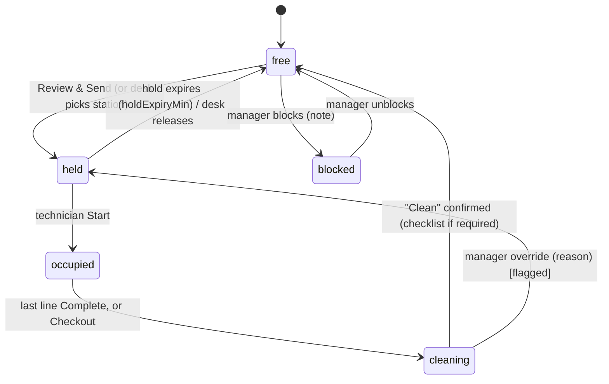

# NEXORA TOUCH — Stations & Cleaning Gate Spec v1 (POS v1.1)

**Status:** Draft for dev review · **Owner:** Brian Nguyen · **Date:** 2026-10-10 (rev 2 — one staff app with roles; no Clean tab; station mode off/manual/auto)
**Depends on:** `nexora-beeper-spec-v1.md` (Beep, Review & Send hook), `nexora-touch-ticket-workflow-spec-v2.md` (station hold §4.3, assignment states, privacy, audit)
**Prototypes:** `prototypes/nexora-pos-prototype-v34.html` (Stations injected into the Front Desk V33 prototype — the reference for placement), `prototypes/nexora-stations-prototype.html` (full lifecycle + dirty-chair scenario), `prototypes/nexora-stations-setup-prototype.html` (4-step setup; superseded by the one-screen setup in V34 but kept for the advanced options), `prototypes/technician-app-prototype-v2.html` (staff app with roles: technician · cleaner · manager — the reference for §7 app placement), `prototypes/nexora-cleaner-app-prototype.html` (early standalone cleaner tab — **superseded** by the role layer in technician-app v2)

---

## 0. Summary

Give every chair, table and room a code and a state, and put a **cleaning gate** between two guests: a station that just finished a guest is `cleaning` and **cannot be assigned** until someone confirms it clean. The confirmation is the sanitation signature and goes to an exportable log. Setup is one screen (three counts, three switches); the desk gets no new tab — a station strip and a station line inside what already exists.

## 1. Facts and constraints

| # | Fact | Source |
|---|---|---|
| S-F1 | Live POS has no station field; the ticket has a free-text NOTE whose placeholder mentions "Seat" | Owner POS, 2026-10-09 |
| S-F2 | Salon Settings tabs today: Salon Information · SMS Settings · Staff · Services · Roles & Permissions · Staff Levels; the V33 prototype adds Access & PIN and Payment Methods & Fees as PROPOSED | Owner POS + V33 |
| S-F3 | Ticket spec v2 §4.3 already defines a station hold: one ticket holds a station at a time; several lines on the same ticket may share it; released at checkout/void or when the desk moves the guest | Ticket spec v2 |
| S-F4 | Service categories (from Services tab): Pedicure, Manicure, Kid's Menu, Nail Enhancements, Shellac Service, Dipping Nail, Builder Gel & Gel-X, Additional Services, Waxing Services, Eyelash Extension | Owner POS |
| S-F5 | [Likely] Texas (TDLR) requires pedicure basins to be disinfected between clients and a cleaning record kept — **owner to confirm the exact rule before using it in marketing** | Owner to verify |

## 2. Decisions locked

| ID | Decision |
|---|---|
| SL1 | **List, not a floor drawing.** Zones → types → stations are a list; the Front Desk grid is rendered from it. No drag-and-drop plan in v1. |
| SL2 | **One-screen setup** (V34 Settings → Stations): three counts (spa chairs / tables / rooms) generate codes `P.n`, `A.n`, `R.n` and map categories by type; three switches; everything else is a default under "More options". |
| SL3 | **No new Front Desk tab.** Stations appear as a strip above the lanes on Today's Operations, a chip on guest cards, a Station line in Selected guest, and an alert line when cleaning is overdue. |
| SL4 | **Cleaning gate is hard.** `cleaning` and `blocked` stations never appear in the picker. Only a manager can override, with a mandatory reason, logged with a red flag. |
| SL5 | **No auto-clean on timer.** Timer expiry = alert and escalation, never "clean". |
| SL6 | **Station mode is salon-level:** `off` (default until stations exist) · `manual` · `auto` (pre-filled, desk still taps Review & Send). Saving the Stations setup switches the mode to `auto`. |
| SL7 | **Behavioural gate for technicians:** when `cleaner = last technician`, that technician's next Beep is held until their last station is confirmed clean. |
| SL8 | Station codes shown in all prototypes are samples; production stores the salon's own list. |
| SL9 | **One staff app, role-based home.** Technician, cleaner and manager use the same app; the role (from Staff → Roles & Permissions) decides the home screen. No separate cleaner or manager app. No new bottom tab: cleaning lives inside the existing ticket flow. |
| SL10 | **Manager app = what needs action now** (overdue cleaning, unanswered Beeps, approvals). Settings, reports and the full sanitation log stay on the POS web. |
| SL11 | Station pickers list **free stations only**, grouped by type with the type that fits the ticket first (🛁 spa chairs / 💅 tables / 🚪 rooms); prefix (P./A./R.) and icon identify the type everywhere. |

## 3. Data model

```ts
type StationType = { id: string; salonId: string; name: string;            // Spa chair · Table · Private room
  kind: "pedi" | "mani" | "room" | "custom";
  categories: string[];        // service categories this type can serve (S-F4)
  capacity: number;            // guests at once, default 1
  cleanMin: number;            // default pedi 10 · mani 5 · room 8 (owner confirms, [SO1])
  checklist: string[];         // "Clean" checklist items
  checklistRequired: boolean;  // default true for pedi, false otherwise
};
type Station = { id: string; salonId: string; code: string; zoneId: string; typeId: string;
  neighborCode: string | null; enabled: boolean;
  state: "free" | "held" | "occupied" | "cleaning" | "blocked";
  ticketId: string | null; technicianId: string | null;
  stateSince: string; cleaningDueAt: string | null;
  override: { byUserId: string; reason: string; at: string } | null;
  blockedNote: string | null; version: number };
type Zone = { id: string; salonId: string; name: string; order: number };
type SanitationRecord = { id: string; salonId: string; stationCode: string; ticketId: string | null;
  confirmedByUserId: string; confirmedAt: string; checklist: Array<{ item: string; checked: boolean }>;
  overdueMin: number; flagged: boolean; overrideReason: string | null };
type StationSettings = { mode: "off" | "manual" | "auto"; cleaner: "tech" | "cleaner" | "both";
  holdExpiryMin: number;       // default 15
  allowOverride: boolean;      // default true (manager role)
  beepCleanerOnOverdue: boolean; // default true
  suggestNeighborsForGroups: boolean }; // default true
```
Ticket gets `stationCode: string | null` (replaces the NOTE-derived seat from Beeper spec §8.1 when `mode != off`).

## 4. Lifecycle


Rules: station holds belong to the **ticket** (S-F3); a technician's `cant_come` does not release it. Group tickets share one station (capacity permitting). Every transition writes an audit event (ticket spec §4.7 shape) with `station.*` types.

## 5. Assignment integration

- Picker (Choose Tech / Selected guest / Review & Send confirm): lists **free stations only**, right type first (`pedi` if any pedicure line, else `mani`; `room` for Waxing/Eyelash), neighbours first for group tickets. `cleaning` stations may be shown dimmed with "N min left" but are not selectable.
- `auto`: server pre-fills the first eligible free station; the desk sees `Kayla · P.3` on the Review & Send confirmation with **Change**. Nothing is sent without the desk's tap.
- `manual`: picker shown, skippable; Review & Send shows "no station" softly.
- `off`: no station UI anywhere; Beep content falls back to NOTE seat (Beeper spec §8.1).
- Beep payload unchanged (ids only); the rich content adds `stationCode`.

## 6. Cleaning gate and escalation ladder

| Layer | Trigger | Who sees |
|---|---|---|
| 1 | Guest done → `cleaning`, countdown on the tile | Desk strip |
| 2 | `cleaningDueAt` passed → tile blinks red, **Overdue** KPI, red alert line on Today's Operations | Desk |
| 3 | Same moment → Beep to the cleaner (or last technician per `cleaner`) with "P.3 waiting — tap Clean when done" | Phone |
| 4 | No reply → Beep re-ring rules apply (Beeper spec §6.2); past max rings → manager notification "P.3 overdue N min, unconfirmed" | Manager |
| 5 | `cleaner = tech`: technician's next Beep is **held** with "Confirm P.3 clean first" (SL7) | Technician |

Override: manager role + reason (≥ 5 chars) → `held` with `override` set, `SanitationRecord.flagged = true`, red ⚑ on the ticket chip and on the technician's Beep card ("Station not confirmed clean — manager override").

## 7. UI placement (reference: V34)

**Front Desk · Today's Operations**
- Station strip above the three lanes: tiles `code · state · who/timer`, colours free/held/occupied/cleaning/blocked, overdue = red ring. Tap = filter lanes by station (v1) — in the prototype tap cycles the lifecycle for demo only.
- Alert line under the strip when any station is overdue: `⚠ P.3 cleaning overdue 12' · Technician C [Mark clean]`.
- Guest card: `st-chip` with the station code; red `⚑` chip when overridden.
- Selected guest: `Station: [P.3] auto · [picker]` — free stations only.

**Turn Board**: station chip on the technician row; `🧽 P.3` when their last station is unconfirmed.

**Salon Settings → Stations (PROPOSED, manager+)**: counts · mode · who confirms · checklist required · "More options" (cleaning minutes per type, rename zones/codes, neighbours, hold expiry, override, print labels with QR). Fifth card on Salon Information overview: "STATIONS · Chairs & cleaning".

**Staff app (technician-app-prototype-v2 is the reference)** — no new screens, no new tab:
- *Technician home ("My tickets")*: a **"🧽 Stations to clean"** strip appears only when one of the technician's own stations awaits confirmation (overdue = red); a push "Cleaning overdue · Pedi 3" opens the checklist; a red line "Your next Beep is held until the station is confirmed clean" (SL7).
- *Ticket screen*: the existing line flow stays (`Start` → `Modify` / `Complete`). When the technician completes the **last of their lines at a station**, that completed line shows **"🧽 Station clean · Pedi 3"**; it opens a checklist sheet (reuses the existing sheet component). The "Ready for checkout" block adds "Chair Pedi 3 is being cleaned — confirm clean to take the next guest".
- *Cleaner role*: home = "To clean" list of every station in `cleaning` (overdue first), same checklist sheet, same overdue push. No tickets. QR on the chair opens the checklist (v1.1).
- *Manager role*: home = **"Needs action"** — overdue stations (🔔 Beep cleaner / ✓ confirm on behalf, logged under the manager), technicians who did not answer a Beep (Beep again / Next tech), changes awaiting approval (reuses the existing approval action) — plus a station chip row. Manager override of a `cleaning` station with a reason happens here or on the POS.
- *What's New* gains one card: "Station clean after Complete".

## 8. Sanitation log and reports

- Every `Clean` confirmation = one `SanitationRecord`. Export CSV/PDF by day or month per salon; filter flagged.
- Reports (v1.1): station utilisation by hour, average cleaning time, overdue count by person, "guest waited while a free technician had no free station".

## 9. Acceptance criteria

| ID | Criterion |
|---|---|
| ST-1 | A station in `cleaning` or `blocked` is absent from every picker and from `auto` selection (unit + API test) |
| ST-2 | `Clean` with `checklistRequired` and any item unchecked is rejected; with all checked it writes a `SanitationRecord` and sets `free` |
| ST-3 | Timer expiry never changes state; it sets overdue flags and fires layers 2–4 exactly once per expiry |
| ST-4 | Manager override requires role + reason; it writes a flagged record and shows ⚑ on the ticket chip and technician Beep card |
| ST-5 | With `cleaner = tech`, a technician with an unconfirmed station receives no new Beep until confirmed (Beep stays queued) |
| ST-6 | Hold expires after `holdExpiryMin` with no Start → `free`, desk notified once |
| ST-7 | Group ticket lines share one station; capacity is enforced |
| ST-8 | `mode = off` hides all station UI and Beep content falls back to NOTE seat |
| ST-9 | Counts change regenerates codes without losing existing stations' history; disabled stations keep history |
| ST-10 | Export of the sanitation log for a date range contains station, time, user, checklist, overdue minutes, flag |
| ST-11 | All strings VI/EN; prototypes run their AI Smart Tour |
| ST-12 | The same app binary renders technician, cleaner and manager homes from the server-side role; a cleaner account receives no ticket data (ticket spec §10 allow-list) |
| ST-13 | Station pickers never list `cleaning`/`blocked` stations and are grouped by type with the fitting type first |

## 10. Open decisions

| ID | Question | Default |
|---|---|---|
| SO1 | Cleaning minutes per type (pedi/mani/room) | 10 / 5 / 8 |
| SO2 | Who confirms Clean at Bitcoin Nail Bar — last technician or a cleaner? | Last technician |
| SO3 | Real station list and neighbour pairs for Bitcoin Nail Bar | Sample codes until provided |
| SO4 | Is the TDLR cleaning-record requirement confirmed (S-F5)? | Treat as product value, not a legal claim, until confirmed |
| SO5 | QR label → checklist deep link uses One QR infrastructure? | v1.1, separate spike |
| SO6 | Tap on a strip tile in production: filter lanes vs. open station detail | Filter lanes |
