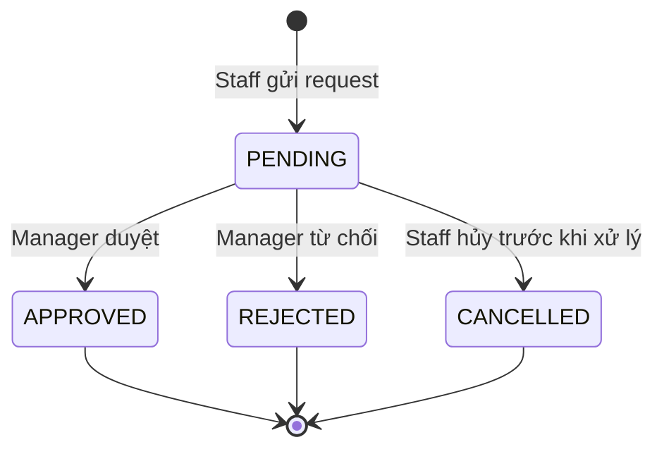

# 02 — Functional specification

## 1. Luồng màn hình

### F1. Add Staff [P0]

1. Owner/Manager nhập tên, điện thoại, POS role, staff level; chọn từng **service ID** mà nhân viên được làm. [P/D]
2. Chọn ngày làm và khoảng giờ của từng ngày. Mặc định an toàn: chưa cấu hình thì off; không tự công bố nhân viên trên booking. [P]
3. Chọn chính sách app phù hợp. Trước khi lưu, hệ thống kiểm tra trường bắt buộc, giờ nằm trong giờ mở cửa, giờ bắt đầu < giờ kết thúc và eligibility hợp lệ. [D]
4. Save tạo profile + service eligibility + schedule + app policy cùng một transaction; lỗi một phần thì không publish booking. [D]
5. Sau khi lưu, staff app xem lịch; booking chỉ thấy staff ở service và giờ phù hợp. [P]

**Không rõ [Q]:** xác minh điện thoại/invite login; level 2 cho Acrylic/Dip là điều kiện bắt buộc hay chỉ gợi ý? Prototype ghi “Level 2 or manager approval”. Đề nghị lưu rule trong service catalog/policy và yêu cầu manager override có audit.

### F2. Weekly Schedule Editor [P0]

- Manager chọn staff, xem 7 ngày; bật/tắt ngày và sửa giờ. Bản production cần hỗ trợ nhiều khoảng ca trong cùng ngày nếu salon dùng nghỉ giữa ca; prototype chỉ có một khoảng/ngày. [D/Q]
- Khi Save, kiểm tra validation và preview: số slot mất/thêm, booking đã xác nhận bị ảnh hưởng, coverage tụt dưới minimum. Nếu có booking bị ảnh hưởng, không tự đổi booking; đưa ra conflict cho manager giải quyết. [P/D]
- Sau lưu thành công, cập nhật availability và staff calendar. Nếu sync bất đồng bộ thất bại, UI phải báo trạng thái xử lý/lỗi thay vì giả vờ đã hoàn tất. [D]

### F3. Staff same-day availability [P0]

| Permission | Không có booking bị ảnh hưởng | Có booking bị ảnh hưởng |
|---|---|---|
| `ALLOWED` | Có thể đổi trạng thái trong ngày; tạo/chặn **booking mới** sau khi lưu. [P/D] | Áp dụng `bookedDayMode`: chặn hoặc chuyển `PENDING_APPROVAL`; booking cũ giữ nguyên. [D] |
| `REQUEST_APPROVAL` | Tạo yêu cầu, chờ manager duyệt. [P/D] | Tạo yêu cầu kèm conflict. [D] |
| `NOT_ALLOWED` | Ẩn hoặc disable thao tác; không gọi API mutation. [P/D] | Như bên trái. |

Toggle `Available` chỉ có hiệu lực trong **ngày hiện tại theo timezone salon**; không biến ngày off hoặc ngoài giờ salon thành ca làm. [D] Nếu staff muốn đổi giờ/ngày tương lai, đi qua request. Bật lại không mở slot đang bị break, booking, closure hay không đủ skill.

**Booking protection [P/Q]:** UI đưa ba lựa chọn “Block off toggle if appointments exist”, “Allow with manager approval”, “Allow and reassign”. Bản MVP đề nghị dùng hai hành vi đầu; `ALLOW_AND_REASSIGN` chỉ khả dụng sau khi có luồng reassign an toàn và được duyệt. Không tự hủy booking đã xác nhận.

### F4. Request day off / change hours / break [P0]

- Staff gửi date + reason cho day off; start/end cho đổi giờ; break cần ngày và khoảng thời gian. [P/D]
- API trả trạng thái `PENDING`; app hiển thị trong tab Requests. Manager xem tác động đến booking và coverage, duyệt hoặc từ chối, có thể ghi lý do. [P/D]
- Khi duyệt, ghi override/absence và phát hành phiên bản availability mới. Khi từ chối, schedule giữ nguyên. Staff nhận trạng thái mới. [D]
- Không cho tạo request trùng/chéo gây kết quả không rõ. Một request đã xử lý không được duyệt lần hai. [D]

### F5. My Calendar [P0]

- **Appointments:** lịch hẹn được gán cho staff, trạng thái và thời gian theo quyền hiển thị.
- **Work Schedule:** lịch tuần từ manager kết hợp ngoại lệ ngày; chỉ đọc đối với staff.
- **Requests:** các yêu cầu và trạng thái phê duyệt.
- Day view có mốc bắt đầu/kết thúc ca, booking, break và khoảng còn trống. “Open slot” cần xuất phát từ cùng availability engine như customer booking, tránh mâu thuẫn. [P/D]
- Nút “Message manager” trong prototype chưa có kênh/đối tượng cụ thể; dùng hệ thống nhắn tin hiện có hoặc tách backlog. [Q]

### F6. Customer booking [P0]

1. Khách chọn salon, service, ngày và (nếu cần) staff.
2. API trả các staff đủ điều kiện và start time phù hợp cho toàn bộ duration + buffer. [P/D]
3. Khi khách chọn slot, có thể hold ngắn hạn nếu booking flow hỗ trợ. Khi xác nhận, kiểm tra lại mọi điều kiện; nếu slot mất, trả conflict và gợi ý slot mới. [D]
4. Staff nghỉ hôm đó không xuất hiện như lựa chọn đặt được; staff bắt đầu trễ chỉ có slot sau thời điểm bắt đầu. [P]

### F7. Team coverage [P1]

Manager xem bảng tuần theo skill và ngày, tổng người làm, cảnh báo không đủ minimum hoặc quá nhiều người off. Minimum cấu hình theo skill, ngày hoặc mặc định toàn tuần [Q]. Một người có nhiều skill chỉ đóng góp coverage cho skill có chứng nhận/eligibility tương ứng; chỉ đếm nếu có khoảng làm việc hữu ích trong ngày. Quy tắc số giờ tối thiểu để “được tính” cần chốt. [D/Q]

### F8. Promotion readiness [P2]

Đọc coverage/capacity theo service và ngày để phát tín hiệu `READY`, `LOW_CAPACITY`, `UNAVAILABLE` cho Promotion Hub. Trước khi tự động dừng quảng cáo cần xác định tài khoản quảng cáo, quyền thực thi, ngưỡng và cách khôi phục. Prototype chỉ nêu ý tưởng, không đủ để triển khai automation thật. [P/Q]

## 2. Ma trận quyền mutation đề xuất [D]

| Thao tác | Owner | Manager | Staff | Front desk | Customer |
|---|---:|---:|---:|---:|---:|
| Xem lịch đội ngũ | ✓ | ✓ | Chỉ lịch mình | Theo phân quyền | — |
| Sửa profile/skill/schedule | ✓ | ✓ | — | — | — |
| Đổi policy app/coverage minimum | ✓ | Theo quyền Owner cấp | — | — | — |
| Toggle hôm nay | ✓ | ✓ | Theo policy | — | — |
| Gửi request | — | — | Của mình | — | — |
| Duyệt/từ chối request | ✓ | ✓ | — | — | — |
| Tạo booking | Theo quyền booking | Theo quyền booking | Theo quyền booking | Theo quyền booking | ✓ |

Mỗi mutation kiểm tra `salonId` và quyền trên server; UI ẩn nút không thay thế authorization.

## 3. State machine

Request đã `APPROVED/REJECTED/CANCELLED` là bất biến; nếu cần sửa thì tạo request mới. Schedule/override có version để chống hai người quản lý ghi đè nhau.

## 4. Validation và trạng thái lỗi

| Tình huống | Hành vi |
|---|---|
| Start ≥ end, ngày không hợp lệ, service không thuộc salon | Trả `422` và lỗi theo field; không lưu một phần. |
| Schedule vượt business hours | Chặn hoặc cho lưu nhưng chỉ tạo slot trong business hours; đề nghị chặn với thông báo rõ. [Q] |
| Có booking đã xác nhận trong khoảng bị đóng | Giữ booking, tạo conflict; policy quyết định chặn hay cần approval. |
| Manager A và B cùng sửa | `409 VERSION_CONFLICT`, tải lại dữ liệu và so sánh. |
| Staff offline / sync chậm | Hiển thị dữ liệu cuối cùng kèm thời gian cập nhật, retry idempotent; booking backend vẫn dùng dữ liệu chuẩn. |
| Booking bị lấy giữa lúc xem và xác nhận | `409 SLOT_UNAVAILABLE`, tải danh sách slot mới. |
| Không có slot | Empty state nêu ngày/service và cho đổi ngày hoặc chọn Any staff. |

## 5. Nội dung phải nhất quán

“Available today” nghĩa là staff **có thể nhận booking mới** trong giờ hợp lệ; không có nghĩa mọi phút đều trống. “Off today” không xóa booking cũ. “Sync” là cập nhật dữ liệu và phiên bản availability, không phải sửa trực tiếp mọi booking. Các nhãn số lượng slot/coverage phải tính từ API, không dùng giá trị demo trong HTML.
