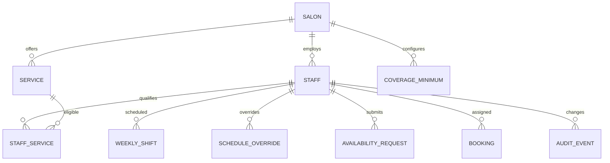

# 03 — Data model & API contract (đề xuất)

Các tên bảng/endpoint ở đây là [D]. Mapping sang schema và chuẩn API hiện tại của Nexora trước khi code. Dữ liệu nguồn của business hours, service và booking có thể đã tồn tại: tham chiếu thay vì tạo bản sao không đồng bộ.

## 1. Entity và quan hệ



| Entity | Trường quan trọng | Ràng buộc |
|---|---|---|
| `Salon` | `id`, `timezone` (IANA), `businessHours`, `closures` | Timezone bắt buộc; holiday/closure theo ngày địa phương. |
| `Staff` | `id`, `salonId`, `displayName`, `phone`, `posRole`, `staffLevel`, `status`, `version` | `status=ACTIVE` mới có thể book; unique ID theo salon. |
| `Service` | `id`, `salonId`, `durationMin`, `bufferBeforeMin`, `bufferAfterMin`, `requiredLevel`, `active` | Duration > 0; tham chiếu catalog hiện hữu. |
| `StaffService` | `staffId`, `serviceId`, `approvedBy`, `validFrom`, `validTo` | Chỉ service thuộc cùng salon; một cặp active duy nhất. |
| `WeeklyShift` | `id`, `staffId`, `weekday` 1–7, `startLocal`, `endLocal`, `effectiveFrom`, `effectiveTo` | Khoảng `[start,end)`; không chồng lấp cùng staff/ngày. |
| `ScheduleOverride` | `id`, `staffId`, `localDate`, `kind` (`OFF`,`HOURS`,`BREAK`,`AVAILABLE_TODAY`), `startLocal`, `endLocal`, `source`, `approvedBy`, `version` | Định nghĩa precedence ở file 04; khoảng giờ hợp lệ. |
| `AppPolicy` | `staffId` hoặc salon default, `sameDayMode`, `futureChangeMode`, `bookedDayMode`, `version` | Enum được server validate. |
| `AvailabilityRequest` | `id`, `staffId`, `kind`, `localDate`, `startLocal`, `endLocal`, `reasonCode`, `status`, `submittedAt`, `decidedBy`, `decidedAt`, `decisionNote`, `version` | Chỉ chuyển trạng thái hợp lệ; chống xử lý lặp. |
| `Booking` | `id`, `salonId`, `staffId`, `serviceId`, `startsAt`, `endsAt`, `status` | Khoảng UTC; status nào chiếm chỗ phải được định nghĩa. |
| `CoverageMinimum` | `salonId`, `skillId`/`serviceGroupId`, `weekday`, `minStaff`, `minMinutes` | P1; `minStaff ≥ 0`. |
| `AvailabilityConflict` | `id`, `bookingId`, `staffId`, `changeRef`, `status`, `resolvedBy`, `resolution` | Một conflict active/booking/change; booking giữ nguyên tới khi xử lý. |
| `AuditEvent` | `id`, `actorId`, `salonId`, `entityType`, `entityId`, `before`, `after`, `occurredAt`, `requestId` | Append only; giới hạn dữ liệu nhạy cảm. |

`staffLevel` không thay thế `StaffService`: quyền làm từng dịch vụ phải tường minh. Break là khoảng unavailable, không phải booking. Các khoảng thời gian dùng biên nửa mở `[start,end)` để booking kết thúc lúc 11:00 có thể đứng trước booking bắt đầu 11:00 nếu buffer bằng 0.

## 2. API đề xuất

Base path ví dụ: `/v1/salons/{salonId}`. Authentication và định dạng lỗi nên theo chuẩn hệ thống hiện có. Header mutation `Idempotency-Key` cho tạo request/booking; `If-Match` hoặc `version` cho update.

| Method + path | Vai trò | Hành vi / response |
|---|---|---|
| `GET /staff?status=active` | Manager | Danh sách staff, skill, trạng thái hôm nay, phân trang. |
| `POST /staff` | Owner/Manager | Tạo profile + skill + schedule + policy nguyên tử; `201`. |
| `PATCH /staff/{staffId}` | Owner/Manager | Sửa profile/eligibility có version; `200/409`. |
| `GET /staff/{staffId}/schedule?from=&to=` | Manager/owner hoặc staff đó | Weekly shift + override + lịch hiệu lực. |
| `PUT /staff/{staffId}/weekly-schedule` | Owner/Manager | Thay toàn bộ cấu hình tuần trong một transaction; trả version và impact. |
| `POST /staff/{staffId}/schedule-preview` | Owner/Manager | Dry run cho slot/booking/coverage bị ảnh hưởng, không ghi dữ liệu. |
| `GET /staff/{staffId}/calendar?from=&to=` | Staff đó/Manager | Appointment, shift, break, request theo phạm vi quyền. |
| `PUT /staff/{staffId}/app-policy` | Owner/Manager được cấp quyền | Lưu policy. |
| `POST /staff/me/availability-today` | Staff | Toggle hoặc request theo policy; trả `APPLIED` hay `PENDING_APPROVAL`. |
| `POST /staff/me/availability-requests` | Staff | Tạo day-off, hours, break request; `201`. |
| `GET /availability-requests?status=pending` | Manager | Hàng chờ có impact summary. |
| `POST /availability-requests/{id}/decision` | Owner/Manager | Approve/reject nguyên tử; `200/409`. |
| `GET /availability?serviceId=&date=&staffId=` | Customer/booking UI | Staff và slots bookable; không trả lý do nghỉ hay dữ liệu cá nhân. |
| `POST /bookings` | Theo booking role | Revalidate và tạo booking atomically; `201` hoặc `409 SLOT_UNAVAILABLE`. |
| `GET /coverage?weekStart=` | Manager | P1: ma trận skill/ngày, minimum, cảnh báo. |
| `GET /audit-events?...` | Owner/Manager có quyền | Lịch sử thay đổi, phân trang. |

### Ví dụ: schedule update

```http
PUT /v1/salons/salon_123/staff/staff_456/weekly-schedule
If-Match: "7"
Content-Type: application/json

{
  "timezone": "America/Chicago",
  "effectiveFrom": "2026-10-12",
  "shifts": [
    {"weekday": 1, "startLocal": "10:00", "endLocal": "19:00"},
    {"weekday": 2, "startLocal": "10:00", "endLocal": "19:00"}
  ],
  "conflictAction": "REQUIRE_REVIEW"
}
```

```json
{
  "staffId": "staff_456",
  "version": 8,
  "availabilityVersion": 342,
  "impact": {"newSlots": 14, "removedSlots": 6, "existingBookingConflicts": 1},
  "syncState": "PENDING"
}
```

Các ngày không có trong `shifts` là off trong effective period. Nếu lịch có hiệu lực từ một ngày giữa tuần, resolver chọn phiên bản lịch theo **ngày địa phương**. [D]

### Ví dụ: availability response

```json
{
  "serviceId": "svc_gel_pedicure",
  "localDate": "2026-10-15",
  "timezone": "America/Chicago",
  "generatedAt": "2026-10-09T15:00:00Z",
  "availabilityVersion": 342,
  "staff": [{
    "staffId": "staff_456",
    "displayName": "Kayla",
    "slots": [
      {"startsAt": "2026-10-15T15:00:00Z", "endsAt": "2026-10-15T16:00:00Z"}
    ]
  }]
}
```

Public API không trả staff off, pending request, reason hoặc booking chi tiết. Một staff có zero slot có thể bị ẩn; nếu UX muốn hiển thị “Unavailable”, trả trạng thái công khai riêng không lộ nguyên nhân. [Q]

### Error envelope

```json
{"error":{"code":"SLOT_UNAVAILABLE","message":"This time is no longer available.","details":{"serviceId":"svc_gel_pedicure","localDate":"2026-10-15"},"requestId":"req_abc"}}
```

Các mã tối thiểu: `VALIDATION_ERROR` (422), `FORBIDDEN` (403), `NOT_FOUND` (404), `VERSION_CONFLICT` (409), `BOOKING_CONFLICT` (409), `SLOT_UNAVAILABLE` (409), `POLICY_REQUIRES_APPROVAL` nếu client dùng sai flow, `RATE_LIMITED` (429).

## 3. Sự kiện và đồng bộ [D]

Sau commit, outbox phát `staff.schedule.changed`, `staff.eligibility.changed`, `staff.policy.changed`, `availability.request.decided`, `booking.changed`. Consumer invalidate/rebuild cache availability và thông báo staff app. Event gồm `eventId`, `salonId`, `staffId`, `availabilityVersion`, `occurredAt`, `correlationId`; xử lý idempotent và bỏ qua version cũ. Source of truth là database giao dịch; cache/search/notification là bản sao. Nếu hàng đợi lỗi, retry + dead-letter + cảnh báo vận hành. Không hiển thị “synced” khi worker chưa hoàn tất.

## 4. Migration và retention [Q]

Map lịch hiện tại, skill hiện tại và booking hiện hữu sang schema mới; không mặc nhiên cho mọi staff làm mọi service. Xác định quy tắc backfill, thời hạn lưu audit/request, khả năng xóa/ẩn PII và quy trình rollout trước khi triển khai.
