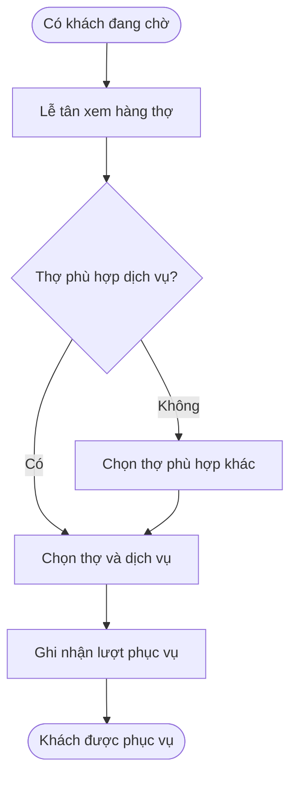
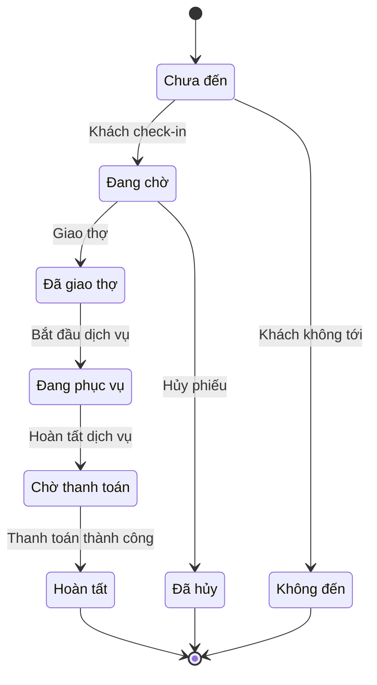
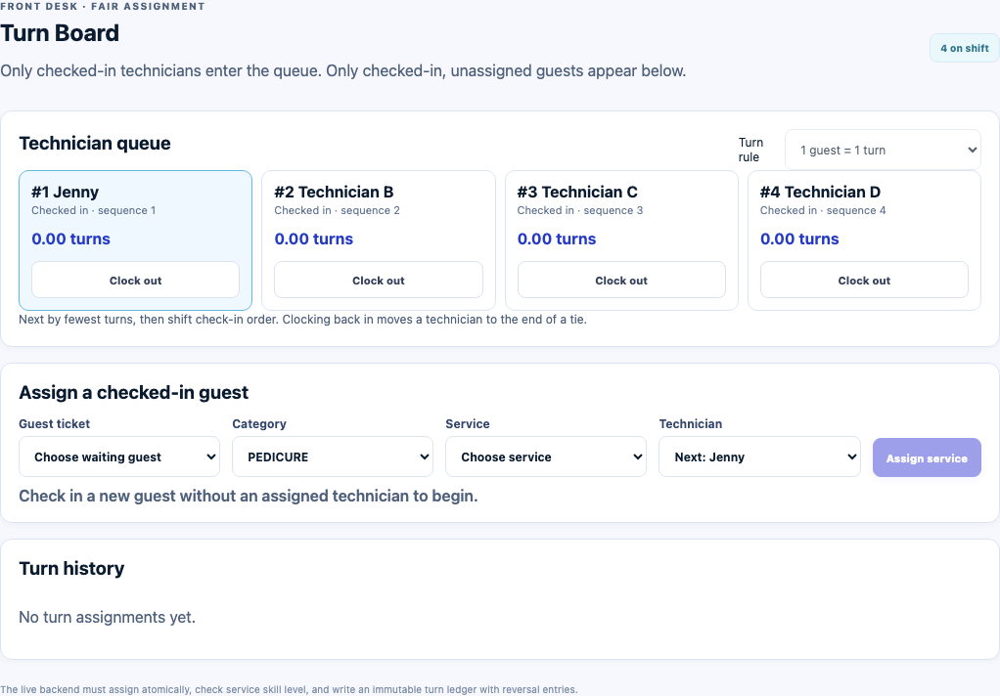
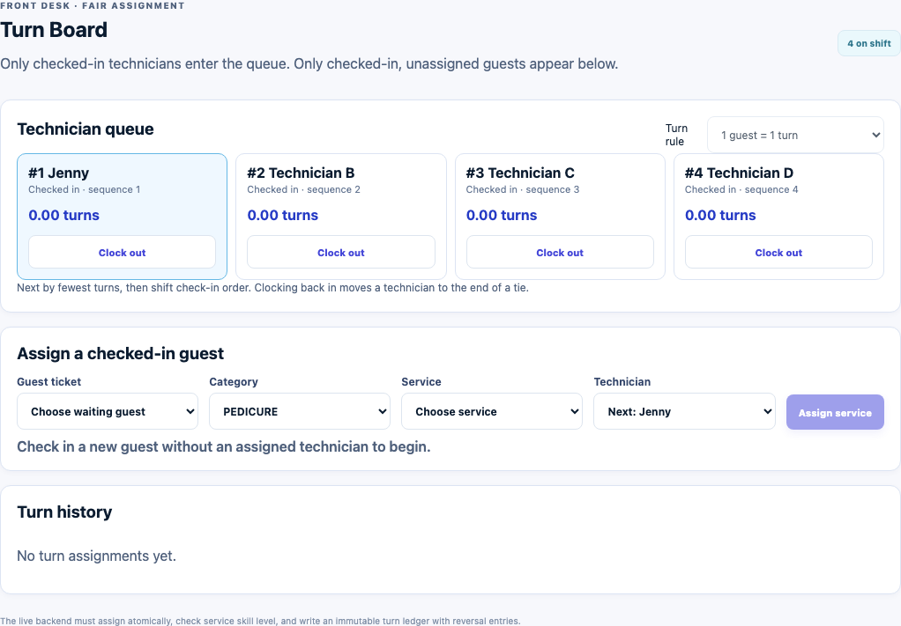
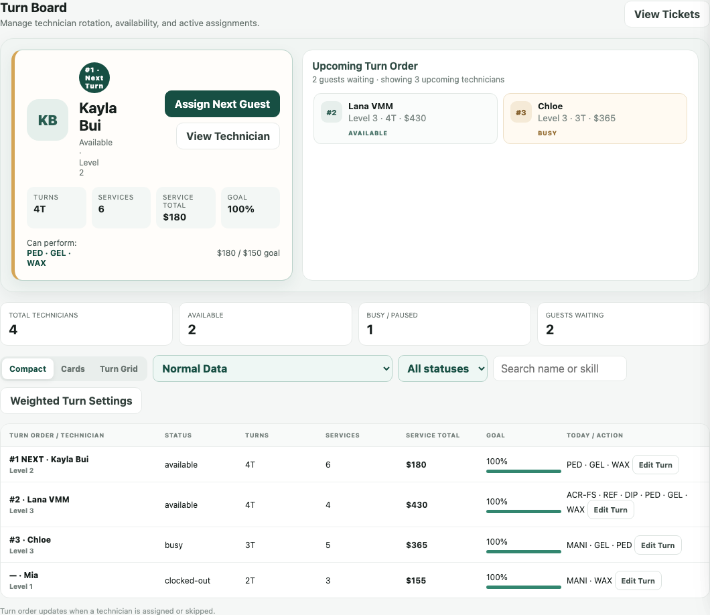
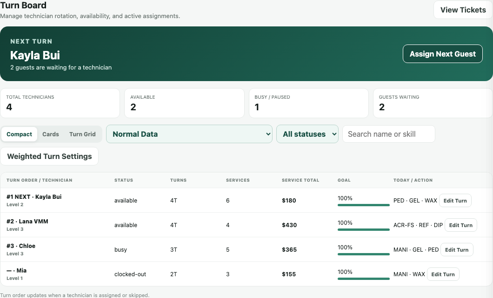
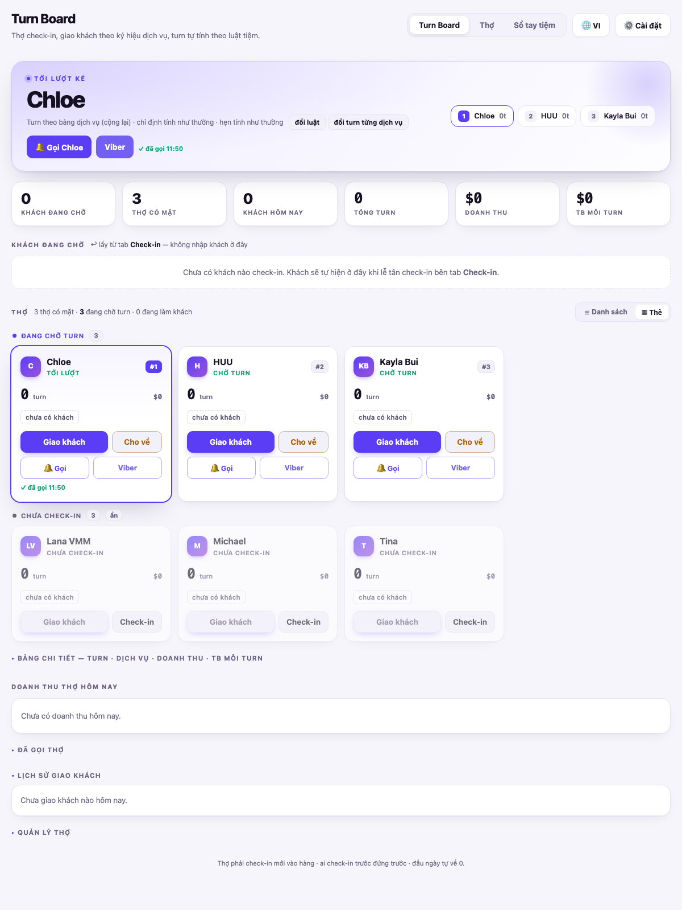

## So sánh màn hình Turnboard

**Cập nhật:** 4 tháng 11 năm 2026  
**Đối tượng:** PO, BA, thiết kế và phát triển  
**Trạng thái:** Bản đối chiếu để rà soát

### Tóm tắt nhanh

Bảng chỉ gồm 6 HTML có màn hình Turnboard. Các trang menu và giới thiệu đã được bỏ khỏi phạm vi so sánh. Bảng HTML kèm theo có ảnh nhúng, bộ lọc và chức năng phóng to ảnh. Sáu cột mẫu mô tả HTML của PO; cột Đang chạy trên web đối chiếu code master. Bảng chưa xác nhận phiên bản đang triển khai trên web.

[Mở bảng so sánh có ảnh và liên kết đến các HTML gốc](so-sanh-turnboard.html)

### Tổng quan

Bảng đối chiếu giúp chọn bố cục và xác định khác biệt về luật xếp lượt, giao khách, tay nghề và vị trí thực hiện. Lễ tân dùng Turnboard để giao khách; quản lý và chủ tiệm thiết lập luật, tay nghề và điều chỉnh lượt. Sáu bản mẫu được đối chiếu với code master của frontend và backend trong ma trận.

### Khái niệm chính

| Khái niệm | Ý nghĩa trong bảng |
| --- | --- |
| Lượt phục vụ (turn) | Đơn vị so sánh mức phục vụ giữa các thợ; mỗi nhóm prototype có cách quy đổi riêng. |
| Prototype | Giao diện có dữ liệu mẫu, có thể có thao tác trong trình duyệt; chưa chứng minh tích hợp sản phẩm thật. |
| Đặc tả | Yêu cầu được viết trong tài liệu. |

### Vai trò người dùng

| Vai trò | Trách nhiệm trong phạm vi đối chiếu |
| --- | --- |
| Lễ tân | Xem khách chờ, chọn dịch vụ và giao thợ. |
| Quản lý / chủ tiệm | Thiết lập luật, tay nghề và điều chỉnh lượt. |
| Thợ | Vào ca và nhận khách theo trạng thái, tay nghề và luật của tiệm. |
| PO / BA / thiết kế | Chọn bố cục và chốt các khác biệt giữa tài liệu. |

### Luồng nghiệp vụ

#### Luồng: Giao khách từ hàng chờ

**Vai trò chính:** Lễ tân  
**Bắt đầu:** Có khách chờ và thợ đã vào ca.  
**Kết quả:** Dịch vụ được giao cho thợ, lượt được ghi theo công thức của bản mẫu.

**Câu chuyện người dùng:**

- Là lễ tân, tôi muốn xem thợ đủ điều kiện để giao khách phù hợp.
- Là lễ tân, tôi muốn chọn thợ khác khi thợ tiếp theo không phù hợp để khách tiếp tục được phục vụ.

| Bước | Ai thực hiện | Thao tác | Kết quả thể hiện trong tài liệu |
| --- | --- | --- | --- |
| 1 | Lễ tân | Nhận khách | Khách xuất hiện trong danh sách chờ. |
| 2 | Lễ tân / bản mẫu | Xem trạng thái, kỹ năng và thứ tự thợ | Hiển thị thợ hoặc gợi ý đủ điều kiện; phạm vi khác nhau theo từng bản. |
| 3 | Lễ tân | Chọn dịch vụ, thợ và vị trí nếu có | Bản mẫu lưu phần giao việc. |
| 4 | Bản mẫu | Ghi lượt và lịch sử nếu có | Cách tính và khả năng hoàn tác khác nhau; xem bảng so sánh. |

### Cấu hình và quản lý

- Là quản lý, tôi muốn so sánh luật tính lượt và điều kiện tay nghề để chọn cấu hình phù hợp cho tiệm.
- Là quản lý, tôi muốn biết đâu là thao tác có trong mẫu và đâu là nội dung mới chỉ mô tả để chốt phạm vi triển khai.

### Vòng đời trạng thái

Các trạng thái sau được viết trong tài liệu Developer Handoff; đây chưa phải trạng thái đầy đủ đã có ở mọi prototype.

| Trạng thái hiện tại | Sự kiện | Trạng thái tiếp theo |
| --- | --- | --- |
| Chưa đến | Khách check-in | Đang chờ |
| Đang chờ | Giao thợ hợp lệ | Đã giao thợ |
| Đã giao thợ | Bắt đầu dịch vụ | Đang phục vụ |
| Đang phục vụ | Hoàn tất dịch vụ | Chờ thanh toán |
| Chờ thanh toán | Thanh toán thành công | Hoàn tất |
| Chưa đến | Khách không tới | Không đến |
| Đang chờ | Hủy phiếu | Đã hủy |

### Quy tắc đọc bảng

1. Ảnh UI là ảnh chụp HTML đã mở, không phải ảnh được vẽ lại.
2. Các cột mẫu mô tả HTML của PO; cột Đang chạy trên web đọc code master. Chưa dùng kết quả này để xác nhận bản đang triển khai.
3. Cột cuối ghi khác biệt và giới hạn ở đúng file liên quan.

Thứ tự hiển thị: từ mới đến cũ theo ngày tài liệu đã xác nhận. Số # tăng từ cũ đến mới: #1 là bản cũ nhất, #6 là bản mới nhất.
Ngày đính kèm lấy từ nội dung HTML hoặc thông tin đã xác nhận. Ngày dữ liệu demo được ghi riêng và không dùng để xác định phiên bản mới hay cũ.

### Bảng so sánh UI và tính năng

| Mã / file | Ảnh Turnboard | Tính năng | Khác biệt và giới hạn |
| --- | --- | --- | --- |
| **#6 · POS V34 · Stations** Ngày tài liệu: 12 tháng 10 năm 2026 (đã xác nhận) |  | Giữ 4 luật tính lượt, Clock in/out, tay nghề, giao dịch vụ, lịch sử và hoàn tác. Bổ sung chọn ghế, bàn hoặc phòng khi giao dịch vụ từ Turnboard. Có chế độ tự chọn vị trí trống đúng loại; vị trí gắn với phiếu dịch vụ. | So với #4, phần dựng UI Turnboard chỉ thêm lựa chọn Station. Luồng giao dịch vụ còn bổ sung giữ vị trí cho phiếu.  Trường Station phụ thuộc cấu hình vị trí. Đây vẫn là dữ liệu mẫu; khóa vị trí và chống xung đột giữa nhiều máy chưa được xác minh trên server. |
| **#5 · POS feedback · Products & Other Sales** Ngày tài liệu: 9 tháng 10 năm 2026 (đã xác nhận) |  | Cùng thẻ thợ, Clock in/out và biểu mẫu giao khách như #4. Cùng 4 cách tính lượt, kiểm tra tay nghề, lịch sử lượt và Undo. | Phần dựng giao diện Turnboard giống hệt #4. Hai file vẫn khác nhau ở các phần khác của ứng dụng.  Cùng giới hạn lưu dữ liệu demo và xác thực vai trò của #4. Không dùng tên file để suy ra Turnboard đã được nâng cấp. |
| **#4 · POS feedback · prototype (1)** Ngày tài liệu: 8 tháng 9 năm 2026 (đã xác nhận) |  | Chỉ đưa thợ đã Clock in vào hàng; xếp theo ít lượt nhất rồi theo thứ tự vào ca. Chọn khách đã check-in, nhóm dịch vụ, dịch vụ và thợ đủ tay nghề. Có 4 cách tính lượt: đầu khách, dịch vụ, thời gian và bậc giá; Owner đổi luật và cấp tay nghề. Giao dịch vụ ghi lịch sử lượt; Undo tạo một dòng hoàn tác và trả lại lượt. | Dùng làm bản đối chiếu nền của nhóm POS. #5 có cùng Turnboard; #6 bổ sung vị trí thực hiện.  Không có bộ Compact / Cards / Turn Grid như #2–3. Dữ liệu demo ở trong phiên trình duyệt; PIN vai trò là mô phỏng, chưa phải xác thực server. |
| **#3 · Front Desk · bản (1)** Ngày tài liệu: 7 tháng 9 năm 2026 (đã xác nhận) |  | Giữ 3 cách xem, lọc thợ, thêm/chỉnh lượt và mục tiêu như bản gốc. Thẻ Next Turn có số liệu chi tiết và nút View Technician. Cửa sổ giao khách tách System recommendation và Final assignment; giữ thông tin thợ khách đã đặt. Với nhiều dịch vụ, gợi ý một thợ làm toàn bộ hoặc chia dịch vụ cho nhiều thợ; giải thích thợ bị bỏ qua vì tay nghề vẫn giữ lượt. | Bản rõ nhất trong nhóm Front Desk về thợ tiếp theo và gợi ý giao nhiều dịch vụ. Các số liệu của thợ xuất hiện ngay trên thẻ chính.  Luật tính lượt có cùng giới hạn như bản gốc: Save Rules chưa cập nhật công thức. Chia dịch vụ và bảo vệ lượt là mô phỏng; chưa chứng minh luồng thanh toán và lượt khớp hoàn toàn. |
| **#2 · Front Desk · bản gốc** Ngày tài liệu: 4 tháng 9 năm 2026 (đã xác nhận) |  | Hiển thị lượt, số dịch vụ, tổng tiền dịch vụ và tiến độ mục tiêu của từng thợ. Tìm thợ, lọc trạng thái và đổi giữa 3 cách xem; có dữ liệu mẫu cho tiệm lớn. Có giao khách tiếp theo, chỉnh lượt, thêm lượt có lý do và màn hình tính lượt theo giá trị dịch vụ. Cửa sổ giao khách có thợ, lý do bỏ lượt, ghế/bàn/phòng, ghi chú và lựa chọn in phiếu. | Cho thấy Turnboard nằm trong toàn bộ luồng Front Desk. Khối Next Turn gọn hơn bản (1).  Nút Save Rules chỉ đóng cửa sổ và báo đã lưu; công thức vẫn cố định trong bản mẫu. Luồng Assign Next Guest cộng 1 lượt, chưa áp dụng đồng nhất công thức theo giá trị. |
| **#1 · TurnBoardBanMau** Ngày tài liệu: 25 tháng 8 năm 2026 (đã xác nhận) |  | Xếp thợ theo số lượt tăng dần, sau đó theo thứ tự check-in. Giao từng dịch vụ cho thợ; tự đề xuất theo tay nghề, trạng thái rảnh và lựa chọn ưu tiên của tiệm. Có 5 cách tính lượt: thời gian, bảng dịch vụ, ngưỡng giá, bậc giá và đầu khách. Có luật riêng cho khách chỉ định và khách hẹn; hồ sơ tay nghề, gọi thợ và hoàn tác lần giao gần nhất. | Tập trung sâu vào luật xếp lượt. Linh hoạt hơn các bản POS về cách tính lượt và ưu tiên tự chọn thợ.  Dữ liệu lưu trong trình duyệt. Gọi qua app chỉ ghi nhận mô phỏng; thông báo thật và Viber chưa được xác minh. Ảnh dùng dữ liệu mẫu: 6 thợ, 3 người đã check-in. |

### Ma trận tính năng Turnboard

**Cột Đang chạy trên web:** Đối chiếu code master của frontend và backend đã lấy lại ngày 4 tháng 11 năm 2026. Chưa xác minh phiên bản đang triển khai hoặc cấu hình tiệm trên web.

| Tiêu chí | Đang chạy trên web Đối chiếu code master 4 tháng 11 năm 2026 | #6 · POS V34 · Stations 12 tháng 10 năm 2026 | #5 · POS feedback · Products & Other Sales 9 tháng 10 năm 2026 | #4 · POS feedback · prototype (1) 8 tháng 9 năm 2026 | #3 · Front Desk · bản (1) 7 tháng 9 năm 2026 | #2 · Front Desk · bản gốc 4 tháng 9 năm 2026 | #1 · TurnBoardBanMau 25 tháng 8 năm 2026 |
| --- | --- | --- | --- | --- | --- | --- | --- |
| Cách hiển thị | Đã có — Compact / Thẻ thợ / Turn Grid; có tìm theo tên hoặc dịch vụ và lọc trạng thái. | Thẻ thợ + biểu mẫu | Thẻ thợ + biểu mẫu | Thẻ thợ + biểu mẫu | Compact / Cards / Grid | Compact / Cards / Grid | Danh sách / Thẻ |
| Thợ tới lượt kế tiếp | Có một phần — Đã đánh dấu Next Turn theo lượt, giá trị dịch vụ chưa chốt và thời gian chờ. Chưa có danh sách Upcoming riêng và mở nhanh hồ sơ như bản mẫu. | Giống #4 | Giống #4 | Thẻ #1 nổi bật | Thẻ chi tiết + Upcoming | Thanh Next Turn | Khối nổi bật + hàng chờ |
| Cách tính lượt | Có một phần — Bậc giá dịch vụ và lượt cho thợ khách chỉ định; lưu luật qua API. Chưa có cách tính theo thời lượng, bảng lượt riêng từng dịch vụ hoặc đầu khách. | Giống #4 | Giống #4 | 4 cách; Owner chọn | Như #2 | Theo giá trị; cấu hình mô phỏng | 5 cách + luật khách chỉ định / hẹn |
| Tay nghề | Có một phần — Đã có dịch vụ được phép làm và cấp thợ chung. Chưa có mức chuyên theo từng dịch vụ, đánh giá tiếng Anh và phục vụ như bản mẫu. | Giống #4 | Giống #4 | Theo nhóm dịch vụ; 3 mức | Như #2 + gợi ý nhiều dịch vụ | Cấp thợ + dịch vụ được phép | Theo từng dịch vụ; 3 mức |
| Giao khách nhiều dịch vụ | Có một phần — Giao theo từng dòng hoặc nhóm, lưu nhiều phân công một lần. Chưa có hai phương án tự đề xuất một thợ làm hết hoặc chia nhiều thợ. | Giống #4 | Giống #4 | Một dịch vụ mỗi thao tác | Gợi ý một thợ / chia dịch vụ | Chọn thợ trong cửa sổ giao khách | Chọn thợ cho từng dịch vụ |
| Ghế / bàn / phòng | Chưa có — Stations hiện là thẻ thợ. Chưa có vị trí vật lý, tự chọn vị trí, giữ chỗ và dọn chỗ trong luồng này. | Có Station; tự chọn / chọn tay | Không có ở biểu mẫu Turnboard | Không có ở biểu mẫu Turnboard | Có trường vị trí + ghi chú khách | Có trường vị trí | Không có trường riêng trong giao khách |
| Sửa lượt / hoàn tác | Có một phần — Đã thêm/sửa lượt tại Grid và gỡ/đổi thợ trong phiếu. Chưa có lý do khi chỉnh lượt hoặc Undo lần giao gần nhất như bản mẫu. | Giống #4 | Giống #4 | Undo ghi dòng hoàn tác | Như #2 | Add Turn / Edit Turn có lý do | Hoàn tác lần giao gần nhất |
| Doanh thu / mục tiêu | Có một phần — Có lượt, số dịch vụ, tiền dịch vụ và giờ làm. Chưa có mục tiêu ngày, tiến độ, trung bình mỗi lượt hoặc gợi ý bù cơ hội. | Giống #4 | Giống #4 | Hiển thị số lượt trên hàng thợ | Đưa số liệu lên thẻ Next Turn | Tổng dịch vụ + mục tiêu thợ | Doanh thu + trung bình mỗi lượt |
| Thử tiệm lớn | Không có bộ demo — Không có nút nạp bộ 50 thợ / 36 khách chờ trong phần Turnboard của master. Chưa đánh giá khả năng vận hành với dữ liệu lớn thực tế. | Không có bộ tương ứng | Không có bộ tương ứng | Không có bộ tương ứng | Có bộ 50 thợ / 36 khách chờ | Có bộ 50 thợ / 36 khách chờ | Không có bộ 50 thợ riêng |

### Vì sao POS feedback và V34 gần giống nhau?

| Phần Turnboard | POS feedback #4 | V34 #6 |
| --- | --- | --- |
| Thẻ thợ, hàng chờ, luật tính lượt | Bố cục nền | Cùng bố cục và logic |
| Biểu mẫu giao khách | Khách, nhóm dịch vụ, dịch vụ, thợ | Thêm Station |
| Vị trí thực hiện | Không có trong biểu mẫu này | Chọn hoặc tự chọn ghế, bàn, phòng; gắn vào phiếu |

Khi tắt quản lý vị trí, trường Station bị ẩn nên V34 gần như giống bản feedback. Phần dựng Turnboard của #4 và #5 giống hệt nhau.

### Ví dụ — chỉ minh họa, không phải cấu hình đã chốt

| Tình huống | #2–3 theo công thức có sẵn | #4–6 khi chọn luật theo giá |
| --- | --- | --- |
| Dịch vụ trị giá $50 | 1 lượt | 0,5 lượt |

### Tiêu chí hoàn thành bản đối chiếu

- Bảng chính chỉ có 6 file có màn hình Turnboard.
- Ảnh chính tập trung vào đúng vùng Turnboard.
- Khác biệt được xét trên màn hình và luồng Turnboard.
- File có cùng phần dựng Turnboard được ghi rõ.

### Ngoại lệ

| Trường hợp | Cách đọc | Phụ trách |
| --- | --- | --- |
| #4 và #5 có cùng Turnboard | Giữ hai nguồn, không tính là hai thiết kế khác nhau | PO / thiết kế |
| V34 tắt quản lý vị trí | Station bị ẩn; UI gần giống #4 | PO / thiết kế |
| Nút có trên UI nhưng chưa đổi công thức | Đọc giới hạn ở đúng dòng | PO / phát triển |

### Câu hỏi thường gặp

**6 file có phải 6 thiết kế hoàn toàn khác nhau không?**  
Không. Chúng thuộc 3 nhóm giao diện; #4 và #5 có cùng phần dựng Turnboard. V34 chỉ bổ sung vị trí trên nền nhóm POS.

### Tính năng liên quan

- Check-in cung cấp khách chờ; hồ sơ thợ cung cấp tay nghề.
- Phiếu dịch vụ lưu thợ, dịch vụ và vị trí được giao.

### Phụ lục

#### Nội dung cần PO chốt

| Nội dung | Quyết định cần đưa ra | Phụ trách |
| --- | --- | --- |
| Bố cục | Turnboard riêng, Front Desk hoặc nhóm POS | PO / thiết kế |
| Công thức lượt | Cách quy đổi và luật cho khách chỉ định / hẹn | PO |
| Nhiều dịch vụ | Một thợ làm toàn bộ hoặc chia nhiều thợ | PO |
| Vị trí | Có quản lý ghế, bàn và phòng khi giao khách hay không | PO |

#### Tham chiếu nguồn

[Developer Handoff](html/pos-prototype/developer-handoff.html) là tài liệu tham khảo quy tắc, không nằm trong bảng UI. Thuật ngữ tham khảo glossary của workspace đã dùng khi biên soạn.

- #6: [nexora-pos-12-10/nexora-pos-prototype-v34.html](html/nexora-pos-12-10/nexora-pos-prototype-v34.html) — nội dung `610810d0c821b0a0`.
- #5: [nexora-pos-feedback-9-10/nexora-pos-products-other-sales.html](html/nexora-pos-feedback-9-10/nexora-pos-products-other-sales.html) — nội dung `01d9d272d367df45`.
- #4: [nexora-pos-feedback-9-10/nexora-pos-prototype (1).html](html/nexora-pos-feedback-9-10/nexora-pos-prototype%20(1).html) — nội dung `5a8a0ff7fe131575`.
- #3: [pos-prototype/front-desk-prototype (1).html](html/pos-prototype/front-desk-prototype%20(1).html) — nội dung `047a8514f254c41d`.
- #2: [pos-prototype/front-desk-prototype.html](html/pos-prototype/front-desk-prototype.html) — nội dung `b12b1bd80e721a5b`.
- #1: [TurnBoardBanMau.html](html/TurnBoardBanMau.html) — nội dung `1b60a11d1b666829`.

#### Căn cứ cột Đang chạy trên web — nhánh master

Đối chiếu code master của frontend và backend đã lấy lại ngày 4 tháng 11 năm 2026. Chưa xác minh phiên bản đang triển khai hoặc cấu hình tiệm trên web.

- FE: [`56ad71bbf7ff2ecb8ea9816fd232664aba8af621`](https://github.com/vlink-group/vlink-nexora-fe/commit/56ad71bbf7ff2ecb8ea9816fd232664aba8af621).
- BE: [`2d7a0762a613b6ba629fa62ad3bea61539e71b14`](https://github.com/vlink-group/vlink-nexora/commit/2d7a0762a613b6ba629fa62ad3bea61539e71b14).

| Mã / tiêu chí | Code đã đối chiếu |
| --- | --- |
| M01 · Cách hiển thị | [FE · PosFrontDeskView.tsx:2270](https://github.com/vlink-group/vlink-nexora-fe/blob/56ad71bbf7ff2ecb8ea9816fd232664aba8af621/src/components/dashboard/views/pos/PosFrontDeskView.tsx#L2270) |
| M02 · Thợ tới lượt kế tiếp | [FE · posNextTurn.ts:23](https://github.com/vlink-group/vlink-nexora-fe/blob/56ad71bbf7ff2ecb8ea9816fd232664aba8af621/src/components/dashboard/views/pos/posNextTurn.ts#L23) [FE · PosFrontDeskView.tsx:1318](https://github.com/vlink-group/vlink-nexora-fe/blob/56ad71bbf7ff2ecb8ea9816fd232664aba8af621/src/components/dashboard/views/pos/PosFrontDeskView.tsx#L1318) |
| M03 · Cách tính lượt | [FE · WeightedTurnSettingsModal.tsx:175](https://github.com/vlink-group/vlink-nexora-fe/blob/56ad71bbf7ff2ecb8ea9816fd232664aba8af621/src/components/dashboard/views/pos/modals/WeightedTurnSettingsModal.tsx#L175) [BE · PosTurnSettings.cs:9](https://github.com/vlink-group/vlink-nexora/blob/2d7a0762a613b6ba629fa62ad3bea61539e71b14/backend/src/Domain/Entities/Pos/PosTurnSettings.cs#L9) [BE · PosTurnCreditResolver.cs:68](https://github.com/vlink-group/vlink-nexora/blob/2d7a0762a613b6ba629fa62ad3bea61539e71b14/backend/src/Application/Features/Pos/Orders/Common/PosTurnCreditResolver.cs#L68) [BE · PosBookingTurnCredits.cs:7](https://github.com/vlink-group/vlink-nexora/blob/2d7a0762a613b6ba629fa62ad3bea61539e71b14/backend/src/Application/Features/Pos/Orders/Common/PosBookingTurnCredits.cs#L7) |
| M04 · Tay nghề | [BE · PosStaffSkillEligibility.cs:8](https://github.com/vlink-group/vlink-nexora/blob/2d7a0762a613b6ba629fa62ad3bea61539e71b14/backend/src/Application/Features/Pos/StaffProfiles/PosStaffSkillEligibility.cs#L8) [BE · PosStaffServiceAssignment.cs:10](https://github.com/vlink-group/vlink-nexora/blob/2d7a0762a613b6ba629fa62ad3bea61539e71b14/backend/src/Domain/Entities/Pos/PosStaffServiceAssignment.cs#L10) [BE · PosStaffProfile.cs:13](https://github.com/vlink-group/vlink-nexora/blob/2d7a0762a613b6ba629fa62ad3bea61539e71b14/backend/src/Domain/Entities/Pos/PosStaffProfile.cs#L13) |
| M05 · Giao khách nhiều dịch vụ | [FE · PosOrderWorkspace.tsx:1144](https://github.com/vlink-group/vlink-nexora-fe/blob/56ad71bbf7ff2ecb8ea9816fd232664aba8af621/src/components/dashboard/views/pos/PosOrderWorkspace.tsx#L1144) [FE · PosOrderWorkspace.tsx:2006](https://github.com/vlink-group/vlink-nexora-fe/blob/56ad71bbf7ff2ecb8ea9816fd232664aba8af621/src/components/dashboard/views/pos/PosOrderWorkspace.tsx#L2006) [BE · SaveOrderServiceLineAssignmentsCommand.cs:16](https://github.com/vlink-group/vlink-nexora/blob/2d7a0762a613b6ba629fa62ad3bea61539e71b14/backend/src/Application/Features/Pos/Orders/Commands/SaveOrderServiceLineAssignments/SaveOrderServiceLineAssignmentsCommand.cs#L16) |
| M06 · Ghế / bàn / phòng | [BE · GetTurnBoardQuery.cs:19](https://github.com/vlink-group/vlink-nexora/blob/2d7a0762a613b6ba629fa62ad3bea61539e71b14/backend/src/Application/Features/Pos/Orders/Queries/GetTurnBoard/GetTurnBoardQuery.cs#L19) [BE · SaveOrderServiceLineAssignmentsCommand.cs:16](https://github.com/vlink-group/vlink-nexora/blob/2d7a0762a613b6ba629fa62ad3bea61539e71b14/backend/src/Application/Features/Pos/Orders/Commands/SaveOrderServiceLineAssignments/SaveOrderServiceLineAssignmentsCommand.cs#L16) [FE · TurnStationDetails.tsx:24](https://github.com/vlink-group/vlink-nexora-fe/blob/56ad71bbf7ff2ecb8ea9816fd232664aba8af621/src/components/dashboard/views/pos/TurnStationDetails.tsx#L24) |
| M07 · Sửa lượt / hoàn tác | [FE · TurnGridTurnModal.tsx:175](https://github.com/vlink-group/vlink-nexora-fe/blob/56ad71bbf7ff2ecb8ea9816fd232664aba8af621/src/components/dashboard/views/pos/TurnGridTurnModal.tsx#L175) [BE · AddManualTurnCommand.cs:12](https://github.com/vlink-group/vlink-nexora/blob/2d7a0762a613b6ba629fa62ad3bea61539e71b14/backend/src/Application/Features/Pos/Orders/Commands/AddManualTurn/AddManualTurnCommand.cs#L12) [BE · UpdateTurnBoardTurnCommand.cs:12](https://github.com/vlink-group/vlink-nexora/blob/2d7a0762a613b6ba629fa62ad3bea61539e71b14/backend/src/Application/Features/Pos/Orders/Commands/UpdateTurnBoardTurn/UpdateTurnBoardTurnCommand.cs#L12) [BE · PosTurnBoardController.cs:15](https://github.com/vlink-group/vlink-nexora/blob/2d7a0762a613b6ba629fa62ad3bea61539e71b14/backend/src/Web/Controllers/Merchant/PosTurnBoardController.cs#L15) [BE · PosServiceLineAssignmentApplier.cs:32](https://github.com/vlink-group/vlink-nexora/blob/2d7a0762a613b6ba629fa62ad3bea61539e71b14/backend/src/Application/Features/Pos/Orders/Common/PosServiceLineAssignmentApplier.cs#L32) |
| M08 · Doanh thu / mục tiêu | [FE · PosFrontDeskView.tsx:1318](https://github.com/vlink-group/vlink-nexora-fe/blob/56ad71bbf7ff2ecb8ea9816fd232664aba8af621/src/components/dashboard/views/pos/PosFrontDeskView.tsx#L1318) [BE · GetTurnBoardQuery.cs:19](https://github.com/vlink-group/vlink-nexora/blob/2d7a0762a613b6ba629fa62ad3bea61539e71b14/backend/src/Application/Features/Pos/Orders/Queries/GetTurnBoard/GetTurnBoardQuery.cs#L19) [BE · PosStaffProfile.cs:13](https://github.com/vlink-group/vlink-nexora/blob/2d7a0762a613b6ba629fa62ad3bea61539e71b14/backend/src/Domain/Entities/Pos/PosStaffProfile.cs#L13) |
| M09 · Thử tiệm lớn | [FE · PosFrontDeskView.tsx:2270](https://github.com/vlink-group/vlink-nexora-fe/blob/56ad71bbf7ff2ecb8ea9816fd232664aba8af621/src/components/dashboard/views/pos/PosFrontDeskView.tsx#L2270) |
