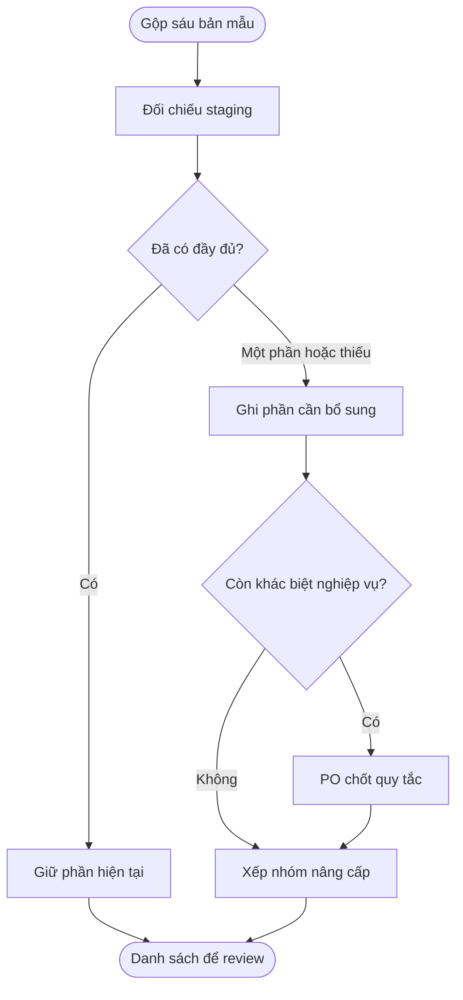
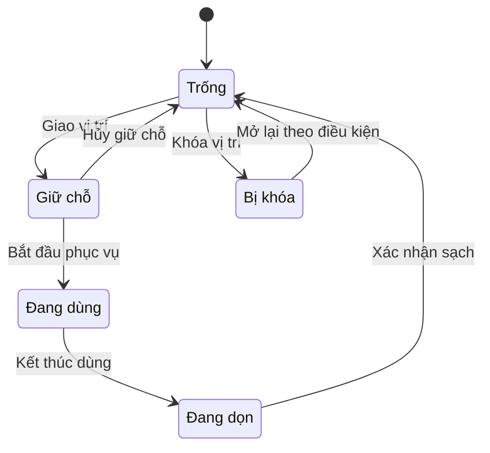

## Turnboard — Gộp các bản từ ngày 25 tháng 8 năm 2026 và đối chiếu staging

**Cập nhật:** 4 tháng 11 năm 2026  
**Đối tượng:** Leader, PO, BA, thiết kế và đội phát triển  
**Trạng thái:** Bản đối chiếu để review; chưa phải yêu cầu triển khai đã chốt

### Tóm tắt nhanh

Staging đã có phần khung Turnboard và nhiều thao tác vận hành. Nếu gộp các bản #1–#6, nên ưu tiên bộ luật tính lượt, cách đề xuất thợ, giao nhiều dịch vụ và thao tác điều chỉnh hàng chờ.
Ghế/bàn/phòng là một nhóm chức năng mới. Mục tiêu ngày, cân bằng cơ hội, cảnh báo và khối Next Turn chi tiết là các phần bổ sung tiếp theo.
Kết luận giữ nguyên theo code frontend/backend đã đọc ngày 3 tháng 11 năm 2026; lần cập nhật này chỉ sửa ngày và nguồn mẫu PO. Chưa kiểm thử bản đang triển khai, cấu hình tiệm hoặc dữ liệu thực tế trên môi trường staging.

| Kết quả đối chiếu | Số mục |
| --- | --- |
| Đã có | 11 |
| Có một phần | 10 |
| Chưa có | 10 |
| Cần PO chốt | 2 |

Đếm theo nhóm khả năng trong bảng dưới, không phải số ticket hay phần trăm hoàn thành sản phẩm.

### Tổng quan

Bản gộp giữ mọi khả năng Turnboard xuất hiện từ ngày 25 tháng 8 năm 2026 trở đi. Lễ tân xem khách chờ, chọn thợ phù hợp và giao dịch vụ; chủ tiệm/quản lý cấu hình luật và xử lý ngoại lệ. Các bản khác nhau về bố cục và công thức nên cần hợp nhất theo mục đích sử dụng, không ghép tất cả nút và công thức vào cùng một luồng.

Phạm vi gồm cả 6 file từ ngày 25 tháng 8 trong [bảng so sánh UI](../turnboard-comparison/so-sanh-turnboard.html). Ngày của `nexora-pos-prototype (1).html` được sửa thành 7 tháng 9 năm 2026 theo xác nhận mới. File này có cùng phần dựng Turnboard với `nexora-pos-products-other-sales.html`, nên số nhóm tính năng cần bổ sung giữ nguyên. Chỉ xét Turnboard và phần liên quan trực tiếp đến giao khách, tính lượt, vị trí, gọi thợ và in phiếu; không gộp toàn bộ chức năng POS khác.

### Khái niệm và cách đọc

| Thuật ngữ | Ý nghĩa |
| --- | --- |
| Đã có | Code staging có khả năng tương ứng; không khẳng định đã kiểm thử vận hành trên môi trường. |
| Có một phần | Đã có nền hoặc một phần luồng; cột cần bổ sung nêu phần còn thiếu. |
| Chưa có | Không tìm thấy đường xử lý và dữ liệu tương ứng trong phạm vi code đã đọc, kèm căn cứ ở phụ lục. |
| Cần PO chốt | Ý tưởng trong HTML mới mô phỏng hoặc có lựa chọn nghiệp vụ chưa đủ rõ để chuyển thẳng thành công việc. |
| Stations hiện tại | Tên cách xem thẻ thợ trên staging; khác với ghế/bàn/phòng vật lý trong V34. |
| Lượt tạm tính / đã chốt | Lượt của phiếu đang mở có thể được tính lại; checkout lưu số lượt đã ghi nhận. |

### Vai trò

| Vai trò | Việc cần làm |
| --- | --- |
| Leader / PO | Chốt D01–D07 và thứ tự thực hiện các nhóm E01–E08. |
| Lễ tân / quản lý | Review cách chọn thợ, xử lý vượt lượt, nghỉ ngắn, giao dịch vụ và vị trí. |
| Đội phát triển | Tận dụng phần đã có; chỉ bổ sung dữ liệu, API và giao diện còn thiếu sau khi yêu cầu được chốt. |

### Luồng review và chốt bản gộp

**Người thực hiện chính:** PO.  
**Bắt đầu:** Gộp khả năng từ 6 bản HTML trong phạm vi.  
**Kết quả:** Danh sách nâng cấp rõ phần dùng lại, phần bổ sung và quyết định còn thiếu.

**Nhu cầu:**

- Là PO, tôi muốn biết phần staging đã có để không tạo công việc trùng.
- Là quản lý tiệm, tôi muốn thấy lý do chọn hoặc bỏ qua thợ để review quy tắc công bằng.
- Là đội phát triển, tôi muốn công thức và ngoại lệ được chốt trước khi thay cách tính lượt thật.

| Bước | Người thực hiện | Thao tác | Kết quả |
| --- | --- | --- | --- |
| 1 | PO / BA | Đọc nguồn #1–#6 và ma trận | Nhận diện khả năng chung và phần mới. |
| 2 | PO / quản lý | Đối chiếu các khác biệt tại D01–D07 | Chọn một cách xử lý cho từng điểm chưa thống nhất. |
| 3 | Leader / đội phát triển | Chia phạm vi theo E01–E08 | Tách phần dùng lại với frontend/backend cần bổ sung. |
| 4 | PO / đội kiểm tra | Đối chiếu bản chạy sau khi triển khai | Xác nhận hành vi, không dùng code review thay cho kiểm thử vận hành. |

### Bảng đối chiếu toàn bộ khả năng Turnboard

| Mã | Khả năng gộp | HTML mẫu PO / phần cần xem | Staging | Đã có trên staging | Cần bổ sung / cách xử lý | Nhóm | Căn cứ |
| --- | --- | --- | --- | --- | --- | --- | --- |
| F01 | Ba cách xem Compact / thẻ / Turn Grid | [#2 · front-desk-prototype.html](../turnboard-leader-review/html/pos-prototype/front-desk-prototype.html) 4 tháng 9 năm 2026 Phần cần xem: Màn hình Turn Board: Ba cách xem Compact / thẻ / Turn Grid.  [#4 · front-desk-prototype (1).html](../turnboard-leader-review/html/pos-prototype/front-desk-prototype%20%281%29.html) 7 tháng 9 năm 2026 Phần cần xem: Màn hình Turn Board: Ba cách xem Compact / thẻ / Turn Grid. | Đã có | Đã có Compact, Stations dạng thẻ và Grid; lưu lựa chọn cách xem. | Giữ lại; không tạo lại ba màn hình. | — | [C01](#ref-c01) |
| F02 | Tìm thợ, lọc trạng thái và 4 chỉ số tổng quan | [#2 · front-desk-prototype.html](../turnboard-leader-review/html/pos-prototype/front-desk-prototype.html) 4 tháng 9 năm 2026 Phần cần xem: Màn hình Turn Board: Tìm thợ, lọc trạng thái và 4 chỉ số tổng quan.  [#4 · front-desk-prototype (1).html](../turnboard-leader-review/html/pos-prototype/front-desk-prototype%20%281%29.html) 7 tháng 9 năm 2026 Phần cần xem: Màn hình Turn Board: Tìm thợ, lọc trạng thái và 4 chỉ số tổng quan. | Đã có | Tìm theo tên hoặc dịch vụ; lọc thợ và đếm thợ rảnh, bận, khách chờ. | Chỉ bổ sung Paused nếu chọn E04. | — | [C01](#ref-c01) |
| F03 | Vào ca, ra ca và chỉ đề xuất thợ đang vào ca | [#1 · TurnBoardBanMau.html](../turnboard-leader-review/html/TurnBoardBanMau.html) 25 tháng 8 năm 2026 Phần cần xem: Màn hình Turn Board: Vào ca, ra ca và chỉ đề xuất thợ đang vào ca.  [#3 · nexora-pos-prototype (1).html](../turnboard-leader-review/html/nexora-pos-feedback-9-10/nexora-pos-prototype%20%281%29.html) 7 tháng 9 năm 2026 Phần cần xem: Màn hình Turn Board: Vào ca, ra ca và chỉ đề xuất thợ đang vào ca. Cùng phần dựng Turnboard với #5.  [#5 · nexora-pos-products-other-sales.html](../turnboard-leader-review/html/nexora-pos-feedback-9-10/nexora-pos-products-other-sales.html) 9 tháng 10 năm 2026 Phần cần xem: Màn hình Turn Board: Vào ca, ra ca và chỉ đề xuất thợ đang vào ca.  [#6 · nexora-pos-prototype-v34.html](../turnboard-leader-review/html/nexora-pos-12-10/nexora-pos-prototype-v34.html) 12 tháng 10 năm 2026 Phần cần xem: Màn hình Turn Board: Vào ca, ra ca và chỉ đề xuất thợ đang vào ca. | Đã có | Có Time Clock và lọc thợ đang vào ca khi xác định Next Turn. | Giữ cơ chế hiện tại; quy tắc khi nghỉ ngắn thuộc E04. | — | [C02](#ref-c02), [C03](#ref-c03) |
| F04 | Lượt, số dịch vụ, tiền dịch vụ, giờ làm và dịch vụ hôm nay | [#1 · TurnBoardBanMau.html](../turnboard-leader-review/html/TurnBoardBanMau.html) 25 tháng 8 năm 2026 Phần cần xem: Tổng quan thợ: doanh thu và TB/turn.  [#2 · front-desk-prototype.html](../turnboard-leader-review/html/pos-prototype/front-desk-prototype.html) 4 tháng 9 năm 2026 Phần cần xem: Turn Board → Cards/Compact: Turns, Services, Service Total, Working Time.  [#4 · front-desk-prototype (1).html](../turnboard-leader-review/html/pos-prototype/front-desk-prototype%20%281%29.html) 7 tháng 9 năm 2026 Phần cần xem: Turn Board → Cards/Compact: các số liệu của thợ. | Đã có | Thẻ thợ và bảng lượt hôm nay đã có các số liệu này. | Doanh thu trung bình/lượt chưa có riêng; có thể tính từ dữ liệu hiện hữu. | E06 | [C03](#ref-c03), [C07](#ref-c07) |
| F05 | Next Turn nổi bật, danh sách Upcoming và mở hồ sơ thợ | [#1 · TurnBoardBanMau.html](../turnboard-leader-review/html/TurnBoardBanMau.html) 25 tháng 8 năm 2026 Phần cần xem: Khối thợ tới lượt trên màn hình Turnboard.  [#2 · front-desk-prototype.html](../turnboard-leader-review/html/pos-prototype/front-desk-prototype.html) 4 tháng 9 năm 2026 Phần cần xem: Turn Board: thanh Next Turn.  [#4 · front-desk-prototype (1).html](../turnboard-leader-review/html/pos-prototype/front-desk-prototype%20%281%29.html) 7 tháng 9 năm 2026 Phần cần xem: Turn Board: thẻ Next Turn, Upcoming Turn Order và View Technician. | Có một phần | Đã đánh dấu thợ Next Turn và có bảng lượt hôm nay. | Thêm khối Next Turn chi tiết, danh sách những người kế tiếp và mở nhanh hồ sơ từ khối này. | E08 | [C02](#ref-c02), [C03](#ref-c03) |
| F06 | Mục tiêu ngày và tiến độ của từng thợ | [#2 · front-desk-prototype.html](../turnboard-leader-review/html/pos-prototype/front-desk-prototype.html) 4 tháng 9 năm 2026 Phần cần xem: Turn Board → Cards: Goal Progress và Daily Goal.  [#4 · front-desk-prototype (1).html](../turnboard-leader-review/html/pos-prototype/front-desk-prototype%20%281%29.html) 7 tháng 9 năm 2026 Phần cần xem: Turn Board → Cards và thẻ Next Turn: Goal Progress. | Chưa có | Turnboard chưa có mục tiêu ngày hoặc thanh tiến độ. Chỉ tiêu thưởng trong hồ sơ trả công phục vụ mục đích khác. | Thêm mục tiêu ngày, số đã đạt, số còn thiếu và trạng thái tiến độ. | E06 | [C03](#ref-c03), [C22](#ref-c22) |
| F07 | Gợi ý bù cơ hội phục vụ cho thợ ít việc | [#2 · front-desk-prototype.html](../turnboard-leader-review/html/pos-prototype/front-desk-prototype.html) 4 tháng 9 năm 2026 Phần cần xem: Turn Board → Cards: MAKE-UP RECOMMENDED.  [#4 · front-desk-prototype (1).html](../turnboard-leader-review/html/pos-prototype/front-desk-prototype%20%281%29.html) 7 tháng 9 năm 2026 Phần cần xem: Turn Board → Cards: MAKE-UP RECOMMENDED. | Chưa có | Có số liệu lượt, tiền dịch vụ và giờ làm; chưa có MAKE-UP RECOMMENDED. | Thêm gợi ý cân bằng với công thức được PO chốt; không tự sửa lượt đã ghi. | E06 | [C03](#ref-c03), [C07](#ref-c07) |
| F08 | Boost This Technician từ Turnboard | [#2 · front-desk-prototype.html](../turnboard-leader-review/html/pos-prototype/front-desk-prototype.html) 4 tháng 9 năm 2026 Phần cần xem: Turn Board → Cards → Boost This Technician.  [#4 · front-desk-prototype (1).html](../turnboard-leader-review/html/pos-prototype/front-desk-prototype%20%281%29.html) 7 tháng 9 năm 2026 Phần cần xem: Turn Board → Cards → Boost This Technician; thao tác mới mô phỏng. | Cần PO chốt | Chưa có hành động này trên thẻ thợ. HTML chỉ mở form và báo đã tạo chương trình. | Chốt liên kết với Promotions, dịch vụ được áp dụng và quyền duyệt; không coi thông báo demo là luồng đã hoàn chỉnh. | E06 | [C03](#ref-c03) |
| F09 | Lượt theo bậc giá, có thể sửa các khoảng và số lượt | [#1 · TurnBoardBanMau.html](../turnboard-leader-review/html/TurnBoardBanMau.html) 25 tháng 8 năm 2026 Phần cần xem: Luật tính turn → Theo bậc giá.  [#2 · front-desk-prototype.html](../turnboard-leader-review/html/pos-prototype/front-desk-prototype.html) 4 tháng 9 năm 2026 Phần cần xem: Turn Board → Weighted Turn Settings; nút lưu chỉ mô phỏng.  [#3 · nexora-pos-prototype (1).html](../turnboard-leader-review/html/nexora-pos-feedback-9-10/nexora-pos-prototype%20%281%29.html) 7 tháng 9 năm 2026 Phần cần xem: Turn Board → Turn rule → Price tiers (0.25–1). Cùng phần dựng Turnboard với #5.  [#4 · front-desk-prototype (1).html](../turnboard-leader-review/html/pos-prototype/front-desk-prototype%20%281%29.html) 7 tháng 9 năm 2026 Phần cần xem: Turn Board → Weighted Turn Settings; nút lưu chỉ mô phỏng.  [#5 · nexora-pos-products-other-sales.html](../turnboard-leader-review/html/nexora-pos-feedback-9-10/nexora-pos-products-other-sales.html) 9 tháng 10 năm 2026 Phần cần xem: Turn Board → Turn rule → Price tiers (0.25–1).  [#6 · nexora-pos-prototype-v34.html](../turnboard-leader-review/html/nexora-pos-12-10/nexora-pos-prototype-v34.html) 12 tháng 10 năm 2026 Phần cần xem: Turn Board → Turn rule → Price tiers (0.25–1). | Đã có | Đã lưu bậc giá thật qua API, có kiểm tra xung đột phiên bản cấu hình. | Giữ nền hiện tại; cách gộp giá cần quyết định D01. | — | [C04](#ref-c04), [C05](#ref-c05), [C06](#ref-c06) |
| F10 | Lượt theo một ngưỡng giá | [#1 · TurnBoardBanMau.html](../turnboard-leader-review/html/TurnBoardBanMau.html) 25 tháng 8 năm 2026 Phần cần xem: Luật tính turn → Theo ngưỡng giá. | Có một phần | Có thể cấu hình hai bậc giá để cho kết quả tương đương trên một dịch vụ. | Nếu cần đúng như mẫu: thêm cách chọn nhanh và chốt tính trên từng dịch vụ hay tổng phần việc của một thợ. | E01 | [C04](#ref-c04), [C06](#ref-c06) |
| F11 | Lượt theo thời lượng dịch vụ | [#1 · TurnBoardBanMau.html](../turnboard-leader-review/html/TurnBoardBanMau.html) 25 tháng 8 năm 2026 Phần cần xem: Luật tính turn → Theo thời gian ghế; chỉnh phút tương ứng một lượt.  [#3 · nexora-pos-prototype (1).html](../turnboard-leader-review/html/nexora-pos-feedback-9-10/nexora-pos-prototype%20%281%29.html) 7 tháng 9 năm 2026 Phần cần xem: Turn Board → Turn rule → Per 15 minutes (0.25). Cùng phần dựng Turnboard với #5.  [#5 · nexora-pos-products-other-sales.html](../turnboard-leader-review/html/nexora-pos-feedback-9-10/nexora-pos-products-other-sales.html) 9 tháng 10 năm 2026 Phần cần xem: Turn Board → Turn rule → Per 15 minutes (0.25).  [#6 · nexora-pos-prototype-v34.html](../turnboard-leader-review/html/nexora-pos-12-10/nexora-pos-prototype-v34.html) 12 tháng 10 năm 2026 Phần cần xem: Turn Board → Turn rule → Per 15 minutes (0.25). | Chưa có | Công thức đang dùng bậc giá; chưa có số phút tương ứng một lượt. | Thêm cách tính theo thời lượng và quy tắc làm tròn. | E01 | [C05](#ref-c05), [C06](#ref-c06) |
| F12 | Số lượt cố định theo từng dịch vụ | [#1 · TurnBoardBanMau.html](../turnboard-leader-review/html/TurnBoardBanMau.html) 25 tháng 8 năm 2026 Phần cần xem: Luật tính turn → Theo bảng dịch vụ; chỉnh số turn từng dịch vụ ở Dịch vụ & ký hiệu.  [#3 · nexora-pos-prototype (1).html](../turnboard-leader-review/html/nexora-pos-feedback-9-10/nexora-pos-prototype%20%281%29.html) 7 tháng 9 năm 2026 Phần cần xem: Turn Board → Turn rule → Per main service; không phải bảng lượt riêng từng dịch vụ. Cùng phần dựng Turnboard với #5.  [#5 · nexora-pos-products-other-sales.html](../turnboard-leader-review/html/nexora-pos-feedback-9-10/nexora-pos-products-other-sales.html) 9 tháng 10 năm 2026 Phần cần xem: Turn Board → Turn rule → Per main service; không phải bảng lượt riêng từng dịch vụ.  [#6 · nexora-pos-prototype-v34.html](../turnboard-leader-review/html/nexora-pos-12-10/nexora-pos-prototype-v34.html) 12 tháng 10 năm 2026 Phần cần xem: Turn Board → Turn rule → Per main service; không phải bảng lượt riêng từng dịch vụ. | Chưa có | Chưa có bảng số lượt riêng cho từng dịch vụ trong công thức tự động. | Cho cấu hình số lượt từng dịch vụ; giữ quy tắc dịch vụ chính và phần thêm. | E01 | [C05](#ref-c05), [C06](#ref-c06) |
| F13 | Một khách là một lượt | [#1 · TurnBoardBanMau.html](../turnboard-leader-review/html/TurnBoardBanMau.html) 25 tháng 8 năm 2026 Phần cần xem: Luật tính turn → Đếm đầu khách.  [#3 · nexora-pos-prototype (1).html](../turnboard-leader-review/html/nexora-pos-feedback-9-10/nexora-pos-prototype%20%281%29.html) 7 tháng 9 năm 2026 Phần cần xem: Turn Board → Turn rule → 1 guest = 1 turn. Cùng phần dựng Turnboard với #5.  [#5 · nexora-pos-products-other-sales.html](../turnboard-leader-review/html/nexora-pos-feedback-9-10/nexora-pos-products-other-sales.html) 9 tháng 10 năm 2026 Phần cần xem: Turn Board → Turn rule → 1 guest = 1 turn.  [#6 · nexora-pos-prototype-v34.html](../turnboard-leader-review/html/nexora-pos-12-10/nexora-pos-prototype-v34.html) 12 tháng 10 năm 2026 Phần cần xem: Turn Board → Turn rule → 1 guest = 1 turn. | Chưa có | Công thức hiện lấy từng dịch vụ chính làm đơn vị tính, không phải đầu khách. | Thêm cách tính theo khách; chốt trường hợp một khách do nhiều thợ làm. | E01 | [C06](#ref-c06) |
| F14 | Luật riêng cho khách chỉ định và khách có hẹn | [#1 · TurnBoardBanMau.html](../turnboard-leader-review/html/TurnBoardBanMau.html) 25 tháng 8 năm 2026 Phần cần xem: Luật tính turn → Khách chỉ định (request) và Khách hẹn trước (booking). | Có một phần | Đã có lượt cho đúng thợ khách chỉ định, gồm mức chung và mức riêng từng thợ. | Chưa tách hai nhóm như #1: theo công thức / 1 / 0,5 / 0 lượt. Phải giữ tương thích chính sách hiện tại. | E01 | [C05](#ref-c05), [C06](#ref-c06), [C26](#ref-c26) |
| F15 | Xem thử số lượt trước khi lưu luật | [#1 · TurnBoardBanMau.html](../turnboard-leader-review/html/TurnBoardBanMau.html) 25 tháng 8 năm 2026 Phần cần xem: Luật tính turn → Xem thử luật này. | Chưa có | Cửa sổ cấu hình có sửa bậc giá và lưu; chưa có bảng thử theo khách thường, chỉ định và hẹn. | Thêm phần xem thử dùng cùng công thức với backend. | E01 | [C04](#ref-c04) |
| F16 | Dịch vụ được phép làm và cấp thợ | [#2 · front-desk-prototype.html](../turnboard-leader-review/html/pos-prototype/front-desk-prototype.html) 4 tháng 9 năm 2026 Phần cần xem: Staff Profiles → Technician level và Approved services.  [#3 · nexora-pos-prototype (1).html](../turnboard-leader-review/html/nexora-pos-feedback-9-10/nexora-pos-prototype%20%281%29.html) 7 tháng 9 năm 2026 Phần cần xem: Turn Board: cấp tay nghề theo nhóm dịch vụ. Cùng phần dựng Turnboard với #5.  [#4 · front-desk-prototype (1).html](../turnboard-leader-review/html/pos-prototype/front-desk-prototype%20%281%29.html) 7 tháng 9 năm 2026 Phần cần xem: Staff Profiles → Technician level và Approved services.  [#5 · nexora-pos-products-other-sales.html](../turnboard-leader-review/html/nexora-pos-feedback-9-10/nexora-pos-products-other-sales.html) 9 tháng 10 năm 2026 Phần cần xem: Turn Board: cấp tay nghề theo nhóm dịch vụ.  [#6 · nexora-pos-prototype-v34.html](../turnboard-leader-review/html/nexora-pos-12-10/nexora-pos-prototype-v34.html) 12 tháng 10 năm 2026 Phần cần xem: Turn Board: cấp tay nghề theo nhóm dịch vụ. | Đã có | Có danh sách dịch vụ được phép làm và cấp thợ do tiệm cấu hình. | Giữ lại; xem D03 về thợ chưa thiết lập tay nghề. | — | [C08](#ref-c08), [C09](#ref-c09), [C22](#ref-c22) |
| F17 | Tay nghề theo 3 mức, tiếng Anh và đánh giá phục vụ | [#1 · TurnBoardBanMau.html](../turnboard-leader-review/html/TurnBoardBanMau.html) 25 tháng 8 năm 2026 Phần cần xem: Tổng quan thợ → Tay nghề từng dịch vụ; Tổng quan & đánh giá → Tiếng Anh, Phục vụ, Hạng.  [#3 · nexora-pos-prototype (1).html](../turnboard-leader-review/html/nexora-pos-feedback-9-10/nexora-pos-prototype%20%281%29.html) 7 tháng 9 năm 2026 Phần cần xem: Turn Board: ba mức tay nghề theo nhóm; không có đánh giá tiếng Anh/phục vụ. Cùng phần dựng Turnboard với #5.  [#5 · nexora-pos-products-other-sales.html](../turnboard-leader-review/html/nexora-pos-feedback-9-10/nexora-pos-products-other-sales.html) 9 tháng 10 năm 2026 Phần cần xem: Turn Board: ba mức tay nghề theo nhóm; không có đánh giá tiếng Anh/phục vụ.  [#6 · nexora-pos-prototype-v34.html](../turnboard-leader-review/html/nexora-pos-12-10/nexora-pos-prototype-v34.html) 12 tháng 10 năm 2026 Phần cần xem: Turn Board: ba mức tay nghề theo nhóm; không có đánh giá tiếng Anh/phục vụ. | Có một phần | Đã có cấp thợ chung và quyền làm dịch vụ; chưa có mức chuyên theo từng dịch vụ, điểm tiếng Anh và phục vụ như #1. | Bổ sung các dữ liệu này nếu dùng để tự chọn thợ; không thay cấp thợ hiện hữu bằng điểm tự tính khi chưa chốt. | E02 | [C08](#ref-c08), [C09](#ref-c09), [C22](#ref-c22) |
| F18 | Ba chế độ tự đề xuất: công bằng / cân bằng / tay nghề | [#1 · TurnBoardBanMau.html](../turnboard-leader-review/html/TurnBoardBanMau.html) 25 tháng 8 năm 2026 Phần cần xem: Luật tính turn → Máy tự xếp thợ ưu tiên gì: Công bằng, Cân bằng, Tay nghề. | Có một phần | Đã gợi ý Next Turn dựa trên lượt, tiền dịch vụ tạm tính và thời gian chờ; có lọc dịch vụ phù hợp. | Thêm chế độ cấu hình, ưu tiên rảnh/chuyên/tiếng Anh và giải thích vì sao đề xuất; xem D02. | E02 | [C02](#ref-c02), [C08](#ref-c08), [C10](#ref-c10), [C24](#ref-c24) |
| F19 | Giao nhiều dịch vụ cho một hoặc nhiều thợ bằng tay | [#1 · TurnBoardBanMau.html](../turnboard-leader-review/html/TurnBoardBanMau.html) 25 tháng 8 năm 2026 Phần cần xem: Giao khách: chọn thợ cho từng dòng dịch vụ.  [#4 · front-desk-prototype (1).html](../turnboard-leader-review/html/pos-prototype/front-desk-prototype%20%281%29.html) 7 tháng 9 năm 2026 Phần cần xem: Assign technician: chọn một thợ hoặc Split Services. | Đã có | Workspace đã cho giao theo từng dòng hoặc nhóm dịch vụ và lưu nhiều phân công cùng lúc. | Giữ khả năng hiện có; không tạo lại API lưu nhiều phân công. | — | [C10](#ref-c10), [C11](#ref-c11), [C12](#ref-c12) |
| F20 | Tự đề xuất một thợ làm hết hoặc chia nhiều thợ | [#1 · TurnBoardBanMau.html](../turnboard-leader-review/html/TurnBoardBanMau.html) 25 tháng 8 năm 2026 Phần cần xem: Giao khách → Máy tự xếp thợ: tự chọn theo từng dịch vụ.  [#4 · front-desk-prototype (1).html](../turnboard-leader-review/html/pos-prototype/front-desk-prototype%20%281%29.html) 7 tháng 9 năm 2026 Phần cần xem: Assign technician → One technician for all services / Faster split option / Split Services. | Có một phần | Có lựa chọn thợ theo dịch vụ, chưa có hai phương án gộp và chia để lễ tân so sánh. | Thêm kế hoạch đề xuất trên toàn bộ dịch vụ, báo phần chưa có thợ và xác nhận phương án cuối. | E03 | [C10](#ref-c10), [C11](#ref-c11), [C12](#ref-c12) |
| F21 | Lý do giao vượt lượt và giải thích giữ lượt vì tay nghề | [#1 · TurnBoardBanMau.html](../turnboard-leader-review/html/TurnBoardBanMau.html) 25 tháng 8 năm 2026 Phần cần xem: Giao khách: cảnh báo vượt lượt và danh sách thợ bị bỏ qua.  [#2 · front-desk-prototype.html](../turnboard-leader-review/html/pos-prototype/front-desk-prototype.html) 4 tháng 9 năm 2026 Phần cần xem: Assign technician → Why are you skipping the next turn? → Reason.  [#3 · nexora-pos-prototype (1).html](../turnboard-leader-review/html/nexora-pos-feedback-9-10/nexora-pos-prototype%20%281%29.html) 7 tháng 9 năm 2026 Phần cần xem: Turn Board → Turn history: ghi người bị bỏ qua; chưa có form lý do vượt lượt. Cùng phần dựng Turnboard với #5.  [#4 · front-desk-prototype (1).html](../turnboard-leader-review/html/pos-prototype/front-desk-prototype%20%281%29.html) 7 tháng 9 năm 2026 Phần cần xem: Assign technician: System recommendation, Final assignment, Manager Override và Turn protected.  [#5 · nexora-pos-products-other-sales.html](../turnboard-leader-review/html/nexora-pos-feedback-9-10/nexora-pos-products-other-sales.html) 9 tháng 10 năm 2026 Phần cần xem: Turn Board → Turn history: ghi người bị bỏ qua; chưa có form lý do vượt lượt.  [#6 · nexora-pos-prototype-v34.html](../turnboard-leader-review/html/nexora-pos-12-10/nexora-pos-prototype-v34.html) 12 tháng 10 năm 2026 Phần cần xem: Turn Board → Turn history: ghi người bị bỏ qua; chưa có form lý do vượt lượt. | Có một phần | Có kiểm tra dịch vụ phù hợp, ghi chú và nhật ký đổi thợ; Booking có lý do không đủ điều kiện. | Thêm lý do có cấu trúc khi vượt lượt, danh sách thợ bị bỏ qua và cách xử lý lượt; chưa có nhật ký này ngay trên Turnboard. | E03 | [C08](#ref-c08), [C12](#ref-c12), [C23](#ref-c23) |
| F22 | Skip Turn và Pause / Resume | [#2 · front-desk-prototype.html](../turnboard-leader-review/html/pos-prototype/front-desk-prototype.html) 4 tháng 9 năm 2026 Phần cần xem: Turn Board → Cards → Skip Turn / Pause.  [#4 · front-desk-prototype (1).html](../turnboard-leader-review/html/pos-prototype/front-desk-prototype%20%281%29.html) 7 tháng 9 năm 2026 Phần cần xem: Turn Board → Cards → Skip Turn / Pause; bấm Pause lần nữa để trở lại. | Chưa có | Thẻ thợ chưa có các thao tác này; trạng thái backend chưa có Paused. | Thêm bỏ lượt, tạm ngưng/tiếp tục nhận khách; chốt vị trí trở lại hàng và ảnh hưởng chấm công. | E04 | [C03](#ref-c03), [C17](#ref-c17), [C18](#ref-c18) |
| F23 | Thêm / sửa lượt ở Turn Grid | [#2 · front-desk-prototype.html](../turnboard-leader-review/html/pos-prototype/front-desk-prototype.html) 4 tháng 9 năm 2026 Phần cần xem: Turn Board → Turn Grid → Add Turn / Edit Turn.  [#4 · front-desk-prototype (1).html](../turnboard-leader-review/html/pos-prototype/front-desk-prototype%20%281%29.html) 7 tháng 9 năm 2026 Phần cần xem: Turn Board → Turn Grid → Add Turn / Edit Turn. | Đã có | Có form và API thêm/sửa lượt thủ công hoặc lượt từ dịch vụ. | Giữ cơ chế; bổ sung lý do và lịch sử ở dòng tiếp theo. | — | [C14](#ref-c14), [C15](#ref-c15), [C16](#ref-c16), [C17](#ref-c17) |
| F24 | Lý do bắt buộc và lịch sử nghiệp vụ khi chỉnh lượt | [#2 · front-desk-prototype.html](../turnboard-leader-review/html/pos-prototype/front-desk-prototype.html) 4 tháng 9 năm 2026 Phần cần xem: Turn Board → Add Turn / Edit Turn → Audit reason.  [#4 · front-desk-prototype (1).html](../turnboard-leader-review/html/pos-prototype/front-desk-prototype%20%281%29.html) 7 tháng 9 năm 2026 Phần cần xem: Turn Board → Add Turn / Edit Turn → Audit reason; lưu lý do trong dữ liệu demo. | Có một phần | Đã lưu số lượt, số tiền và đánh dấu chỉnh tay; form và API chưa có trường lý do. | Thêm lý do, giá trị trước/sau và người thực hiện để thợ/quản lý tra cứu. | E04 | [C14](#ref-c14), [C15](#ref-c15), [C16](#ref-c16) |
| F25 | Undo lần giao khách gần nhất | [#1 · TurnBoardBanMau.html](../turnboard-leader-review/html/TurnBoardBanMau.html) 25 tháng 8 năm 2026 Phần cần xem: Hoàn tác lần giao gần nhất trên Turnboard.  [#3 · nexora-pos-prototype (1).html](../turnboard-leader-review/html/nexora-pos-feedback-9-10/nexora-pos-prototype%20%281%29.html) 7 tháng 9 năm 2026 Phần cần xem: Turn Board → Turn history → Undo; thêm dòng đảo lượt. Cùng phần dựng Turnboard với #5.  [#5 · nexora-pos-products-other-sales.html](../turnboard-leader-review/html/nexora-pos-feedback-9-10/nexora-pos-products-other-sales.html) 9 tháng 10 năm 2026 Phần cần xem: Turn Board → Turn history → Undo; thêm dòng đảo lượt.  [#6 · nexora-pos-prototype-v34.html](../turnboard-leader-review/html/nexora-pos-12-10/nexora-pos-prototype-v34.html) 12 tháng 10 năm 2026 Phần cần xem: Turn Board → Turn history → Undo; thêm dòng đảo lượt. | Có một phần | Có thể gỡ/đổi thợ trong phiếu đang mở; chưa có Undo lần giao gần nhất và dòng đảo lượt như mẫu. | Thêm Undo có điều kiện và thông tin trước/sau; chặn khi phần việc đã đi quá trạng thái cho phép. | E04 | [C12](#ref-c12), [C13](#ref-c13), [C17](#ref-c17) |
| F26 | Chọn hoặc tự chọn ghế, bàn, phòng khi giao khách | [#2 · front-desk-prototype.html](../turnboard-leader-review/html/pos-prototype/front-desk-prototype.html) 4 tháng 9 năm 2026 Phần cần xem: Assign technician → Service location và Chair / table number; cảnh báo trùng vị trí.  [#4 · front-desk-prototype (1).html](../turnboard-leader-review/html/pos-prototype/front-desk-prototype%20%281%29.html) 7 tháng 9 năm 2026 Phần cần xem: Assign technician → Service location và Chair / table number; cảnh báo trùng vị trí.  [#6 · nexora-pos-prototype-v34.html](../turnboard-leader-review/html/nexora-pos-12-10/nexora-pos-prototype-v34.html) 12 tháng 10 năm 2026 Phần cần xem: Turn Board → Assign a checked-in guest → Station; Settings → Stations → Off / Manual / Auto. | Chưa có | Turnboard và phân công hiện không có vị trí vật lý. Stations trên UI hiện là thẻ thợ. | Thêm danh mục vị trí, bật/tắt/chọn tay/tự chọn, chọn đúng loại và gắn với phiếu. | E05 | [C07](#ref-c07), [C12](#ref-c12), [C21](#ref-c21) |
| F27 | Giữ chỗ, đang dùng, dọn chỗ, khóa chỗ và xác nhận sạch | [#6 · nexora-pos-prototype-v34.html](../turnboard-leader-review/html/nexora-pos-12-10/nexora-pos-prototype-v34.html) 12 tháng 10 năm 2026 Phần cần xem: Settings → Stations; dải vị trí trên Front Desk: free, held, occupied, cleaning, blocked và Mark clean. | Chưa có | Chưa có vòng đời vị trí vật lý trong các phần Turnboard/phiếu đã kiểm tra. | Thêm trạng thái và liên kết với phục vụ; bản triển khai cần xử lý đồng thời vì HTML chỉ dùng dữ liệu demo. | E05 | [C07](#ref-c07), [C12](#ref-c12), [C21](#ref-c21) |
| F28 | Gọi thợ thủ công qua app và xem phản hồi | [#1 · TurnBoardBanMau.html](../turnboard-leader-review/html/TurnBoardBanMau.html) 25 tháng 8 năm 2026 Phần cần xem: Turnboard: Gọi thợ qua app và lịch sử gọi. | Đã có | Có Beep, tin nhắn, trạng thái gửi và phản hồi của thợ; có giới hạn thợ không có tài khoản. | Tái sử dụng luồng đang có. | — | [C03](#ref-c03), [C19](#ref-c19) |
| F29 | Tự gọi khi lên Next Turn và mở Viber | [#1 · TurnBoardBanMau.html](../turnboard-leader-review/html/TurnBoardBanMau.html) 25 tháng 8 năm 2026 Phần cần xem: Luật tính turn → Tự gọi khi tới lượt; nút Viber trên thẻ thợ và số Viber trong hồ sơ. | Chưa có | Turnboard hiện gọi qua thao tác của lễ tân; chưa có cấu hình tự gọi theo Next Turn hoặc nút Viber. | Bổ sung tùy chọn tự gọi; Viber là mở ứng dụng nhắn tin, không tự coi là xác nhận đã nhận tin. | E07 | [C03](#ref-c03), [C05](#ref-c05), [C19](#ref-c19) |
| F30 | Dự kiến thời gian chờ, giờ xong và ngưỡng chờ khách hẹn | [#1 · TurnBoardBanMau.html](../turnboard-leader-review/html/TurnBoardBanMau.html) 25 tháng 8 năm 2026 Phần cần xem: Luật tính turn → Khách hẹn đợi thợ tối đa bao lâu; nhãn dự kiến chờ và dự kiến xong trên Turnboard. | Có một phần | Đã có số phút chờ từ check-in và giờ nhận dịch vụ; chưa có dự kiến theo thời lượng hay ngưỡng cảnh báo như #1. | Thêm giờ dự kiến xong, thời gian chờ theo thợ phù hợp và cảnh báo quá ngưỡng khách hẹn. | E07 | [C20](#ref-c20), [C21](#ref-c21) |
| F31 | Ghi chú khách/thợ và in phiếu dịch vụ | [#2 · front-desk-prototype.html](../turnboard-leader-review/html/pos-prototype/front-desk-prototype.html) 4 tháng 9 năm 2026 Phần cần xem: Assign technician → Guest note, Technician note; Assign Only / Assign & Print.  [#4 · front-desk-prototype (1).html](../turnboard-leader-review/html/pos-prototype/front-desk-prototype%20%281%29.html) 7 tháng 9 năm 2026 Phần cần xem: Assign technician → Guest note, Technician note; Assign Only / Assign & Print. | Đã có | Workspace đã có ghi chú và in phiếu. | Nếu cần nút Assign & Print ngay trên Turnboard thì nối vào luồng in hiện hữu. | E08 | [C12](#ref-c12), [C25](#ref-c25) |
| F32 | Lưu luật thật, dùng chung khi tính lượt và chốt phiếu | [#1 · TurnBoardBanMau.html](../turnboard-leader-review/html/TurnBoardBanMau.html) 25 tháng 8 năm 2026 Phần cần xem: Luật tính turn → Lưu; bản này lưu trong trình duyệt.  [#3 · nexora-pos-prototype (1).html](../turnboard-leader-review/html/nexora-pos-feedback-9-10/nexora-pos-prototype%20%281%29.html) 7 tháng 9 năm 2026 Phần cần xem: Turn Board → Turn rule và Turn history; dữ liệu demo. Cùng phần dựng Turnboard với #5.  [#5 · nexora-pos-products-other-sales.html](../turnboard-leader-review/html/nexora-pos-feedback-9-10/nexora-pos-products-other-sales.html) 9 tháng 10 năm 2026 Phần cần xem: Turn Board → Turn rule và Turn history; dữ liệu demo.  [#6 · nexora-pos-prototype-v34.html](../turnboard-leader-review/html/nexora-pos-12-10/nexora-pos-prototype-v34.html) 12 tháng 10 năm 2026 Phần cần xem: Turn Board → Turn rule và Turn history; dữ liệu demo. | Đã có | Đã có API lưu, công thức dùng chung và lưu lượt khi checkout; tốt hơn nút Save Rules mô phỏng ở #2/#4. | Giữ nguyên nền này khi thêm các cách tính; không sao chép công thức cố định từ HTML. | — | [C04](#ref-c04), [C06](#ref-c06) |
| F33 | Reset ngày thủ công và dữ liệu 50 thợ / 36 khách chờ | [#1 · TurnBoardBanMau.html](../turnboard-leader-review/html/TurnBoardBanMau.html) 25 tháng 8 năm 2026 Phần cần xem: Menu cài đặt → Reset toàn bộ ngày hôm nay; thao tác xóa dữ liệu mẫu.  [#2 · front-desk-prototype.html](../turnboard-leader-review/html/pos-prototype/front-desk-prototype.html) 4 tháng 9 năm 2026 Phần cần xem: Turn Board → Large Salon Demo · 50 techs / 36 waiting.  [#4 · front-desk-prototype (1).html](../turnboard-leader-review/html/pos-prototype/front-desk-prototype%20%281%29.html) 7 tháng 9 năm 2026 Phần cần xem: Turn Board → Large Salon Demo · 50 techs / 36 waiting. | Cần PO chốt | Đây là tiện ích xóa/khởi tạo dữ liệu trong bản mẫu, không phải yêu cầu vận hành đã được chốt. | Không đưa thao tác xóa lịch sử thật hoặc nút nạp dữ liệu demo vào backlog mặc định; dùng bộ dữ liệu lớn để kiểm tra khi triển khai. | — | [C07](#ref-c07), [C14](#ref-c14) |

### Nhóm nâng cấp đề xuất

Nên làm **E01–E04 trước** vì chúng quyết định cách ghi lượt, chọn thợ và xử lý ngoại lệ. Các mục E05–E08 mở rộng vị trí và trải nghiệm sử dụng. Đây là thứ tự đề xuất để review, chưa phải lịch triển khai hoặc ước lượng.

Mỗi nhóm dưới đây ghi rõ tên file HTML của PO, ngày tài liệu và phần cần mở. Bấm tên file để đối chiếu với bản mẫu trong bộ review.

| Nhóm | Ưu tiên | Nội dung | Phần cần làm | HTML mẫu PO / phần cần xem | Phạm vi | Phụ thuộc |
| --- | --- | --- | --- | --- | --- | --- |
| E01 | P1 | Hoàn thiện bộ luật tính lượt | Thêm thời lượng, bảng lượt theo dịch vụ và đầu khách; tận dụng bậc giá hiện có. Bổ sung xem thử và xử lý riêng khách chỉ định/hẹn sau khi chốt D01. | [#1 · TurnBoardBanMau.html](../turnboard-leader-review/html/TurnBoardBanMau.html) 25 tháng 8 năm 2026 Phần cần xem: Nguồn chính cho phần thiếu: Luật tính turn → năm cách tính, luật riêng request/booking và Xem thử luật này.  [#5 · nexora-pos-products-other-sales.html](../turnboard-leader-review/html/nexora-pos-feedback-9-10/nexora-pos-products-other-sales.html) 9 tháng 10 năm 2026 Phần cần xem: Turn Board → Turn rule: 1 guest = 1 turn / Per main service / Per 15 minutes (0.25) / Price tiers (0.25–1).  [#6 · nexora-pos-prototype-v34.html](../turnboard-leader-review/html/nexora-pos-12-10/nexora-pos-prototype-v34.html) 12 tháng 10 năm 2026 Phần cần xem: Turn Board → Turn rule: cùng bốn cách tính như #5.  [#3 · nexora-pos-prototype (1).html](../turnboard-leader-review/html/nexora-pos-feedback-9-10/nexora-pos-prototype%20%281%29.html) 7 tháng 9 năm 2026 Phần cần xem: Turn Board → Turn rule: 1 guest = 1 turn / Per main service / Per 15 minutes (0.25) / Price tiers (0.25–1). Cùng phần dựng Turnboard với #5. | Frontend + backend | D01 |
| E02 | P1 | Thống nhất cách đề xuất thợ | Giữ Next Turn hiện có; bổ sung các chế độ của #1, điều kiện rảnh, tay nghề và giải thích đề xuất. | [#1 · TurnBoardBanMau.html](../turnboard-leader-review/html/TurnBoardBanMau.html) 25 tháng 8 năm 2026 Phần cần xem: Luật tính turn → Máy tự xếp thợ ưu tiên gì; Tổng quan thợ → tay nghề, tiếng Anh và phục vụ. | Frontend + backend | D02, D03 |
| E03 | P1 | Gợi ý giao nhiều dịch vụ và ghi nhận vượt lượt | Tận dụng lưu phân công theo dòng/nhóm. Bổ sung phương án một thợ/chia thợ, lý do vượt lượt và giải thích người giữ lượt. | [#4 · front-desk-prototype (1).html](../turnboard-leader-review/html/pos-prototype/front-desk-prototype%20%281%29.html) 7 tháng 9 năm 2026 Phần cần xem: Assign technician → One technician for all services / Faster split option, Manager Override và Turn protected.  [#1 · TurnBoardBanMau.html](../turnboard-leader-review/html/TurnBoardBanMau.html) 25 tháng 8 năm 2026 Phần cần xem: Giao khách → Máy tự xếp thợ theo từng dịch vụ và cảnh báo vượt lượt.  [#2 · front-desk-prototype.html](../turnboard-leader-review/html/pos-prototype/front-desk-prototype.html) 4 tháng 9 năm 2026 Phần cần xem: Assign technician → lý do Why are you skipping the next turn? | Frontend + backend; tái sử dụng API phân công | E02, D02 |
| E04 | P1 | Bổ sung thao tác vận hành và lịch sử lượt | Skip, Pause/Resume, Undo; thêm lý do và lịch sử khi chỉnh lượt. Đưa lối mở chỉnh lượt từ thẻ nếu cần. | [#2 · front-desk-prototype.html](../turnboard-leader-review/html/pos-prototype/front-desk-prototype.html) 4 tháng 9 năm 2026 Phần cần xem: Turn Board → Cards: Skip Turn / Pause; Add Turn / Edit Turn: Audit reason.  [#4 · front-desk-prototype (1).html](../turnboard-leader-review/html/pos-prototype/front-desk-prototype%20%281%29.html) 7 tháng 9 năm 2026 Phần cần xem: Turn Board → Cards và Turn Grid: cùng thao tác Skip/Pause và lý do chỉnh lượt.  [#1 · TurnBoardBanMau.html](../turnboard-leader-review/html/TurnBoardBanMau.html) 25 tháng 8 năm 2026 Phần cần xem: Hoàn tác lần giao gần nhất.  [#5 · nexora-pos-products-other-sales.html](../turnboard-leader-review/html/nexora-pos-feedback-9-10/nexora-pos-products-other-sales.html) 9 tháng 10 năm 2026 Phần cần xem: Turn Board → Turn history → Undo và dòng đảo lượt.  [#6 · nexora-pos-prototype-v34.html](../turnboard-leader-review/html/nexora-pos-12-10/nexora-pos-prototype-v34.html) 12 tháng 10 năm 2026 Phần cần xem: Turn Board → Turn history → Undo và dòng đảo lượt.  [#3 · nexora-pos-prototype (1).html](../turnboard-leader-review/html/nexora-pos-feedback-9-10/nexora-pos-prototype%20%281%29.html) 7 tháng 9 năm 2026 Phần cần xem: Turn Board → Turn history → Undo và dòng đảo lượt. Cùng phần dựng Turnboard với #5. | Frontend + backend | D04 |
| E05 | P2 | Quản lý ghế, bàn, phòng theo V34 | Đây là nhóm chức năng mới: danh mục, chọn tay/tự chọn, giữ chỗ, đang dùng, dọn và xác nhận sạch. | [#6 · nexora-pos-prototype-v34.html](../turnboard-leader-review/html/nexora-pos-12-10/nexora-pos-prototype-v34.html) 12 tháng 10 năm 2026 Phần cần xem: Nguồn chính: Assign a checked-in guest → Station; Settings → Stations; trạng thái vị trí và Mark clean.  [#2 · front-desk-prototype.html](../turnboard-leader-review/html/pos-prototype/front-desk-prototype.html) 4 tháng 9 năm 2026 Phần cần xem: Assign technician → Service location / Chair / table number và cảnh báo trùng.  [#4 · front-desk-prototype (1).html](../turnboard-leader-review/html/pos-prototype/front-desk-prototype%20%281%29.html) 7 tháng 9 năm 2026 Phần cần xem: Assign technician → Service location / Chair / table number và cảnh báo trùng. | Frontend + backend | D05 |
| E06 | P2 | Mục tiêu ngày và cân bằng cơ hội cho thợ | Mục tiêu/tiến độ, doanh thu trung bình mỗi lượt và gợi ý bù cơ hội. Boost cần PO xác định luồng thật. | [#2 · front-desk-prototype.html](../turnboard-leader-review/html/pos-prototype/front-desk-prototype.html) 4 tháng 9 năm 2026 Phần cần xem: Turn Board → Cards: Goal Progress, MAKE-UP RECOMMENDED và Boost This Technician.  [#4 · front-desk-prototype (1).html](../turnboard-leader-review/html/pos-prototype/front-desk-prototype%20%281%29.html) 7 tháng 9 năm 2026 Phần cần xem: Turn Board → Cards và Next Turn: mục tiêu; Boost This Technician mới mô phỏng.  [#1 · TurnBoardBanMau.html](../turnboard-leader-review/html/TurnBoardBanMau.html) 25 tháng 8 năm 2026 Phần cần xem: Tổng quan thợ → Doanh thu và TB/turn. | Frontend + backend; kết nối Promotions nếu chọn | D06 |
| E07 | P2 | Cảnh báo chờ và gọi thợ chủ động | Tận dụng Beep. Bổ sung tự gọi khi lên Next Turn, cảnh báo khách hẹn chờ quá ngưỡng, dự kiến thời gian và mở Viber nếu cần. | [#1 · TurnBoardBanMau.html](../turnboard-leader-review/html/TurnBoardBanMau.html) 25 tháng 8 năm 2026 Phần cần xem: Luật tính turn → Tự gọi khi tới lượt, ngưỡng chờ khách hẹn; Turnboard → Viber, dự kiến chờ/xong. | Frontend + backend cho tự động/cấu hình; Viber chủ yếu frontend | D07 |
| E08 | P2 | Hoàn thiện khối Next Turn và thao tác nhanh | Khối chi tiết, Upcoming, mở hồ sơ và Assign & Print; dùng lại số liệu, hồ sơ và luồng in đã có. | [#4 · front-desk-prototype (1).html](../turnboard-leader-review/html/pos-prototype/front-desk-prototype%20%281%29.html) 7 tháng 9 năm 2026 Phần cần xem: Turn Board → Next Turn, Upcoming Turn Order, View Technician; Assign technician → Assign & Print.  [#2 · front-desk-prototype.html](../turnboard-leader-review/html/pos-prototype/front-desk-prototype.html) 4 tháng 9 năm 2026 Phần cần xem: Turn Board → thanh Next Turn; Assign technician → Assign & Print. | Chủ yếu frontend; phụ thuộc dữ liệu từ các nhóm trên | E02, E06 |

### Cấu hình và quản trị

- Là chủ tiệm/quản lý, tôi muốn lưu một bộ luật dùng chung để Turnboard, phiếu dịch vụ và checkout cho kết quả thống nhất.
- Là chủ tiệm, tôi muốn bật riêng quản lý vị trí và các tùy chọn tự động để tiệm không cần chúng vẫn vận hành theo phần đang có.

### Vòng đời vị trí cần bổ sung nếu chọn E05

V34 có các trạng thái trống, giữ chỗ, đang dùng, đang dọn và bị khóa. Đây là vòng đời đề xuất từ HTML, chưa có trong staging. Điều kiện chuyển trạng thái và liên kết với dịch vụ cần chốt theo D05.

| Trạng thái | Tình huống trong mẫu | Điểm cần chốt |
| --- | --- | --- |
| Trống | Có thể chọn hoặc tự chọn | Phải đúng loại vị trí cho dịch vụ. |
| Giữ chỗ | Đã chọn khi giao khách | Mốc hết giữ chỗ và giải phóng khi đổi/hủy. |
| Đang dùng | Khách đang phục vụ | Gắn theo phiếu hay theo dịch vụ. |
| Đang dọn | Chờ xác nhận sạch | Thời gian dọn, người phụ trách và cảnh báo quá hạn. |
| Bị khóa | Vị trí không được dùng | Quyền khóa/mở và điều kiện mở lại. |

### Quy tắc dùng khi đối chiếu

1. **Nguồn gộp:** Chỉ các bản có ngày tài liệu từ ngày 25 tháng 8 năm 2026; ngày demo bên trong không dùng để xác định phạm vi.
2. **Tính năng trùng:** Một khả năng có ở nhiều HTML được tính một lần; #5 không tạo thêm một thiết kế Turnboard riêng.
3. **Giữ dữ liệu thật:** Khi triển khai, dùng nền tính lượt và lưu cấu hình hiện có; không thay bằng công thức hoặc thao tác reset của bản demo.
4. **Điểm xung đột:** Chỉ chuyển các khác biệt D01–D07 thành yêu cầu sau khi PO chọn cách xử lý. Không coi hành vi khác mẫu là lỗi sẵn có của staging.

### Ví dụ — chỉ minh họa, không phải cấu hình đã chốt

| Tình huống | Vì sao cần quyết định |
| --- | --- |
| Một thợ làm hai dịch vụ $30 + $30; giả sử dưới $50 = 0,5 lượt, từ $50 = 1,5 lượt | Theo từng dịch vụ là 1 lượt; gộp phần việc $60 là 1,5 lượt. Đây là khác biệt D01, không phải hai chế độ được áp cùng lúc. |
| Khách có hai dịch vụ, thợ đầu hàng chỉ làm được một dịch vụ | Phải chọn một thợ làm hết hoặc chia dịch vụ; giải thích lượt của người bị bỏ qua theo D02/D03. |

### Tiêu chí hoàn thành bản đối chiếu

- Các nguồn #1–#6 được dùng làm phạm vi gộp.
- Mỗi mục phân biệt phần đã có với phần còn thiếu và có căn cứ code.
- Các quyết định chưa chốt tập trung ở một danh sách.
- Không diễn giải thông báo thành công trong HTML thành tích hợp thật.

### Ngoại lệ và giới hạn

| Trường hợp | Cách đọc kết quả | Phụ trách bước tiếp theo |
| --- | --- | --- |
| Code có tính năng nhưng chưa bật cho tiệm | Không kết luận tính năng đã dùng được trên bản chạy. | Đội kiểm tra / quản lý tiệm |
| Mẫu chỉ có toast hoặc dữ liệu trong trình duyệt | Mô tả khả năng mong muốn; chưa đủ để chốt quy trình thật. | PO |
| Khác công thức hoặc cách chọn thợ | Áp quy tắc đối chiếu số 4. | PO / quản lý |
| Mã nguồn có tên Stations | Đọc định nghĩa ở phần khái niệm; không dùng tên này để kết luận đã có ghế/bàn/phòng. | BA / đội phát triển |

### Câu hỏi thường gặp

**Có phải xây lại Turnboard không?**  
Không. Ma trận cho thấy nhiều khả năng đã có và cần giữ lại; phần còn thiếu được gom thành E01–E08.

**Có thể triển khai nguyên tất cả công thức từ các HTML không?**  
Cần chọn quy tắc tại D01–D03 trước; xem quy tắc đối chiếu số 4.

### Tính năng liên quan

- Check-in và Booking cung cấp khách chờ, lịch hẹn và thợ khách chỉ định.
- Hồ sơ thợ cung cấp dịch vụ được phép làm, cấp thợ và ca làm.
- Phiếu dịch vụ, checkout và in phiếu sử dụng phân công và số lượt; Promotions có thể được nối với Boost sau khi chốt.

### Phụ lục

#### Quyết định còn thiếu

| Mã | Nội dung PO cần chốt | Chi tiết |
| --- | --- | --- |
| D01 | Một lượt được tính trên đơn vị nào? | Chốt từng dịch vụ, phần việc của một thợ trên một khách hay toàn khách; xác định giá trước/sau giảm giá, phần thêm, cách làm tròn và thời điểm ghi/chốt. HTML #1 gộp phần việc theo thợ; staging mặc định theo dịch vụ chính. Không áp hai công thức đồng thời. |
| D02 | Khi nào đề xuất thợ bận và thứ tự ưu tiên là gì? | Staging có thể đánh dấu Next Turn dù thợ bận; #1 ưu tiên rảnh, #4 lọc thợ rảnh. Chốt lượt trước hay tay nghề trước, cách xử lý bằng lượt và khi nào được giao vượt lượt. |
| D03 | Thợ chưa thiết lập tay nghề và cấp thợ được hiểu thế nào? | Staging hiện cho thợ chưa có danh sách dịch vụ nhận mọi dịch vụ kèm cảnh báo. Mẫu #1 dùng mức chuyên theo dịch vụ; #4 còn yêu cầu cấp thợ. Chốt cơ chế thiếu dữ liệu và có dùng tiếng Anh/đánh giá phục vụ để xếp hạng hay không. |
| D04 | Skip, Pause và Undo ảnh hưởng hàng chờ ra sao? | Chốt có mất lượt hay chỉ đổi thứ tự, vị trí khi Resume, có tính giờ nghỉ vào chấm công và trạng thái dịch vụ cho phép Undo. Không dùng thao tác reset dữ liệu demo để thay lịch sử thật. |
| D05 | Vị trí gắn với cả phiếu hay từng dịch vụ? | V34 gắn một vị trí với phiếu; một khách có nhiều dịch vụ có thể cần nhiều loại vị trí. Chốt thời điểm giữ/giải phóng, cách đổi vị trí và người xác nhận dọn sạch. |
| D06 | Mục tiêu đo tiền dịch vụ hay thu nhập của thợ? | Nhãn trong mẫu có chỗ gọi income nhưng thanh tiến độ lấy service sales. Chốt chỉ tiêu, công thức MAKE-UP và Boost là tạo nháp hay chạy chương trình có duyệt. |
| D07 | Tự gọi và cảnh báo dùng điều kiện nào? | Chốt đổi Next Turn do giao khách, đổi luật hay lọc màn hình có được gửi hay không; ngưỡng chờ khách hẹn và cách xử lý khi thợ không có app/Viber. |

#### Nguồn HTML trong phạm vi

| Mã | Ngày tài liệu đã xác nhận | Nguồn |
| --- | --- | --- |
| #1 | 25 tháng 8 năm 2026 | [TurnBoardBanMau](../turnboard-leader-review/html/TurnBoardBanMau.html) |
| #2 | 4 tháng 9 năm 2026 | [Front Desk · bản gốc](../turnboard-leader-review/html/pos-prototype/front-desk-prototype.html) |
| #3 | 7 tháng 9 năm 2026 | [POS feedback · prototype (1)](../turnboard-leader-review/html/nexora-pos-feedback-9-10/nexora-pos-prototype%20%281%29.html) |
| #4 | 7 tháng 9 năm 2026 | [Front Desk · bản (1)](../turnboard-leader-review/html/pos-prototype/front-desk-prototype%20%281%29.html) |
| #5 | 9 tháng 10 năm 2026 | [POS feedback · Products & Other Sales](../turnboard-leader-review/html/nexora-pos-feedback-9-10/nexora-pos-products-other-sales.html) |
| #6 | 12 tháng 10 năm 2026 | [POS V34 · Stations](../turnboard-leader-review/html/nexora-pos-12-10/nexora-pos-prototype-v34.html) |

#### Nhánh và code đã đọc

| Repository | Tham chiếu đã lấy lại | Commit |
| --- | --- | --- |
| FE | origin/staging | `455ddfd15b4e91d5c2f6340c19f7f03f1fc610e4` |
| BE | origin/staging | `08f4c3fe2b97d656bcb7bde63979b0b651843ce6` |

GitHub đã xác nhận hai commit trên. Không đọc tính năng từ nhánh task hiện đang mở của frontend. Các liên kết code dưới đây cố định theo commit, cần quyền truy cập repository.

- **C01:** [Ba cách xem, tìm/lọc và số liệu tổng quan](https://github.com/vlink-group/vlink-nexora-fe/blob/455ddfd15b4e91d5c2f6340c19f7f03f1fc610e4/src/components/dashboard/views/pos/PosFrontDeskView.tsx#L2270) — `src/components/dashboard/views/pos/PosFrontDeskView.tsx`.

- **C02:** [Thứ tự Next Turn: lượt, giá trị dịch vụ chưa chốt, thời điểm chờ](https://github.com/vlink-group/vlink-nexora-fe/blob/455ddfd15b4e91d5c2f6340c19f7f03f1fc610e4/src/components/dashboard/views/pos/posNextTurn.ts#L23) — `src/components/dashboard/views/pos/posNextTurn.ts`.

- **C03:** [Thẻ thợ, số liệu, giao khách; chưa có nút Skip/Pause](https://github.com/vlink-group/vlink-nexora-fe/blob/455ddfd15b4e91d5c2f6340c19f7f03f1fc610e4/src/components/dashboard/views/pos/PosFrontDeskView.tsx#L1318) — `src/components/dashboard/views/pos/PosFrontDeskView.tsx`.

- **C04:** [Lưu bậc giá và lượt khách chỉ định qua API, kiểm tra phiên bản](https://github.com/vlink-group/vlink-nexora-fe/blob/455ddfd15b4e91d5c2f6340c19f7f03f1fc610e4/src/components/dashboard/views/pos/modals/WeightedTurnSettingsModal.tsx#L175) — `src/components/dashboard/views/pos/modals/WeightedTurnSettingsModal.tsx`.

- **C05:** [Cấu hình chỉ có bậc giá và BookingTurnCredit](https://github.com/vlink-group/vlink-nexora/blob/08f4c3fe2b97d656bcb7bde63979b0b651843ce6/backend/src/Domain/Entities/Pos/PosTurnSettings.cs#L9) — `backend/src/Domain/Entities/Pos/PosTurnSettings.cs`.

- **C06:** [Lượt theo dịch vụ chính và luật cho đúng thợ khách chỉ định](https://github.com/vlink-group/vlink-nexora/blob/08f4c3fe2b97d656bcb7bde63979b0b651843ce6/backend/src/Application/Features/Pos/Orders/Common/PosTurnCreditResolver.cs#L68) — `backend/src/Application/Features/Pos/Orders/Common/PosTurnCreditResolver.cs`.

- **C07:** [Dữ liệu Turnboard: thợ, lượt, tiền dịch vụ, lịch sử từng lượt](https://github.com/vlink-group/vlink-nexora/blob/08f4c3fe2b97d656bcb7bde63979b0b651843ce6/backend/src/Application/Features/Pos/Orders/Queries/GetTurnBoard/GetTurnBoardQuery.cs#L19) — `backend/src/Application/Features/Pos/Orders/Queries/GetTurnBoard/GetTurnBoardQuery.cs`.

- **C08:** [Điều kiện được làm dịch vụ; thợ chưa thiết lập tay nghề có ngoại lệ](https://github.com/vlink-group/vlink-nexora/blob/08f4c3fe2b97d656bcb7bde63979b0b651843ce6/backend/src/Application/Features/Pos/StaffProfiles/PosStaffSkillEligibility.cs#L8) — `backend/src/Application/Features/Pos/StaffProfiles/PosStaffSkillEligibility.cs`.

- **C09:** [Dịch vụ được phép làm, chưa có mức chuyên cho từng dịch vụ](https://github.com/vlink-group/vlink-nexora/blob/08f4c3fe2b97d656bcb7bde63979b0b651843ce6/backend/src/Domain/Entities/Pos/PosStaffServiceAssignment.cs#L10) — `backend/src/Domain/Entities/Pos/PosStaffServiceAssignment.cs`.

- **C10:** [Gợi ý thợ theo từng dịch vụ và nhận biết thợ bận](https://github.com/vlink-group/vlink-nexora-fe/blob/455ddfd15b4e91d5c2f6340c19f7f03f1fc610e4/src/components/dashboard/views/pos/PosOrderWorkspace.tsx#L1144) — `src/components/dashboard/views/pos/PosOrderWorkspace.tsx`.

- **C11:** [Đổi thợ cho nhóm dịch vụ trong phiếu](https://github.com/vlink-group/vlink-nexora-fe/blob/455ddfd15b4e91d5c2f6340c19f7f03f1fc610e4/src/components/dashboard/views/pos/PosOrderWorkspace.tsx#L2006) — `src/components/dashboard/views/pos/PosOrderWorkspace.tsx`.

- **C12:** [Lưu nhiều phân công cùng lúc; cho phép bỏ thợ, có ghi chú và nhật ký thay đổi](https://github.com/vlink-group/vlink-nexora/blob/08f4c3fe2b97d656bcb7bde63979b0b651843ce6/backend/src/Application/Features/Pos/Orders/Commands/SaveOrderServiceLineAssignments/SaveOrderServiceLineAssignmentsCommand.cs#L16) — `backend/src/Application/Features/Pos/Orders/Commands/SaveOrderServiceLineAssignments/SaveOrderServiceLineAssignmentsCommand.cs`.

- **C13:** [Gỡ thợ và cập nhật lại trạng thái dịch vụ](https://github.com/vlink-group/vlink-nexora/blob/08f4c3fe2b97d656bcb7bde63979b0b651843ce6/backend/src/Application/Features/Pos/Orders/Common/PosServiceLineAssignmentApplier.cs#L32) — `backend/src/Application/Features/Pos/Orders/Common/PosServiceLineAssignmentApplier.cs`.

- **C14:** [Thêm/sửa lượt; chưa thu thập lý do nghiệp vụ](https://github.com/vlink-group/vlink-nexora-fe/blob/455ddfd15b4e91d5c2f6340c19f7f03f1fc610e4/src/components/dashboard/views/pos/TurnGridTurnModal.tsx#L175) — `src/components/dashboard/views/pos/TurnGridTurnModal.tsx`.

- **C15:** [API thêm lượt chưa có trường lý do](https://github.com/vlink-group/vlink-nexora/blob/08f4c3fe2b97d656bcb7bde63979b0b651843ce6/backend/src/Application/Features/Pos/Orders/Commands/AddManualTurn/AddManualTurnCommand.cs#L12) — `backend/src/Application/Features/Pos/Orders/Commands/AddManualTurn/AddManualTurnCommand.cs`.

- **C16:** [API sửa lượt chưa có trường lý do](https://github.com/vlink-group/vlink-nexora/blob/08f4c3fe2b97d656bcb7bde63979b0b651843ce6/backend/src/Application/Features/Pos/Orders/Commands/UpdateTurnBoardTurn/UpdateTurnBoardTurnCommand.cs#L12) — `backend/src/Application/Features/Pos/Orders/Commands/UpdateTurnBoardTurn/UpdateTurnBoardTurnCommand.cs`.

- **C17:** [Các API Turnboard hiện có; không có thao tác Undo/Skip/Pause](https://github.com/vlink-group/vlink-nexora/blob/08f4c3fe2b97d656bcb7bde63979b0b651843ce6/backend/src/Web/Controllers/Merchant/PosTurnBoardController.cs#L15) — `backend/src/Web/Controllers/Merchant/PosTurnBoardController.cs`.

- **C18:** [Trạng thái thợ: Active, Off, Locked; chưa có Paused](https://github.com/vlink-group/vlink-nexora/blob/08f4c3fe2b97d656bcb7bde63979b0b651843ce6/backend/src/Domain/Enums/Pos/PosStaffStatus.cs#L5) — `backend/src/Domain/Enums/Pos/PosStaffStatus.cs`.

- **C19:** [Gọi thợ qua app, trạng thái gửi và phản hồi](https://github.com/vlink-group/vlink-nexora/blob/08f4c3fe2b97d656bcb7bde63979b0b651843ce6/backend/src/Application/Features/Pos/TimeClock/Commands/BeepStaff/BeepStaffCommand.cs#L14) — `backend/src/Application/Features/Pos/TimeClock/Commands/BeepStaff/BeepStaffCommand.cs`.

- **C20:** [Đã có thời gian chờ kể từ check-in](https://github.com/vlink-group/vlink-nexora/blob/08f4c3fe2b97d656bcb7bde63979b0b651843ce6/backend/src/Application/Features/Pos/Orders/Queries/GetOrderList/GetOrderListQuery.cs#L18) — `backend/src/Application/Features/Pos/Orders/Queries/GetOrderList/GetOrderListQuery.cs`.

- **C21:** [Hiển thị khách và giờ nhận; chưa có giờ dự kiến xong hay vị trí vật lý](https://github.com/vlink-group/vlink-nexora-fe/blob/455ddfd15b4e91d5c2f6340c19f7f03f1fc610e4/src/components/dashboard/views/pos/TurnStationDetails.tsx#L24) — `src/components/dashboard/views/pos/TurnStationDetails.tsx`.

- **C22:** [Cấp thợ đã có; chỉ tiêu thưởng thuộc hồ sơ trả công, không phải mục tiêu ngày trên Turnboard](https://github.com/vlink-group/vlink-nexora/blob/08f4c3fe2b97d656bcb7bde63979b0b651843ce6/backend/src/Domain/Entities/Pos/PosStaffProfile.cs#L13) — `backend/src/Domain/Entities/Pos/PosStaffProfile.cs`.

- **C23:** [Booking đã có thứ hạng và lý do không đủ điều kiện theo từng dịch vụ](https://github.com/vlink-group/vlink-nexora/blob/08f4c3fe2b97d656bcb7bde63979b0b651843ce6/backend/src/Application/Features/Pos/Bookings/Queries/GetBookingAssignmentCandidates/GetBookingAssignmentCandidatesQuery.cs#L20) — `backend/src/Application/Features/Pos/Bookings/Queries/GetBookingAssignmentCandidates/GetBookingAssignmentCandidatesQuery.cs`.

- **C24:** [First available hiện để chưa giao; không tự chọn thợ ở backend](https://github.com/vlink-group/vlink-nexora/blob/08f4c3fe2b97d656bcb7bde63979b0b651843ce6/backend/src/Application/Features/Pos/Orders/Common/PosStaffAssignmentResolver.cs#L11) — `backend/src/Application/Features/Pos/Orders/Common/PosStaffAssignmentResolver.cs`.

- **C25:** [Đã có in phiếu và ghi chú trong workspace](https://github.com/vlink-group/vlink-nexora-fe/blob/455ddfd15b4e91d5c2f6340c19f7f03f1fc610e4/src/components/dashboard/views/pos/PosOrderWorkspace.tsx#L125) — `src/components/dashboard/views/pos/PosOrderWorkspace.tsx`.

- **C26:** [Lượt khách chỉ định có cấu hình chung và riêng từng thợ](https://github.com/vlink-group/vlink-nexora/blob/08f4c3fe2b97d656bcb7bde63979b0b651843ce6/backend/src/Application/Features/Pos/Orders/Common/PosBookingTurnCredits.cs#L7) — `backend/src/Application/Features/Pos/Orders/Common/PosBookingTurnCredits.cs`.

Phần kiểm tra bổ sung đã tìm vị trí vật lý, mục tiêu ngày, Pause/Skip/Undo và các cách tính lượt trong thành phần Turnboard, phiếu, cấu hình và mô hình POS của cả hai repository. Kết quả “chưa có” được giới hạn trong các phần này. Thuật ngữ nghiệp vụ được đối chiếu với glossary của workspace.
