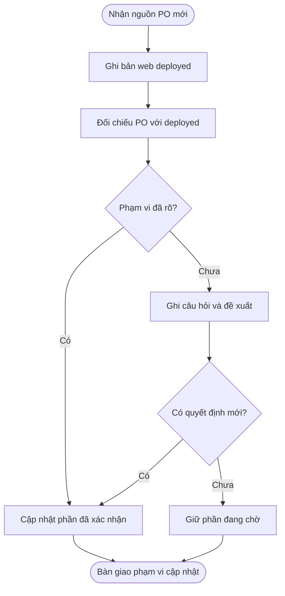

# Chuẩn đối chiếu và hợp nhất yêu cầu

## Đơn vị quản lý

Một hồ sơ cho một tính năng hoặc luồng có ranh giới rõ: Booking, Checkout, Turnboard, Payroll… Không gộp toàn bộ POS vào một hồ sơ. Một yêu cầu mô tả một hành vi có thể đối chiếu độc lập; tách công thức, điều kiện, quyền và ngoại lệ nếu chúng có thể thay đổi riêng.

Bốn tài liệu chính là Feature Master List, Master Specification, Change Impact Analysis và Decision Log. Regression Checklist hỗ trợ kiểm tra từng đợt. Tái sử dụng chuẩn và mẫu; giữ riêng dữ liệu, nghiệp vụ và quyết định của mỗi tính năng.

## Mốc đối chiếu chính: bản deployed

Khi nhận V2 từ PO, so sánh **V2 với bản thực tế đang deploy trên môi trường web được chỉ định**. Bản deployed có thể đã là V1 cộng nhiều sửa đổi, hotfix và yêu cầu phát sinh. So V2 với V1 không đủ để xác định phạm vi tích hợp hiện tại.

Tách hai khái niệm:

- **Deployed baseline (`DEP`)**: hiện trạng web tại thời điểm/ngữ cảnh cụ thể; là mốc chính để xác định delta và phần cần giữ khi tích hợp.
- **Requirement baseline (`BL`) / Master Spec**: yêu cầu được xác nhận; giúp giải thích chủ đích, nhận diện lỗi hiện có và truy quyết định. Không dùng thay cho hiện trạng deployed.

PO cũ và lịch sử thay đổi là nguồn phụ để giải thích các khác biệt chưa rõ. Không cần đọc lại toàn bộ V1–V8 khi bản deployed và các căn cứ liên quan đã đủ. Tài liệu Master Spec bị lệch so với web phải ghi nhận là một khoảng lệch riêng, không giả định web giống Master Spec.

Trước khi phân loại delta:

1. Xác định URL và môi trường cần đối chiếu; staging/production có thể khác nhau. Dùng môi trường người dùng chỉ định; hỏi khi có nhiều môi trường và không xác định được mốc đúng.
2. Ghi thời điểm, bản release/build/commit nếu xác minh được, phiên bản frontend/backend riêng nếu có, vai trò, tiệm/cấu hình/feature flag và ngôn ngữ liên quan. Không lưu mật khẩu, token hoặc dữ liệu khách hàng thật vào hồ sơ.
3. Ghi màn hình, trạng thái và hành vi đã quan sát cùng căn cứ. Quan sát UI/đọc thông tin triển khai trong phạm vi đối chiếu được giao không đồng nghĩa được tự chạy kiểm thử tương tác.
4. Chỉ gọi code là code của deployed nếu đã đối chiếu được revision/artifact với release web. `main`, `master`, tag mới nhất hoặc code local chưa chứng minh điều đó. Code chưa ánh xạ được chỉ là nguồn bổ sung.
5. Nếu không truy cập được web hoặc không xác minh được một phần, ghi rõ phần thiếu/Unknown. Có thể tiếp tục phân tích phần có căn cứ, nhưng không tuyên bố đã đối chiếu đầy đủ với deployed và không lấy V1 làm mốc thay thế.
6. Giữ snapshot `DEP` dùng cho từng `UPD`. Khi deploy thay đổi giữa lúc phân tích và tích hợp, ghi snapshot mới và đối chiếu lại phần bị tác động; không âm thầm ghi đè mốc đầu vào.

## Nguồn và thẩm quyền

1. Ưu tiên chỉ dẫn rõ ràng hiện tại của người dùng trong đúng phạm vi. Ghi nguồn, không yêu cầu xác nhận lại.
2. Dùng quyết định đã xác nhận và tài liệu PO đúng ngữ cảnh. Khi các nguồn PO mâu thuẫn, tìm quyết định giải quyết; ngày mới hơn không tự chứng minh thay thế toàn bộ.
3. Baseline giữ các yêu cầu đã xác nhận còn hiệu lực. Chỉ dẫn mới rõ ràng được ghi thành delta tương ứng. Baseline là bản tổng hợp có dẫn nguồn, không tự có thẩm quyền cao hơn PO.
4. Với phần PO chưa cung cấp, lấy staging đúng màn hình/ngữ cảnh theo quy tắc dự án. Ghi môi trường, vai trò, cấu hình, phiên bản nếu biết và thời điểm. Thiếu truy cập hoặc vẫn thiếu nội dung thì hỏi đúng phần cần thiết trước khi triển khai phần đó.
5. Code, ảnh chụp và tài liệu nội bộ chứng minh hiện trạng trong phạm vi đã đọc/quan sát. Không biến hành vi đang có hoặc lỗi hiện tại thành yêu cầu đã được phê duyệt.

Tài liệu so sánh trước đây là đầu vào, không phải quyết định PO. Ghi nhận định nào được kế thừa và căn cứ có còn truy cập được không. Không tự sửa, di chuyển hoặc đưa nguồn PO vào Git.

## ID và phiên bản

| Mã | Phạm vi duy nhất | Ý nghĩa |
| --- | --- | --- |
| SRC-001 | Trong một tính năng | Một nguồn với phiên bản cụ thể; nội dung đổi thì thêm SRC. |
| EVD-001 | Trong một tính năng | Căn cứ tại mục, trang, dòng, hàm hoặc ảnh của SRC. |
| REQ-001 | Trong một tính năng | Một yêu cầu; giữ mã qua các lần chỉnh sửa. |
| DEC-001 | Trong một tính năng | Câu hỏi/quyết định; liên kết quyết định bị thay thế. |
| DEP-001 | Trong một tính năng | Snapshot bản deployed, gồm môi trường, thời điểm, phiên bản/ngữ cảnh và căn cứ. |
| BL-001 | Trong một tính năng | Baseline được xác nhận trong phạm vi ghi rõ. |
| UPD-001 | Trong một tính năng | Một đợt cập nhật; không suy ra thứ tự từ tên file PO. |
| CHG-001 | Trong một UPD | Một delta; dẫn đầy đủ bằng UPD-001/CHG-001. |
| REG-001 | Trong một UPD | Tình huống kiểm tra dẫn về REQ và CHG. |

Tham chiếu liên tính năng dùng `<feature-slug>/REQ-xxx`. Giữ ID đã có trong hồ sơ cũ và lập ánh xạ nếu cần; không đánh số lại. Giữ các dòng đã bị thay/loại để truy lịch sử.

Ngày hiển thị dùng `MMM D, YYYY`. Tách ngày nội dung PO, ngày tiếp nhận và ngày dữ liệu demo. Ngày không rõ ghi `Chưa xác định`, không đoán từ tên file. Không đổi định dạng ISO của dữ liệu lưu trữ/API.

## Phân loại thay đổi

| Loại | Khi sử dụng | Xử lý |
| --- | --- | --- |
| Keep | Khả năng deployed nằm ngoài phạm vi thay đổi, hoặc yêu cầu vẫn còn hiệu lực | Bảo toàn hiện trạng trong tích hợp; không tự coi lỗi hiện có là yêu cầu đúng. |
| Add | PO mới yêu cầu khả năng chưa có ở deployed đúng ngữ cảnh | Ghi nguồn/phạm vi; không ghi Add chỉ vì V1 chưa có. |
| Enhance | Điều chỉnh hành vi, giữ mục đích và danh tính REQ | Ghi trước/sau phần đổi, giữ phần còn lại. |
| Replace | Có chỉ dẫn rõ thay A bằng B | Ghi REQ bị thay, REQ thay thế, tác động và căn cứ. |
| Remove | Có chỉ dẫn rõ dừng một khả năng | Giữ lịch sử REQ và quyết định; thiếu nút trong HTML mới chưa đủ căn cứ. |
| Unclear | Mâu thuẫn/thiếu thông tin làm thay đổi cách triển khai | Ghi lựa chọn, tác động, đề xuất và câu hỏi cụ thể. |

Thiếu căn cứ Replace/Remove thì dùng Unclear, bảo toàn phần deployed đang chờ. Không gom mọi chức năng từng xuất hiện trong các mẫu thành yêu cầu còn hiệu lực. Khả năng web đã bổ sung sau V1 nhưng không xuất hiện trong V2 vẫn được ghi nhận và bảo toàn nếu chưa có chỉ dẫn thay/loại; hiệu lực nghiệp vụ được xác định riêng.

## Các trạng thái độc lập

| Trục | Giá trị | Cách hiểu |
| --- | --- | --- |
| Hiệu lực yêu cầu | Unconfirmed / Confirmed / Rejected / Superseded / Removed | Đã xác nhận hay chưa, còn hiệu lực hay đã bị từ chối/thay/loại. |
| Mức đáp ứng tìm thấy | Full / Partial / None / Unknown | So với REQ trong phạm vi nguồn/môi trường được ghi. None cần ghi nơi đã tìm; thiếu truy cập là Unknown. |
| Mức kiểm chứng | Not checked / Code only / UI observed / Tested | Loại bằng chứng. Full + Code only chưa chứng minh bản deploy đã đạt. |
| Quyết định thay đổi | Not needed / Pending / Resolved | Có cần câu trả lời bổ sung không. Chỉ dẫn đã rõ dùng Not needed/Resolved kèm nguồn. |
| Kết quả kiểm tra | Not run / Passed / Failed / Blocked | Kết quả thực tế từng tình huống, trong môi trường cụ thể. |

REQ Confirmed chưa chắc đã triển khai. Khả năng Full trong code chưa chắc là yêu cầu đã được duyệt. Không có câu hỏi chưa có nghĩa đã kiểm thử đầy đủ.

## Khởi tạo một tính năng

1. Xác định ranh giới, vai trò, màn hình, môi trường, người phụ trách; lập snapshot deployed `deployments/DEP-xxx.md` theo hướng dẫn ở trên.
2. Lập SRC trong Feature Master List, dẫn DEP đang dùng. Ghi commit cho nguồn trong Git và tình trạng ánh xạ với deployed; với PO không có trong Git, ghi phiên bản/checksum nếu lấy được và giới hạn chia sẻ.
3. Trích xuất REQ theo UI, nội dung, tương tác, nghiệp vụ, trạng thái, dữ liệu/quyền, tích hợp. Phân biệt phần chỉ có UI với hành vi thực thi.
4. Đối chiếu nguồn PO với deployed cùng ngữ cảnh. Đánh dấu mô phỏng, chưa tích hợp hoặc chưa quan sát; không lấy hiện trạng local thay thế web.
5. Soạn Master Specification có REQ và EVD. Nội dung chưa xác nhận nằm ở mục mở/bản đề xuất, không trộn vào quy tắc có hiệu lực.
6. Ghi xác nhận đã có. Khi chưa đủ căn cứ baseline, giữ Draft/Review và baseline hiện hành là `Chưa có`; vẫn bàn giao phân tích.

## Tiếp nhận cập nhật

1. Xác minh bản đang deploy và ghi DEP; đọc chỉ dẫn/PO mới. Đọc Master Spec và lịch sử liên quan để hiểu chủ đích, không dùng chúng làm mốc thay deployed.
2. Đối chiếu chính: **PO mới ↔ deployed** theo hành vi và cùng ngữ cảnh. Dùng yêu cầu đã xác nhận để phân biệt delta mới, lỗi hiện có, drift tài liệu và phần chưa rõ.
3. Tạo Change Impact Analysis: mỗi CHG có trước/sau, lớp thay đổi, loại, REQ, EVD, quyết định và tác động. Tách lỗi đã tồn tại khỏi yêu cầu mới.
4. Ghi câu hỏi vào Decision Log. Có thể trình người dùng trong chat; chỉ gửi cho PO/người khác bằng công cụ khi được cho phép rõ ràng.
5. Chuẩn bị đề xuất đủ cụ thể cho phần chưa rõ; tách khỏi master có hiệu lực. Khi cần một bản hợp nhất để review, dùng `updates/UPD-xxx/master-specification.proposed.md` và sửa các liên kết tương đối về hồ sơ gốc.
6. Cập nhật đúng phần đã xác nhận. Điểm đang chờ không chặn phần độc lập đã rõ. Giữ nguyên DEP đầu vào; sửa Master Spec không có nghĩa bản web đã đổi.
7. Lập Regression Checklist cho delta và các REQ Keep liên quan. Chỉ chạy khi được yêu cầu, gom theo phạm vi người dùng chỉ định.

## Quyết định và baseline

- Ghi nguyên ý quyết định, người xác nhận thực tế, ngày, phạm vi và nguồn tin nhắn/tài liệu. Không tự gán người duyệt.
- Cập nhật REQ, Master Specification, kết luận CHG. Tăng BL khi có bộ yêu cầu được xác nhận mới; dẫn commit/snapshot truy lại bản trước.
- Quyết định bị thay vẫn giữ nội dung, đánh dấu Superseded, dẫn DEC mới; không xóa lịch sử.
- Baseline yêu cầu và release là hai mốc riêng. Không tự ghi đã triển khai, UAT hoặc release vì yêu cầu đã chốt.

## Ví dụ áp dụng cho một tính năng bất kỳ

Ví dụ giả định để giải thích phương pháp, không phải yêu cầu sản phẩm: PO V1 đã được triển khai; sau đó web có thêm chức năng B và sửa quy tắc C. PO gửi V2, yêu cầu thêm D nhưng không hiển thị B, còn C lại dùng giá trị cũ của V1.

| Nội dung | Bản deployed được ghi nhận | PO V2 | Kết luận đối chiếu |
| --- | --- | --- | --- |
| B | Đã có sau V1 | Không thể hiện | Ghi Keep trong phạm vi tích hợp; không tự xóa vì V2 thiếu. |
| C | Đã sửa theo quyết định có dẫn nguồn | Hiển thị quy tắc cũ | Unclear nếu không có chỉ dẫn đổi lại; dẫn quyết định cũ và hỏi có chủ đích thay không. |
| D | Chưa có | Yêu cầu thêm rõ ràng | Add so với deployed, thực hiện trong phạm vi được giao. |

Nếu chỉ so V2 với V1 sẽ không thấy B và có thể đưa C về hành vi cũ. Vì vậy mỗi CHG phải dẫn DEP đang dùng và căn cứ cho chính phần hiện trạng đó.

## Ngoại lệ cần thể hiện

| Trường hợp | Ghi nhận |
| --- | --- |
| Cùng tên nhưng khác khái niệm/ngữ cảnh | Định nghĩa riêng, không tự đồng nhất. |
| Có nút nhưng chỉ đóng modal/báo toast | Tách ý định UI với nghiệp vụ chưa có căn cứ. |
| Đổi toàn bộ style nhưng chỉ yêu cầu thêm một trường | Ghi delta của trường; ghi câu hỏi layout nếu thực sự ảnh hưởng tích hợp. |
| Nội dung không có ở PO và staging | Ghi thiếu nguồn, không tự thêm nhãn/trạng thái. |
| Code nhánh chính khác bản deploy | Ghi riêng phiên bản và mức kiểm chứng. |
| Hai UPD cùng sửa một REQ | Đối chiếu baseline đầu vào và giải quyết xung đột trước khi ghi đè. |
| Liên quan module khác | Dẫn REQ của module chủ quản, không tạo quy tắc trùng không rõ nguồn. |

## Hoàn thành hồ sơ

Mỗi delta có REQ/căn cứ, yêu cầu giữ lại được bảo toàn, điểm chưa rõ được tách riêng và phần bàn giao chỉ ra đúng UI/logic/module bị tác động. Ghi nguồn thiếu, mức kiểm chứng, kiểm thử chưa chạy. Hoàn thành phân tích không đồng nghĩa hồ sơ đã được phê duyệt.
